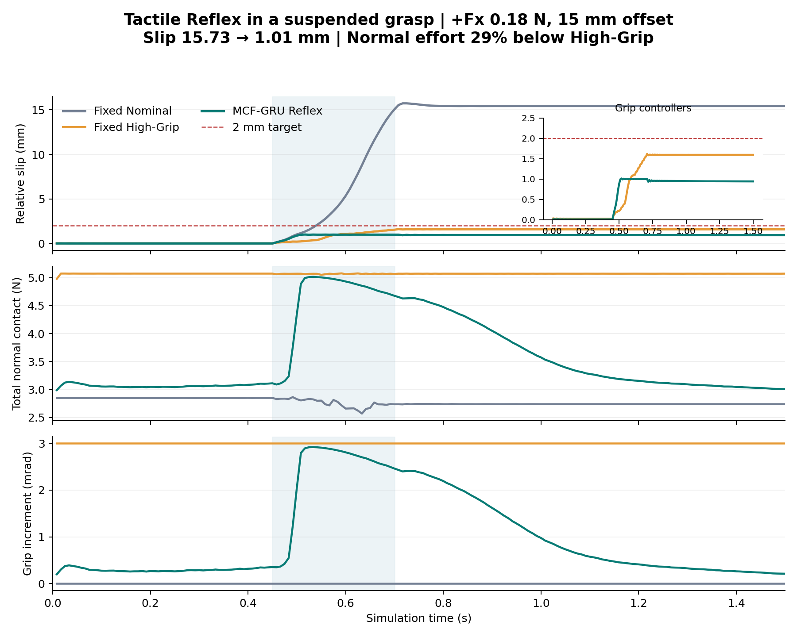

# Stage 3S：受控加载、离线表征与仿真 Reflex 实验归档

日期：2026-10-13。本目录新增本轮完整实验记录，保留仓库既有冻结稿和 Stage 1/2P 档案。研究主线仍为法向触觉、逐指 MCF 8D、GRU 与偏心抗扰；四指控制输入拼接为 32D。

## 已验证的仿真成果

- 修复近常量通道 Z-score 归一化的数千倍放大路径：训练集 median/IQR、通道尺度下限、[-8,8] 截断。无支撑 Static MCF 方向准确率 48.1%→57.2%，Fx/Fy RMSE 0.147/0.273→0.133/0.189 N。
- 专家与触觉学生仅输出抓握增量 Δg。0.18 N、15 mm 偏心的四方向测试全部达到相对指尖滑移 ≤2 mm，最坏 1.013 mm；相比 High-Grip，平均法向力积分降低 33.9%，扰动后法向力降低 37.7%。
- 两个幅度的八个流式测试条件中 MCF 7/8 达标；0.20 N +Fx 为 2.823 mm，未达标曲线和完整条件均保留。Scalar 也为 7/8；本轮显示控制成本与滑移的权衡，没有宣称 MCF 的普遍优越性。
- 完成新增 121 条物理试次、21,330 帧同步记录和 45 次模型训练。原有 225 个 NPZ 哈希不变；数据因果性、成对初态/载荷、模型验证选择、源码版本与流式 GRU 一致性已复核。



## 结果入口

| 内容 | 入口 |
|---|---|
| 当前交付与结果边界 | [REFLEX_DELIVERY.md](isaac_windows/e1s/REFLEX_DELIVERY.md) |
| 全部闭环条件、Scalar/Oracle 与成功/失败曲线 | [流式闭环报告](isaac_windows/e1s/outputs/reflex_report_stream_01/REPORT.md) |
| 第一版滚动窗口闭环 | [第一版报告](isaac_windows/e1s/outputs/reflex_report_01/REPORT.md) |
| 无支撑归一化前后对照 | [bounded_pure_01/results.json](isaac_windows/e1s/outputs/bounded_pure_01/results.json) |
| 工程 pilot、时序探针、E2 比较及支撑/预紧研究 | [NEXT_DELIVERY.md](isaac_windows/e1s/NEXT_DELIVERY.md) / [DELIVERY.md](isaac_windows/e1s/DELIVERY.md) |
| 原始科学协议 | [PROTOCOL.md](isaac_windows/e1s/PROTOCOL.md) |
| 两版控制开发与冻结划分 | [Reflex 协议](isaac_windows/e1s/REFLEX_PROTOCOL.md) / [流式协议](isaac_windows/e1s/REFLEX_STREAM_PROTOCOL.md) |
| 已运行复核与原始文件 SHA-256 | [reflex_verification.json](isaac_windows/e1s/reflex_verification.json) / [raw_data_manifest.json](raw_data_manifest.json) |

曲线同时提供 PNG、SVG 和 PDF。代码、源码快照、逐试次 JSON、全部训练结果、模型权重和离线预测进入 Git；较大的物理逐帧 NPZ 放到[同仓库 Release](https://github.com/Marco6-3/ICRA2028/releases/tag/stage3s-reflex-20261013)，原始字节没有改变。

目录保留当时的交接文档：其中“尚未训练控制器”“尚未推送”等描述是对应阶段的历史状态，以本入口及 REFLEX_DELIVERY 的当前交付为准。历史 manifest 中被后续更新的同名脚本，使用对应版本源码快照核验，不覆盖旧实验结果。

## 获取数据并离线复核

需要 Python 3.11、NumPy、PyTorch 和 Matplotlib。完整版本清单见 [requirements_installed.txt](isaac_windows/requirements_installed.txt)，当前实验为 CPU PyTorch 2.7.0，未要求安装完整 NVIDIA 环境才能读数据。

在本目录执行（`gh` 为 GitHub CLI）：

```powershell
python restore_data.py --download
python isaac_windows/e1s/verify_reflex_delivery.py
python -m unittest discover -s isaac_windows/e1s -p 'test_*.py' -v
```

也可从 Release 页面手动下载所有 ZIP，再执行 `python restore_data.py --archive-dir <下载目录>`。该工具校验 ZIP 大小、SHA-256、文件清单及每个 NPZ 哈希，不覆盖不同内容的现有数据。校验来源为 [release_assets.json](release_assets.json) 和 [raw_data_manifest.json](raw_data_manifest.json)。

离线重新训练归一化对照：

```powershell
python isaac_windows/e1s/bounded_probe.py --source isaac_windows/e1s/outputs/pure_loading_01 --out isaac_windows/e1s/outputs/new_bounded_probe
```

## 完整重放仿真

原作者环境为 [FlexiTac-IsaacSim-Simulation](https://github.com/binghao-huang/FlexiTac-IsaacSim-Simulation)，提交 `dc2e1c6607a1b1a0e4b196bb4e2d4ccdc1afdcb0`。本目录没有重新分发其 URDF/网格、原始演示轨迹、NVIDIA SDK 或第三方真实触觉数据；依其条款获取原环境和数据。使用 Isaac Sim 5.1、原作者 Isaac Lab 核心，以及 [Windows 兼容补丁](isaac_windows/upstream_windows.patch)。

先恢复 Release 记录，再从已授权的原作者轨迹重建输入：

```powershell
python prepare_replay_portable.py --official-repo C:/isaac_ws/FlexiTac-IsaacSim-Simulation
python isaac_windows/e1s/run_reflex_pipeline.py --official-repo C:/isaac_ws/FlexiTac-IsaacSim-Simulation --out isaac_windows/e1s/outputs/new_reflex_reproduction
```

便携还原工具逐位验证生成输入的 SHA-256，源数据及来源见 [DATA_SOURCES.json](DATA_SOURCES.json)。输出目录必须是新的；单步调试和原 Windows 命令见 [e1s/README.md](isaac_windows/e1s/README.md)。这次发布进行了数据恢复、离线复核和源码字节检查，没有为了检查出版入口再次重跑整套仿真。

## 科学范围

这是刚体接触 + SDF 读出的仿真 pilot / 控制研发成果。SDF 强度不是校准牛顿；法向力积分为 PhysX 接触 effort 代理。真实 FlexiTac E1 尚待硬件齐备；当前不宣布真实柔性层机制、MCF 最小充分或真机闭环成立。CPU 软件控制调用时间与真实 sensor→actuator 时延分别记录，保留完整 E1/E2/E3 研究范围。
