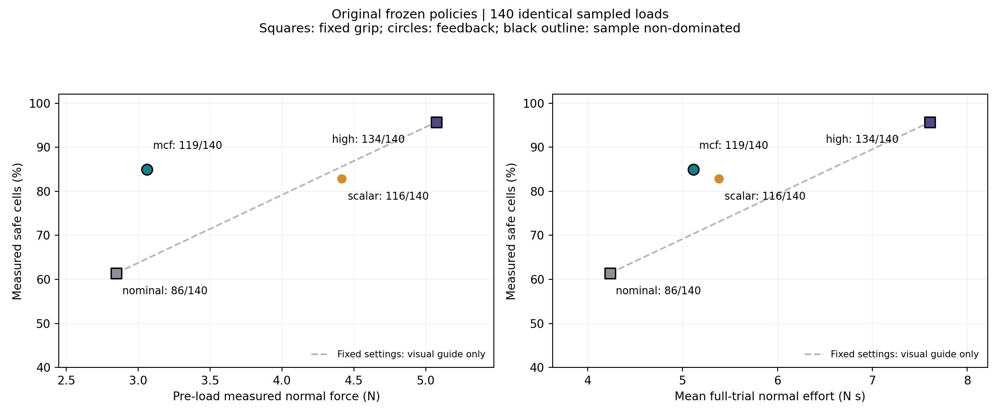
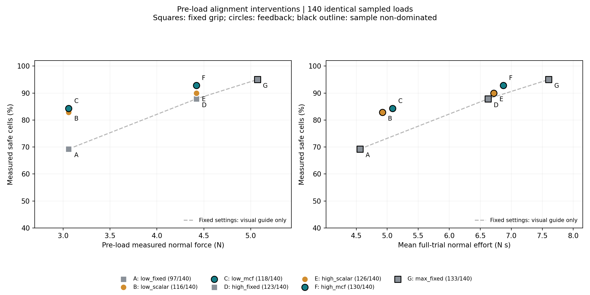
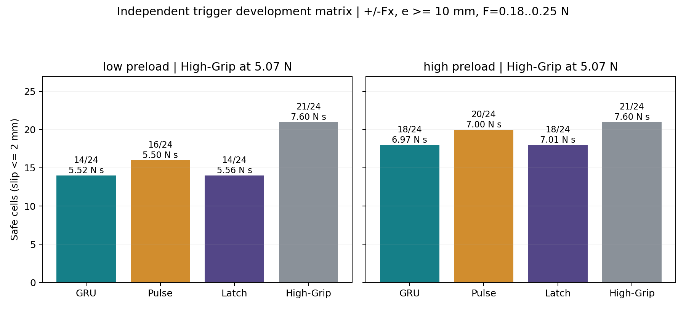
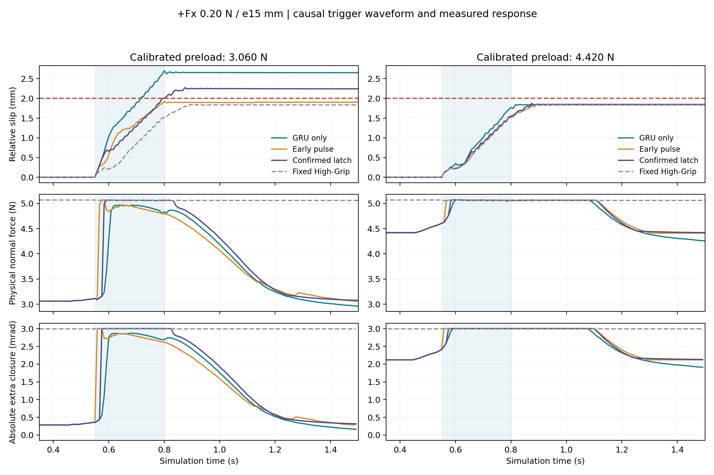

# A/B/C 实验结果

完成 1190 个新正式物理试次、214200 个同步记录步。原相图与模型保持原字节。

## A：等实测预紧力

| 组别 | 静息力 N | 安全格 / 140 | +Fx | −Fx | +Fy | −Fy | 平均力积分 N·s |
|---|---:|---:|---:|---:|---:|---:|---:|
| low_fixed | 3.0599 | 97 | 10 | 21 | 35 | 31 | 4.5609 |
| low_scalar | 3.0599 | 116 | 19 | 27 | 35 | 35 | 4.9228 |
| low_mcf | 3.0599 | 118 | 19 | 29 | 35 | 35 | 5.0877 |
| high_fixed | 4.4202 | 123 | 24 | 29 | 35 | 35 | 6.6262 |
| high_scalar | 4.4202 | 126 | 23 | 33 | 35 | 35 | 6.7189 |
| high_mcf | 4.4202 | 130 | 26 | 34 | 35 | 35 | 6.8720 |
| max_fixed | 5.0699 | 133 | 28 | 35 | 35 | 35 | 7.6031 |

low：MCF−Scalar 安全格差 +2；共同安全 114 格上的平均力积分：Scalar 4.9323、MCF 4.9802 N·s。

high：MCF−Scalar 安全格差 +4；共同安全 126 格上的平均力积分：Scalar 6.7063、MCF 6.8581 N·s。

## B：成本—安全图

原模型的 3.06 / 4.42 N 静息差异及四组全部结果保留。原图中的 Scalar 是反馈策略，不作为静态握力参照；新图静态参照来自三组完整 Fixed 网格。黑边点仅表示当前样本中的非支配点。

## C：触发与保持

| 组别 | 安全格 / 24 | 平均积分 N·s | 平均饱和时长 s | 最大位移 mm | 零载触发时间 s |
|---|---:|---:|---:|---:|---:|
| trigger_low_none | 14 | 5.5179 | 0.0000 | 16.8328 | None |
| trigger_low_pulse | 16 | 5.4952 | 0.0250 | 3.6259 | None |
| trigger_low_latch | 14 | 5.5636 | 0.2583 | 5.0444 | None |
| trigger_high_none | 18 | 6.9712 | 0.4677 | 3.1152 | None |
| trigger_high_pulse | 20 | 7.0027 | 0.4847 | 3.0840 | 0.6 |
| trigger_high_latch | 18 | 7.0100 | 0.4833 | 3.0919 | 0.6166666666666667 |
| trigger_max_fixed | 21 | 7.5998 | 1.5000 | 3.0302 | None |

## 解释边界

本轮检验冻结模型在新初态与基线扣除下的部署行为，不能把部署方式的失败自动推成表征无价值。原始学生在静息输出不为零且隐藏状态继续演化；零载控制中的释放后漂移也完整记录。

触发试验的短脉冲和锁存采用不同确认帧数；它们是两个固定工程干预，不能把差异单独归因于保持时长。加载起点改为 0.55 s，触发判断只读过去触觉，记录加载前误触发。

固定一个夹持快照、每格单次确定性试验，重复仅为两个锚点。网格安全率与非支配关系不代表统计总体泛化或真机安全。SDF 量仍是响应代理；图中 N 来自独立物理接触法向投影。

给定公式 π(obs)−π(obs_pre) 保留了冻结学生的 [0,3] mrad 有界输出头。虽然机械绝对限幅一致，不同基线预测仍导致不同的策略可达残差范围；每条记录同时列出 centered_policy_reachable_min/max_extra_rad，不能把部署对照单独视为表征机制的唯一因果证明。

所有失败格、重复差异、初态校准、触发时刻、绝对饱和、峰值握力和尾部握力均见 results.json / metrics.csv。未经校准的 N 峰值仅作接触代价，不能直接称为物体损伤。

## 直接结论与零载检查

同预紧 MCF 相对 Scalar 分别增加 2 / 4 个安全格，平均全程力积分增加 3.35% / 2.28%。

重点 +Fx / 0.20 N / e15 mm 的早期脉冲为 1.925 mm，相对同载荷 High-Grip 力积分低 28.17%；三帧确认锁存为 2.271 mm。

低预紧脉冲与锁存的零载对照均未触发。高预紧存在零载误触发：trigger_high_pulse 于 0.6000 s、trigger_high_latch 于 0.6167 s；现有门限尚不能可靠区分外部扰动与闭环自身变化。高预紧触发结果不能据此称为稳健扰动检测。

C 的 3.06/4.42 N 指校准静息目标。为检查未知加载起点，GRU 在 0.45 s 释放、外扰在 0.55 s 加载；加载前 75 ms 窗口的实测中位力分别约 3.082/4.531 N。同级三个变体在真实触发前共享这段轨迹。A 的加载与释放则均为 0.45 s，维持其严格等预紧比较。
