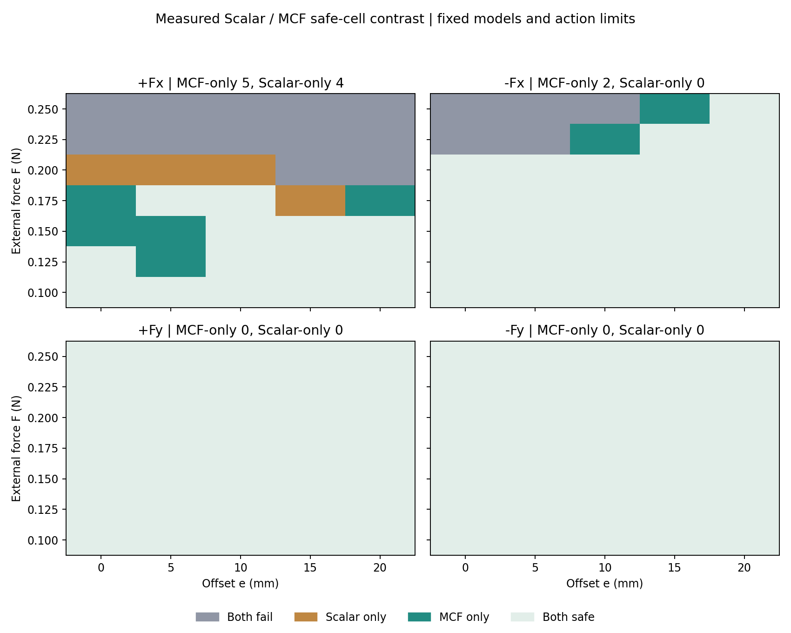

# 偏心相图与机制验证结果

本轮按机制猜想实际执行了纯力、纯力矩、组合载荷、无外载闭合阶跃与抓握时刻干预，并完整扫描四个加载方向。原模型未重训，原相图没有被干预控制器替换。

## 得到了什么

- MCF 安全格 119/140，Scalar 116/140，Nominal 86/140，High-Grip 134/140。
- 高偏心 e≥10 mm 的分片面积变化有方向差异：−Fx 为 +22.2%，+Fx 为 −20.0%，±Fy 不变；四方向合并为 +2.6%。没有把局部优势写成所有方向扩域。
- 两策略共同安全的 112 个条件中，MCF 平均法向力积分较 Scalar 降低 5.8%；全网格平均较 High-Grip 降低 32.8%。
- 纯力和纯力矩都有早期弱 CoP/响应和变化，按基线噪声尺度均在载荷后25 ms完成三帧确认。大幅变化门限则更晚或未检出。因此当前模型没有支持“纯力必然晚显现、纯力矩必然立即大幅显现”的完整解释，弱响应不能当作没有信息。
- 1/3 mrad 无外载闭合阶跃的物理法向力在首个8.333 ms采样步达到接近平台：两个10–90%门限落在同一帧。不是零物理延迟，也没有观察到多帧慢爬升。
- 抓握时刻干预显示补偿时刻很重要：同一3 mrad补偿，提前100 ms最大滑移1.635 mm；载荷同刻开始2.102 mm；晚25 ms为2.959 mm；晚100 ms为11.639 mm。
- 扰动前实际握持力并不相同：Scalar约4.42 N、MCF约3.06 N（同一初态、同一名义指令，但策略运行后形成不同预握持）。相图展示完整策略/接触状态的表现，不能单独归因于传感器可观测性。

## 对机制猜想的判断

实验支持“早期运动发生得快、抓握补偿时刻显著影响恢复”的部分。当前证据更指向早期弱信号如何转化成足够补偿，以及载荷到来前夹持状态的差异；还不能归因于仿真驱动器法向力爬升慢。

时刻干预使用加载时钟，属于特权诊断；提前100 ms的成功不等于触觉学生能预知扰动。驱动器没有测得明显慢爬升，因此这轮没有仅按该解释加入PD前馈或宣称其必然解决0.20 N问题。后续可在保留主图的独立开发对照里检验策略触发/保持及初始预紧。

网格面积是相邻单元四角全部安全的面积代理，不是未采内点的连续安全保证。每格是确定性开发试次，恢复重复不作为独立样本。当前SDF模型的弱响应、门限与时序也不等同真实柔性层/硬件边界。

## 完整记录

- [四方向安全图、逐条件表和机制探针](REPORT.md)
- [全部网格数据](phase_results.json)
- [抓握时刻干预](timing_intervention.json)
- [复核记录](verification.json)
