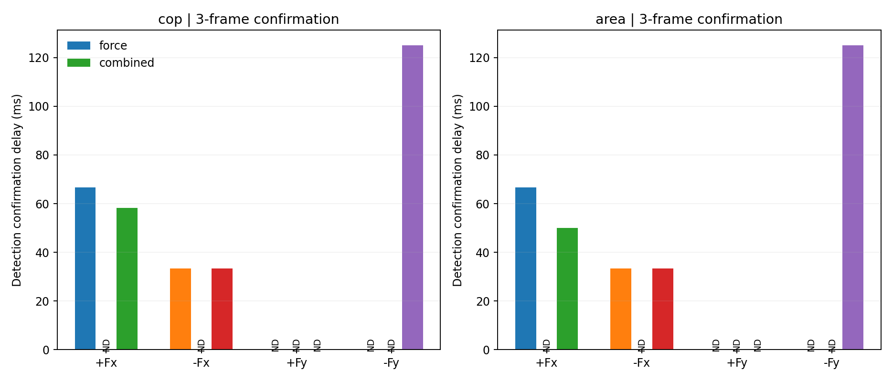
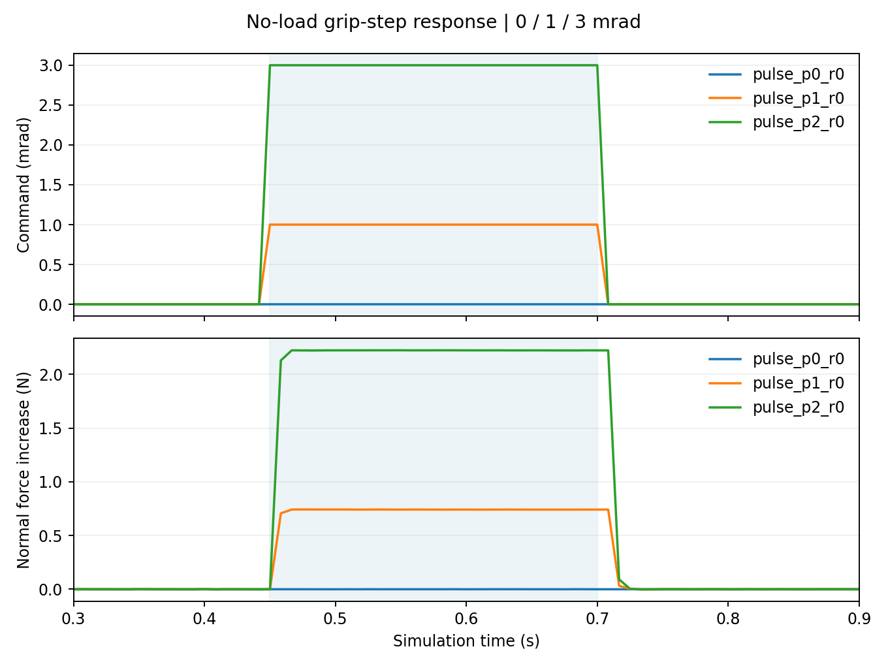
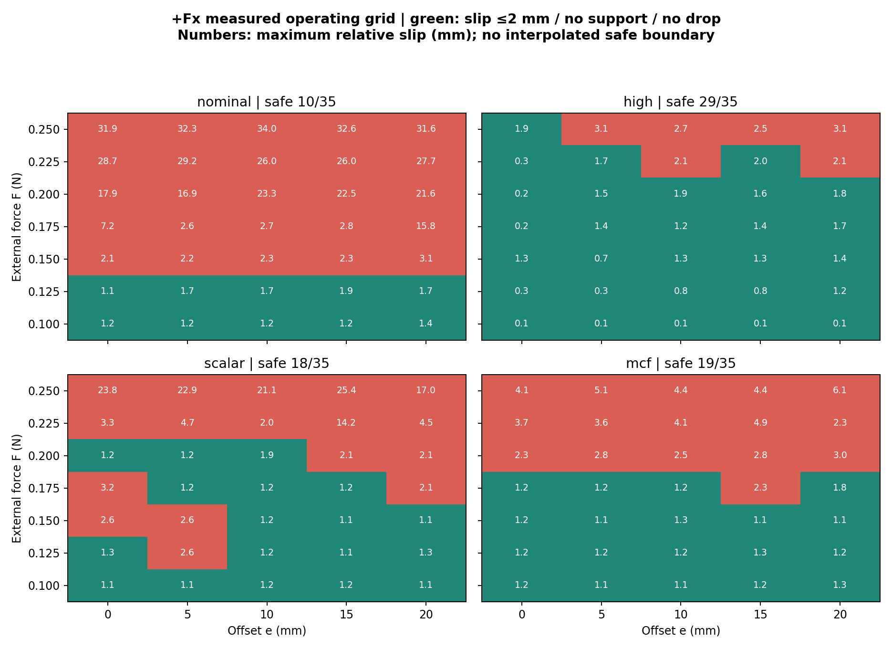
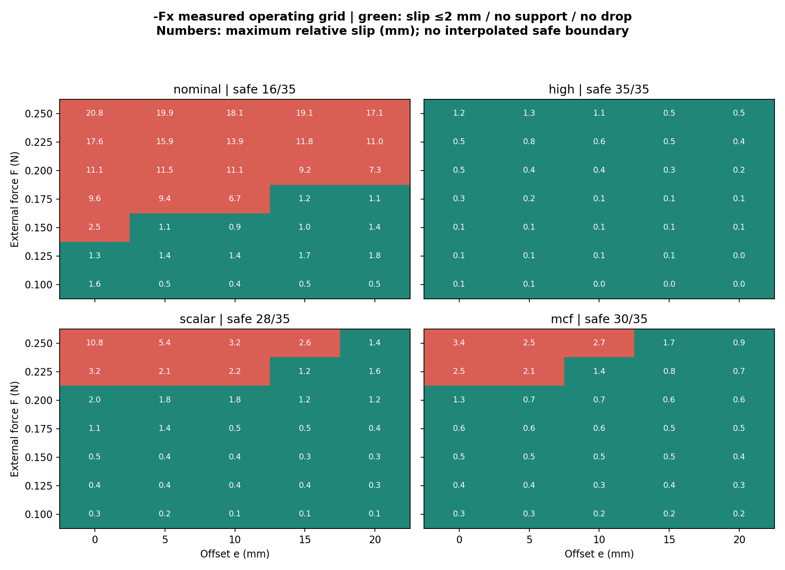
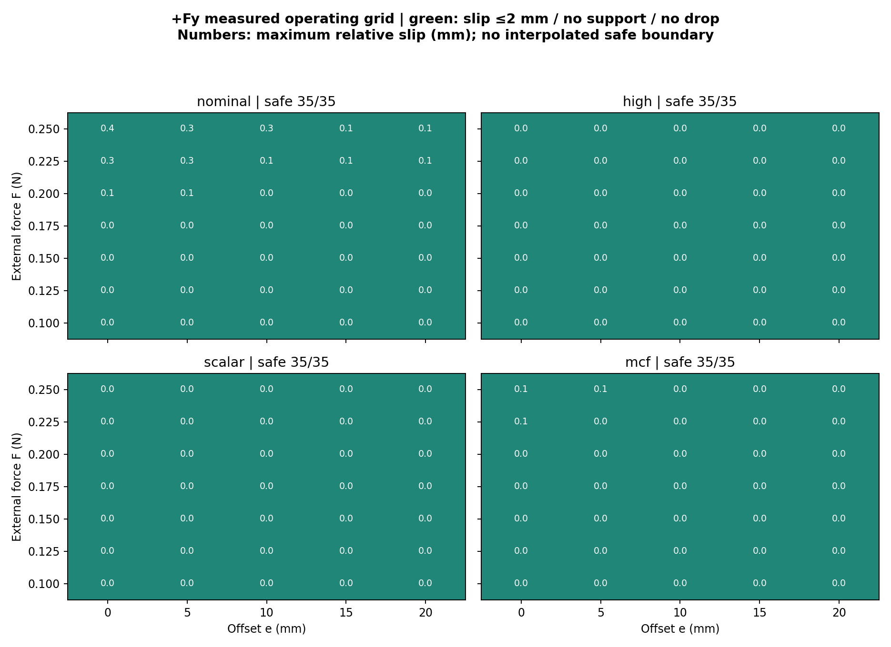
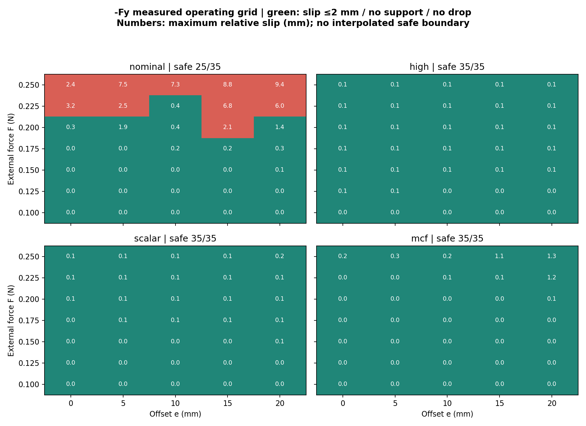
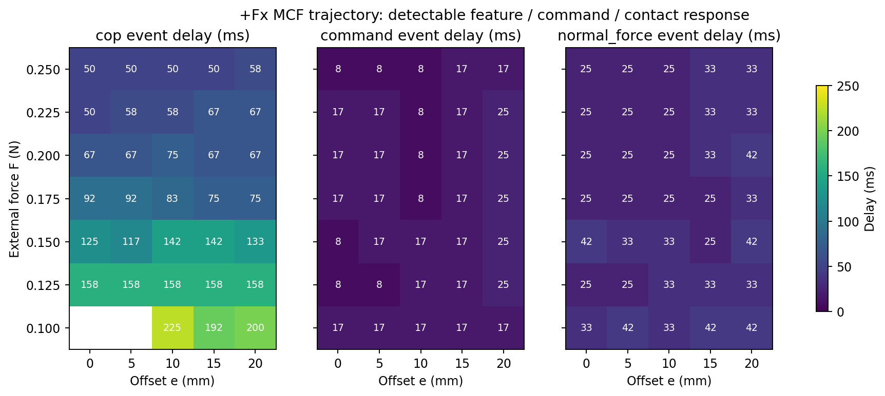
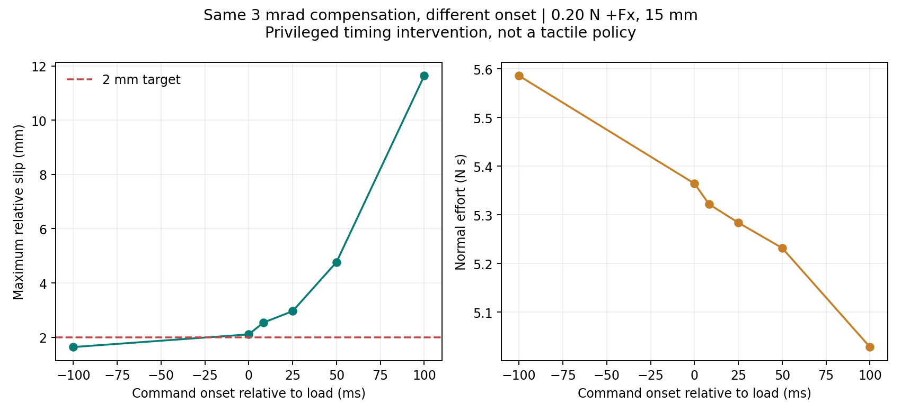

# 机制猜想与偏心抗扰相图（2026-10-14）

本轮完整检验纯力/纯力矩响应时序，以及四方向(F,e)控制安全域。模型和增益在扫描前冻结。

## 机制分离对照

| 类型 | 方向 | CoP 检出 ms | 面积检出 ms | Raw 检出 ms | 0.10 mm 位移 ms |
|---|---|---:|---:|---:|---:|
| force | +Fx | 66.7 | 66.7 | 25.0 | 8.3 |
| torque | +Fx | 未检出 | 未检出 | 25.0 | 未检出 |
| combined | +Fx | 58.3 | 50.0 | 25.0 | 8.3 |
| force | -Fx | 33.3 | 33.3 | 25.0 | 8.3 |
| torque | -Fx | 未检出 | 未检出 | 未检出 | 未检出 |
| combined | -Fx | 33.3 | 33.3 | 25.0 | 8.3 |
| force | +Fy | 未检出 | 未检出 | 25.0 | 未检出 |
| torque | +Fy | 未检出 | 未检出 | 未检出 | 未检出 |
| combined | +Fy | 未检出 | 未检出 | 未检出 | 未检出 |
| force | -Fy | 未检出 | 未检出 | 25.0 | 116.7 |
| torque | -Fy | 未检出 | 未检出 | 未检出 | 未检出 |
| combined | -Fy | 125.0 | 125.0 | 25.0 | 58.3 |

触觉事件使用三帧确认、6×MAD及预定量纲门限；确认时间不等于最早非零响应。纯力与纯力矩都有相同初态和时序，对照才是机制证据。两个重复用于恢复一致性，不当独立统计样本。

| 类型 | 方向 | 噪声尺度 CoP 检出 ms | 噪声尺度响应和检出 ms | 主门限首次 Raw 越界 ms |
|---|---|---:|---:|---:|
| force | +Fx | 25.0 | 25.0 | 8.3 |
| torque | +Fx | 25.0 | 25.0 | 8.3 |
| combined | +Fx | 25.0 | 25.0 | 8.3 |
| force | -Fx | 25.0 | 25.0 | 8.3 |
| torque | -Fx | 25.0 | 25.0 | 未检出 |
| combined | -Fx | 25.0 | 25.0 | 8.3 |
| force | +Fy | 25.0 | 25.0 | 8.3 |
| torque | +Fy | 25.0 | 25.0 | 未检出 |
| combined | +Fy | 25.0 | 25.0 | 16.7 |
| force | -Fy | 25.0 | 25.0 | 8.3 |
| torque | -Fy | 25.0 | 25.0 | 未检出 |
| combined | -Fy | 25.0 | 25.0 | 8.3 |

噪声尺度检出只使用仿真基线与1e-6数值下限；弱的亚像素CoP响应不按大幅变化门限判成不可观测。主門限、敏感性和噪声检出结果同时保存。

## 无外载执行器响应

| 阶跃 | 法向力增量 N | 法向力10–90% ms | 关节闭合平台 mrad |
|---|---:|---:|---:|
| pulse_p0_r0 | -0.000 | 未检出 | -0.0000 |
| pulse_p1_r0 | 0.742 | 0.0 | 0.0037 |
| pulse_p2_r0 | 2.224 | 0.0 | 0.0105 |

## 安全域与实际扩大量

| 方向 | Nominal安全格 | High安全格 | Scalar安全格 | MCF安全格 | 高偏心分片面积 Scalar→MCF (N·mm) | 相对变化 |
|---|---:|---:|---:|---:|---|---:|
| +Fx | 10 | 29 | 18 | 19 | 0.625→0.500 | -20.0% |
| -Fx | 16 | 35 | 28 | 30 | 1.125→1.375 | +22.2% |
| +Fy | 35 | 35 | 35 | 35 | 1.500→1.500 | +0.0% |
| -Fy | 25 | 35 | 35 | 35 | 1.500→1.500 | +0.0% |

## 判断范围

安全为最大三维相对位移≤2 mm、有效初态、无掉落且无环境支撑。相邻网格单元四角全部安全的面积仅是网格分片代理，未采内点没有连续安全保证。高偏心区域为e≥10 mm，另外报告1/3 mm敏感性；安全格与面积变化分别计算。

同一刺激下的轨迹时序不能单独证明感知或执行器的因果瓶颈；纯载荷分离和无外载闭合阶跃用于区分机制。当前GRU只输出Δg，没有F̂x曲线。法向触觉是SDF穿透代理，物理法向力为独立PhysX投影；未用μfN>Fx忽略重力、力矩与接触几何。

High-Grip和特权参考仅是已测控制权限下的参照，不能据其失败宣布理论不可控。结构可观测性和真实传感器迟滞还需真实E1标定。所有结果、未检出事件、低表现控制器和失败试次保留。

## 抓握时刻干预

| 相对载荷时刻 ms | 最大滑移 mm | 法向力积分 N·s |
|---:|---:|---:|
| -100.000 | 1.635 | 5.586 |
| 0.000 | 2.102 | 5.364 |
| 8.333 | 2.537 | 5.322 |
| 25.000 | 2.959 | 5.284 |
| 50.000 | 4.767 | 5.232 |
| 100.000 | 11.639 | 5.028 |

[机制与控制结论](FINDINGS.md)
