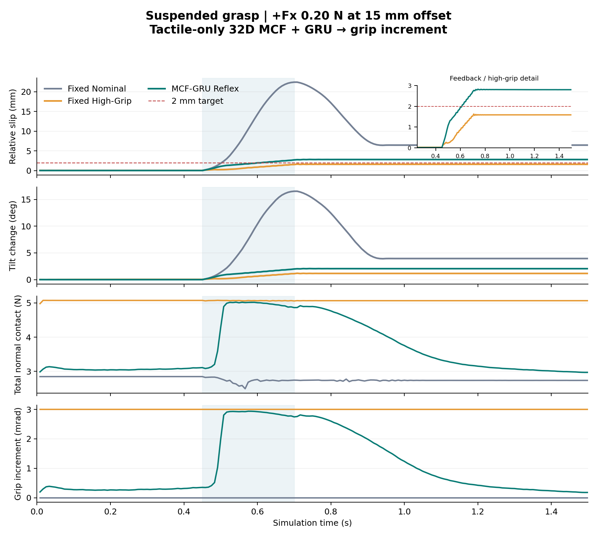
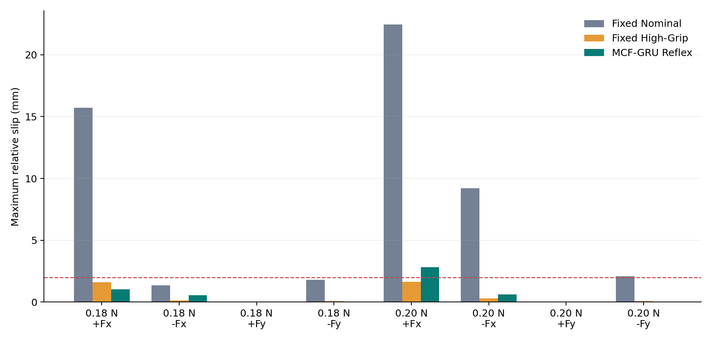

# 仿真 Reflex 原型交付

已完成有界归一化、无支撑数据重新验证、专家采集、同数据学生训练，以及 Isaac Sim 实际闭环比较。

## 无支撑离线修复

| 表征 | 归一化 | 方向准确率 | Fx RMSE (N) | Fy RMSE (N) | 最大归一化输入 |
|---|---|---:|---:|---:|---:|
| static_mcf | legacy_zscore | 48.1% | 0.1474 | 0.2732 | 14.92 |
| static_mcf | robust_floor_clip8 | 57.2% | 0.1332 | 0.1886 | 6.36 |
| mcf | legacy_zscore | 48.9% | 0.1244 | 0.1391 | 14.92 |
| mcf | robust_floor_clip8 | 40.3% | 0.1580 | 0.1315 | 6.36 |
| scalar | legacy_zscore | 35.3% | 0.2215 | 0.1704 | 10.30 |
| scalar | robust_floor_clip8 | 28.9% | 0.2131 | 0.2053 | 5.83 |
| raw | legacy_zscore | 37.2% | 0.1653 | 0.1791 | 7548.58 |
| raw | robust_floor_clip8 | 37.2% | 0.1650 | 0.1581 | 8.00 |

同模型、相同目标尺度、相同训练条件和三 seeds；回归输出未截断。Static MCF 改善明显，其他组的方向准确率没有一致提高，因此数值修复和预测收益分别报告。

## 实际闭环结果

| 控制器 | ≤2 mm 条件数 | 最坏滑移 (mm) | 平均法向力积分 (N·s) | 扰动后平均法向力 (N) | 最大倾角变化 (deg) |
|---|---:|---:|---:|---:|---:|
| Fixed Nominal | 4/8 | 22.453 | 4.225 | 2.801 | 16.537 |
| Fixed High-Grip | 8/8 | 1.624 | 7.606 | 5.071 | 1.193 |
| MCF-GRU Reflex | 7/8 | 2.823 | 5.046 | 3.172 | 2.071 |
| Scalar-GRU Reflex | 7/8 | 2.060 | 5.448 | 3.125 | 1.508 |
| Privileged expert | 7/8 | 2.430 | 5.351 | 3.313 | 1.785 |

| 幅度 | MCF ≤2 mm | MCF 最坏滑移 mm | 法向力积分降低 | 扰动后法向力降低 |
|---|---:|---:|---:|---:|
| 0.18 N | 4/4 | 1.013 | 33.9% | 37.7% |
| 0.2 N | 3/4 | 2.823 | 33.4% | 37.2% |

MCF Reflex 相对 High-Grip 的平均法向力积分降低 33.7%，扰动后平均法向力降低 37.5%。

## 逐条件结果

| 载荷 | 方向 | Nominal 滑移 mm | High-Grip 滑移 mm | MCF 滑移 mm | MCF/High 力积分比 |
|---|---|---:|---:|---:|---:|
| 0.18 N | +Fx | 15.728 | 1.617 | 1.013 | 70.6% |
| 0.18 N | -Fx | 1.354 | 0.142 | 0.560 | 70.7% |
| 0.18 N | +Fy | 0.026 | 0.033 | 0.023 | 61.8% |
| 0.18 N | -Fy | 1.807 | 0.055 | 0.037 | 61.1% |
| 0.20 N | +Fx | 22.453 | 1.624 | 2.823 | 72.0% |
| 0.20 N | -Fx | 9.201 | 0.304 | 0.614 | 71.4% |
| 0.20 N | +Fy | 0.037 | 0.035 | 0.023 | 61.8% |
| 0.20 N | -Fy | 2.084 | 0.057 | 0.039 | 61.4% |

## 复核与使用范围

各控制器具有相同初始物体与机器人状态、相同外力和偏心力矩、相同加载时间；逐步记录动作、触觉、独立物体姿态、相对滑移、环境接触和模型调用时间。所有输入确认为上一帧 MCF，学生输入不包含物体状态或加载时钟。测试时仍单独记录专家标签，便于诊断，但不送入学生。

最大滑移使用初态物体相对于两指支撑 link 的三维位移，包含夹指闭合导致的法向变化；不是仅取世界位置。倾角变化为相对初始朝向的世界竖直轴摆动角 acos((R_current·R_initial^T)[2,2])，排除纯世界竖直轴 yaw，另保存完整姿态转角。法向力积分来自 PhysX 接触投影，作为抓握 effort 代理，不等同于电耗或物体损伤。

这是当前刚体接触/SDF 读出的仿真原型；最终测试留出了加载时刻及部分幅度，仍在同一夹爪/物体几何内。真实 FlexiTac E1 和更广条件的正式结论留待硬件与后续实验。

MCF 控制调用 P95 最大值 0.574 ms（包含调试专家标签计算，未包含真实传感器/执行器链路）。所有测试的环境接触最大法向力 0 N。
