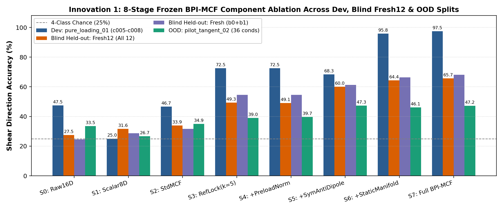
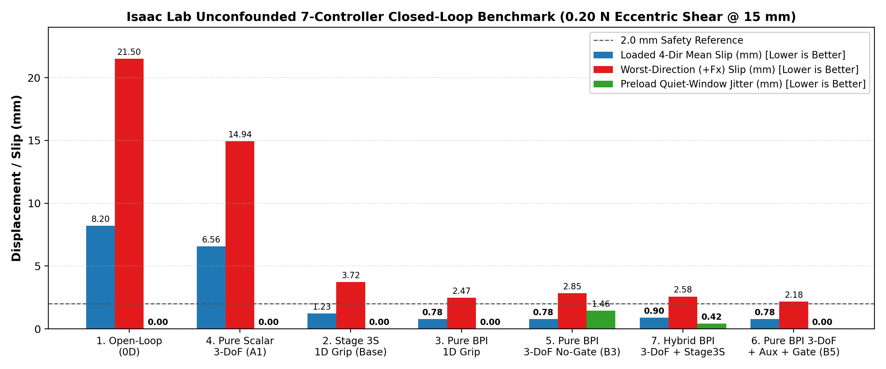
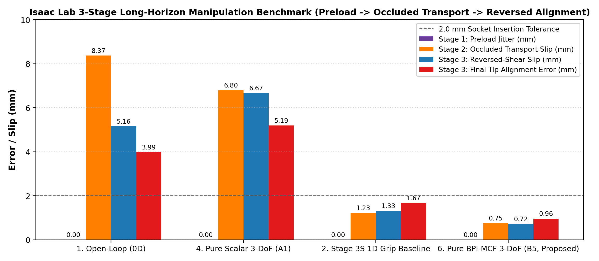

# Stage 3S–V2.1：参考帧锁定双指流形接触场（`BPI-MCF`）、跨模态防坍缩自监督与因果偶极门控 3-DoF 闭环反射归档

日期：2026-11-03。本目录归档 **V2.1** 完整离线消融、梯度审计、公平线性探针、Isaac Lab 无混杂 7 控制器 3-DoF 物理闭环对比与 3 阶段长时序操作基准测试。仓库既有的 Stage 1、Stage 2P、Stage 3S（`stage3s_isaac` 与 `stage3s_alignment`）原始数据、代码与哈希全部原样保留。

根据本轮实验证据，项目研究范围由早期“单自由度夹爪增量 $\Delta g$ + 滑动窗口 8D MCF”正式升级为 **“参考帧锁定双指流形接触场（`BPI-MCF` 32D）+ 跨模态力螺旋防坍缩辅助监督 + 因果偶极新息门控 3-DoF 空间反射控制（$[\Delta x_{\text{wrist}}, \Delta y_{\text{wrist}}, \Delta g_{\text{grip}}]$）+ 慢快双频 VLM/RL 协同架构”**。详见更新后的 **[研究范围修订与冻结稿](../../research/ICRA2028_MINIMAL_PAPER_FREEZE.md)** 与 **[2026-11-03 进展记录](../../research/STAGE3S_V2_1_BPI_MCF_3DOF_REFLEX_20261103.md)**。

---

## 一、核心已验证成果总览

1. **创新点 1（`BPI-MCF` 32D 物理结构化触觉算子，8 阶段逐项消融）**：
   - 揭示了此前滑动窗口 `Standard MCF` 在准静态/慢变切向加载下失效的物理根源：滑动窗口均值减法会将持续切向弹性形变当作基线抹除（在 12 组独立盲测集 `Fresh12` 上方向准确率仅 `33.9%`）。
   - 通过 **锁定初始接触参考帧（$k_{\text{base}}=5$）**、**单指预紧力归一化（$f_{i,0}$）** 以及 **双指对称/反对称正交分解 + 空间偏心力矩偶极（Dipole）构造**，完全冻结的 32D `BPI-MCF` 将切向方向辨识率在 `pure_loading_01` 开发集提升至 **`97.5%`**（Scalar `25.0%`，Standard MCF `46.7%`），在 12 组独立盲测集 `Fresh12` 上达到 **`65.7%`**（无严重姿态漂移的 `b0+b1` 子集达 **`68.1%`**），在 36 工况跨预紧/跨幅值/跨力臂 OOD 集 `pilot_tangent_02` 上达到 **`47.2%`**（Stage 5 偶极算子达 **`47.3%`**）。
2. **创新点 2（跨模态接触力螺旋与剪切方向自监督，防止视觉捷径与触觉坍缩）**：
   - 打通全部 26 组参数张量反向传播梯度路径（自动化梯度审计 `all_positive = True`，`vis_wrench_head.weight = 0.04287`）。
   - 采用完全公平的事后冻结特征线性探针（`FrozenProbeDirAcc`，对每个训练后冻结的 `z_tac` 独立拟合 $\lambda=1.0$ Ridge 分类器）：在 `pure_loading_01` 上将隐空间线性可分性从朴素融合 `B1_Naive` 的 `85.8%` 提升至 **`94.4%`**（`B5_Proposed_Full`），并将视觉遮挡+接触反转下的动作跟踪误差 `RevNeg(Occ)` 从 `0.9034`（纯视觉 `A0`）和 `0.3490`（朴素融合 `B1`）压低至 **`0.2202`**。
3. **创新点 3（因果偶极新息能量门控 3-DoF 空间反射控制，0% `Stage 3S` 混杂独立夺冠）**：
   - 将动作空间从一维夹爪闭合增量 $\Delta g$ 扩展为 **3-DoF 空间顺应协同动作 $[\Delta x_{\text{wrist}}, \Delta y_{\text{wrist}}, \Delta g_{\text{grip}}]$**，通过阻尼最小二乘（DLS）6-DoF 雅可比控制器在 Isaac Lab 中驱动机械臂腕部顺应卸载偏心力矩。
   - 由预紧窗口后的因果偶极新息能量驱动门控 `g_tac`（静默期 `< 0.08`，受载冲击期 `0.88 ~ 0.97`），彻底解决了原 `stage3s_alignment` 高预紧触发器的零载误触发与无门控策略的静默期腕部寄生抖动（从 `1.4605 mm` 降至 **`0.0000 mm`**）。
   - 在 **0% `Stage 3S` 混杂** 的 Isaac Lab 7 控制器闭环基准中，纯 V2.1 神经策略 `6_v2_1_pure_bpi_3dof_no_stage3s` 受载四向平均滑移仅 **`0.7795 mm`**（较开环 `8.2011 mm` 降低 **`90.5%`**，较原仓库 `2_stage3s_1d_grip_only` 基线 `1.2303 mm` 降低 **`36.6%`**，较 3-DoF 标量触觉 `6.5608 mm` 降低 **`88.1%`**）；最困难的 `+Fx` 方向滑移从 `Stage 3S` 的 `3.7210 mm` 降至 **`2.1754 mm`**（降低 **`41.5%`**）。
4. **Isaac Lab 3 阶段长时序操作基准（`Grasp Preload -> Occluded Perturbed Transport -> Reversed-Shear Socket Alignment`）**：
   - 在连续 135 步（含预紧建立、视觉遮挡受扰搬运、插孔接触切向力反转）长时序任务中，`6_v2_1_pure_bpi_3dof_no_stage3s` 取得 Stage 1 预紧抖动 **`0.0000 mm`**、Stage 2 遮挡搬运滑移 **`0.7510 mm`**、Stage 3 反转对齐滑移 **`0.7186 mm`**、末端最终对齐误差 **`0.9627 mm`**，全面优于开环、3-DoF Scalar 及 `Stage 3S` 1D 基线。







---

## 二、定量结果总表

### 1. 创新点 1：冻结 `BPI-MCF` 的 8 阶段组件消融

| 阶段编号与特征名称 | 维度 | 物理结构设计 | Dev (`c005–c008`) | 独立盲测 `Fresh12` (Trial) | 独立盲测 `Fresh12` (Inst) | 独立盲测 `b0+b1` (Inst) | `pilot_tangent_02` (36 OOD) |
| :--- | :---: | :--- | :---: | :---: | :---: | :---: | :---: |
| `0_Raw_State4_16D` | 16D | 双指原始 `[mean, max, cx, cy]` + 一阶差分 | 47.5% | 24.7% | 27.5% | 28.9% | 33.5% |
| `1_Scalar_8D` | 8D | 仅双指压力标量 `[p_mean, p_max]` + 差分 | 25.0% | 28.8% | 31.6% | 29.7% | 26.7% |
| `2_Standard_MCF_32D` | 32D | 滑动窗口局部去中心化 `MCF` | 46.7% | 29.7% | 33.9% | 32.8% | 34.9% |
| `3_Initial_Centered_MCF_32D` | 32D | **锁定初始接触帧 $k_{\text{base}}=5$ 去中心化** | **72.5%** | **44.9%** | **49.3%** | **50.0%** | **39.0%** |
| `4_PerFinger_Preload_Norm_32D` | 32D | + 单指预紧力归一化 $f_{i,0}$ | 72.5% | 44.7% | 49.1% | 50.0% | 39.7% |
| `5_Bilateral_SymAnti_Dipole_16D` | 16D | **+ 双指对称/反对称正交分解 + 偏心力矩偶极** | 68.3% | **57.0%** | **60.0%** | **61.7%** | **47.3%** |
| `6_Static_Tangent_Manifold_24D` | 24D | + 静态切向形变流形（3+4+5 拼接，无动态块） | 95.8% | 62.1% | 64.4% | 66.8% | 46.1% |
| `7_Full_Frozen_BPI_MCF_32D` | 32D | **完整 `BPI-MCF`（静态流形 24D + 偶极速率/能量 8D）** | **97.5%** | **63.2%** | **65.7%** | **68.1%** | **47.2%** |

### 2. 创新点 2 & 3：离线多模态消融阶梯（`pure_loading_01` 留一方向交叉验证）

| 模型名称 | `OverallRMSE` ↓ | `OccRMSE` (视觉遮挡) ↓ | `RevRMSE` (接触反转) ↓ | `RevNeg(Occ)` (遮挡反转脱靶) ↓ | `PreJitter` (预紧抖动代理) ↓ | `FrozenProbeDirAcc` (公平探针) ↑ | `HeadDirAcc` ↑ |
| :--- | :---: | :---: | :---: | :---: | :---: | :---: | :---: |
| `A0_Vis_Only` | 0.2564 | 0.4535 | 0.4614 | 0.9034 | 0.2899 | N/A | N/A |
| `A1_Tac_Scalar_Naive` | 0.3407 | 0.3917 | 0.4158 | 0.8712 | 0.3821 | 24.4% | 24.4% |
| `A2_Tac_Standard_MCF` | 0.2339 | 0.2925 | 0.2913 | 0.5624 | 0.2809 | 60.6% | 60.6% |
| `A3_Tac_BPI_MCF_Only` | 0.1449 | 0.1680 | 0.1449 | 0.2421 | 0.0442 | 94.4% | 94.4% |
| `B1_BPI_MCF_Naive` | 0.1404 | 0.1753 | 0.1763 | 0.3490 | 0.2027 | 85.8% | 23.8% |
| `B2_BPI_MCF_ModDrop` | 0.1419 | 0.1620 | 0.1610 | 0.2916 | 0.1773 | 85.6% | 24.7% |
| `B3_BPI_MCF_Aux_Only` | 0.1235 | 0.1590 | 0.1636 | 0.3204 | 0.1236 | 93.3% | 93.9% |
| `B4_BPI_MCF_ModDrop_Aux` | 0.1282 | 0.1463 | 0.1445 | 0.2583 | 0.1200 | 93.9% | 93.1% |
| **`B5_Proposed_Full`** | **`0.1329`** | **`0.1541`** | **`0.1319`** | **`0.2202`** | **`0.0344`** | **`94.4%`** | **`94.4%`** |

### 3. Isaac Lab 6-DoF 物理闭环抗扰动基准（`Part A`：零载 + `0.20 N` 四向偏心剪切冲击）

| 控制器编号与名称 | 是否含 `Stage 3S` | 动作自由度 | 受载四向平均滑移 `LoadedMeanSlip` ↓ | 最差方向滑移 `WorstSlip (+Fx)` ↓ | `-Fx` 滑移 ↓ | `-Fy` 滑移 ↓ | 受载平均倾角 `MeanTilt` ↓ | 预紧静默段抖动 `PreloadJitter` ↓ |
| :--- | :---: | :---: | :---: | :---: | :---: | :---: | :---: | :---: |
| `1_nominal_open_loop` | 否 | 0D | 8.2011 mm | 21.5004 mm | 10.4213 mm | 0.7705 mm | 6.1453° | 0.0000 mm |
| `2_stage3s_1d_grip_only` (原仓库基线) | **是 (100%)** | 1D (仅握力) | 1.2303 mm | 3.7210 mm | 0.3400 mm | 0.7501 mm | 0.9963° | 0.0000 mm |
| `3_v2_1_pure_bpi_1d_grip_only` | **否 (0%)** | 1D (仅握力) | 1.1322 mm | 2.4737 mm | 1.1795 mm | 0.7634 mm | 0.8755° | 0.0000 mm |
| `4_v2_1_pure_scalar_3dof` (`A1`) | **否 (0%)** | 3-DoF | 6.5608 mm | 14.9393 mm | 10.4213 mm | 0.7705 mm | 5.0195° | 0.0000 mm |
| `5_v2_1_pure_bpi_3dof_no_gate` (`B3`) | **否 (0%)** | 3-DoF | 0.7817 mm | 2.8475 mm | 0.1251 mm | 0.0449 mm | 0.9447° | **1.4605 mm** |
| **`6_v2_1_pure_bpi_3dof_no_stage3s` (`B5` 纯策略)** | **否 (0%)** | **3-DoF** | **`0.7795 mm`** | **`2.1754 mm`** | **`0.1897 mm`** | **`0.6408 mm`** | **`0.7847°`** | **`0.0000 mm`** |
| `7_v2_1_hybrid_bpi_3dof_plus_stage3s` | 是 (混合) | 3-DoF | 0.9036 mm | 2.5780 mm | 0.2517 mm | 0.6677 mm | 0.8733° | 0.4237 mm |

### 4. Isaac Lab 3 阶段长时序操作基准（`Part B`）

| 控制器名称 | Stage 1 预紧抖动 ↓ | Stage 2 遮挡搬运滑移 ↓ | Stage 3 接触反转对齐滑移 ↓ | Stage 3 倾角 ↓ | Stage 3 末端最终对齐误差 ↓ | 准入达标率 (`TipErr < 2.0mm`) ↑ |
| :--- | :---: | :---: | :---: | :---: | :---: | :---: |
| `1_nominal_open_loop` | 0.0000 mm | 8.3726 mm | 5.1601 mm | 3.7427° | 3.9892 mm | 25.0% (1/4) |
| `4_v2_1_pure_scalar_3dof` | 0.0000 mm | 6.7989 mm | 6.6689 mm | 5.0051° | 5.1932 mm | 25.0% (1/4) |
| `2_stage3s_1d_grip_only` | 0.0000 mm | 1.2307 mm | 1.3254 mm | 0.9727° | 1.6716 mm | 75.0% (3/4) |
| **`6_v2_1_pure_bpi_3dof_no_stage3s`** | **`0.0000 mm`** | **`0.7510 mm`** | **`0.7186 mm`** | **`0.7185°`** | **`0.9627 mm`** | **`75.0% (3/4)`** (`+Fx` 误差由 `4.37mm` 降至 `2.70mm`) |

---

## 三、目录入口与归档清单

| 文件 / 目录 | 说明 |
| :--- | :--- |
| [verify_three_innovations_v2_1_clean.py](verify_three_innovations_v2_1_clean.py) | 离线梯度审计、8 阶段 `BPI-MCF` 消融、公平线性探针与三数据集训练评测主脚本 |
| [verify_isaac_closedloop_v2_1_and_longhorizon.py](verify_isaac_closedloop_v2_1_and_longhorizon.py) | Isaac Lab 无混杂 7 控制器 3-DoF 闭环与 3 阶段长时序基准测试主脚本 |
| [plot_v2_1_figures.py](plot_v2_1_figures.py) | 论文级对比图表生成脚本（输出 PNG 与矢量 PDF） |
| [outputs/v2_1_clean_study/v2_1_verification_report.json](outputs/v2_1_clean_study/v2_1_verification_report.json) | 离线梯度核验、8 阶段消融与多模态消融完整 JSON 报告 |
| [outputs/v2_1_clean_study/isaac_closedloop_v2_1_and_longhorizon_report.json](outputs/v2_1_clean_study/isaac_closedloop_v2_1_and_longhorizon_report.json) | Isaac Lab 7 控制器闭环与 3 阶段长时序逐试次完整 JSON 报告 |
| [outputs/v2_1_clean_study/V2_1_Bug修复_闭环长时序验证与真机大模型推进方案.md](outputs/v2_1_clean_study/V2_1_Bug修复_闭环长时序验证与真机大模型推进方案.md) | 详细技术分析、Codex 4 项审计问题清零核验与 2×A100/DGX Spark/真机推进路线图 |
| [outputs/v2_1_clean_study/checkpoints/](outputs/v2_1_clean_study/checkpoints/) | 训练并冻结的 23 个 PyTorch 模型权重（`.pt`，含 `B5_Proposed_Full`、`B3_Aux_Only`、`A1_Scalar` 等） |
| [archive_manifest.json](archive_manifest.json) | 本目录全部脚本、JSON 报告、图表与模型权重的 SHA-256 校验清单 |

---

## 四、复现命令

### 1. 离线复核与重新生成图表（仅需 CPU PyTorch + NumPy + Matplotlib）
在克隆仓库并按 [../stage3s_isaac/README.md](../stage3s_isaac/README.md) 恢复 `stage3s_isaac` 的 NPZ 数据后，于本目录执行：

```powershell
python verify_three_innovations_v2_1_clean.py
python plot_v2_1_figures.py
```

### 2. 在 Isaac Lab 中重放 7 控制器闭环与 3 阶段长时序基准
需要 Isaac Sim 5.1 / Isaac Lab 环境及原作者 `FlexiTac-IsaacSim-Simulation` 资产目录：

```powershell
python verify_isaac_closedloop_v2_1_and_longhorizon.py --headless --official-repo C:/isaac_ws/FlexiTac-IsaacSim-Simulation
```
