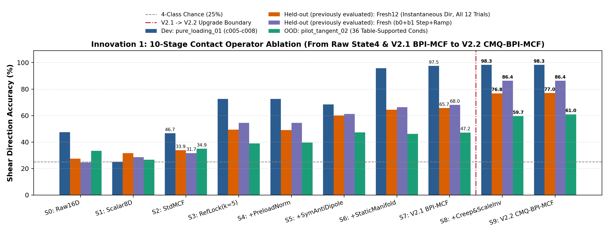
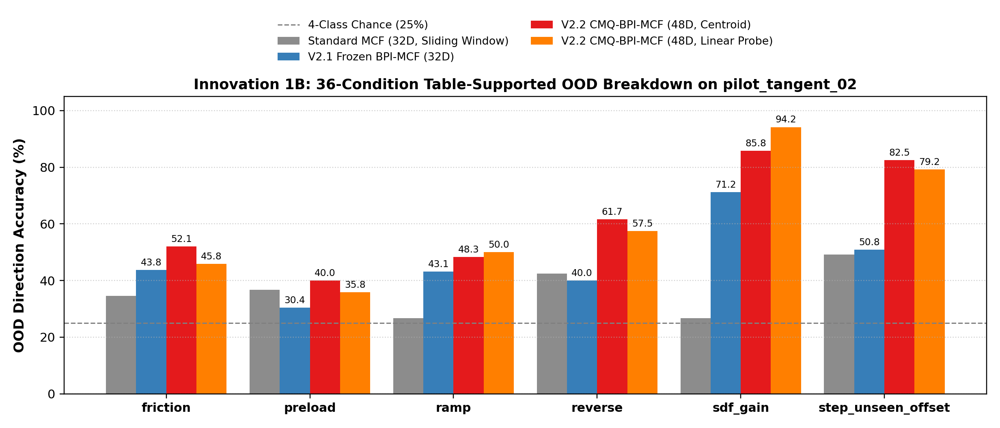
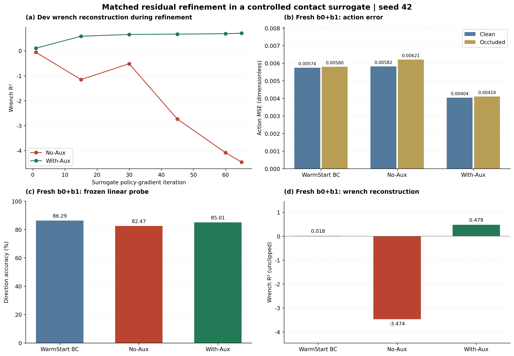
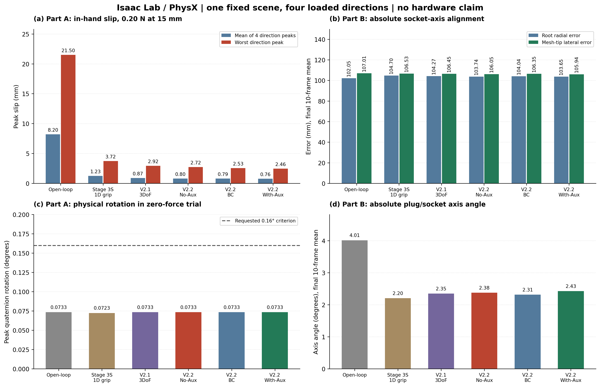

# Stage 4 V2.2：受控代理残差精调与物理回放归档

日期：2026-11-04（二次审计版）。

本轮收尾执行完成，但验收**未全部通过**。5 项单元审计为 True，离线指定指标比较通过；起始帧幅值判据仅 20/28。With-Aux 的 Part A 四向平均峰值滑移为 **0.7644 mm**，零扰动旋转为 **0.0733°**。Part B 的绝对网格端点横向误差为 **105.9436 mm**，场景尚未预对准插孔，不能把初始位姿漂移当作插孔误差，也不能保留旧版“100% 插孔准入”的结论。

## 验收汇总

| 验收项 | 实际结论 |
| --- | --- |
| 5 项 verify_unit_audits | True |
| With-Aux 的离线四类指标同时优于 BC / No-Aux | True（单种子点估计，无统计显著性检验） |
| 起始 t30–36 四方向幅值/门控判据 | 20/28，未全部通过 |
| 所有 3DoF 的外层增益、门限与 DLS 参数一致 | True |
| Part A With-Aux 同时优于 V2.1、No-Aux、BC | True |
| 零扰动旋转 ≤ 0.16° | 0.0733°，True |
| Part B With-Aux 三项绝对几何误差均最优 | False |
| 当前场景已证明插孔准入/成功 | 否；所有控制器几何准入均为 0%，未验证插入深度或接触成功 |

### Dev c005–c008

| 策略 | Clean MSE ↓ | Occ MSE ↓ | Wrench R² ↑ | Frozen probe ↑ | Clean 代理滑移 ↓ | Occ 代理滑移 ↓ |
| --- | --- | --- | --- | --- | --- | --- |
| WarmStart BC | 0.00593 | 0.00572 | 0.4384 | 94.17% | 1.5940 | 1.5900 |
| No-Aux | 0.00329 | 0.00355 | -4.4607 | 94.17% | 1.5485 | 1.5535 |
| With-Aux | 0.00190 | 0.00197 | 0.7054 | 96.67% | 1.5176 | 1.5190 |

### Fresh b0+b1（8 条非零试次）

| 策略 | Clean MSE ↓ | Occ MSE ↓ | Wrench R² ↑ | Frozen probe ↑ | Clean 代理滑移 ↓ | Occ 代理滑移 ↓ |
| --- | --- | --- | --- | --- | --- | --- |
| WarmStart BC | 0.00574 | 0.00580 | 0.0178 | 86.29% | 1.5717 | 1.5729 |
| No-Aux | 0.00582 | 0.00621 | -3.4744 | 82.47% | 1.5733 | 1.5806 |
| With-Aux | 0.00404 | 0.00410 | 0.4793 | 85.01% | 1.5374 | 1.5385 |

## Part A：物理闭环

| 控制器 | 四向平均峰值滑移 mm | 最差峰值 mm | 平均峰值倾角 ° | 预紧命令抖动 mm | 零扰动旋转 ° |
| --- | --- | --- | --- | --- | --- |
| Open-loop | 8.2011 | 21.5004 | 6.1453 | 0.0000 | 0.0733 |
| Stage 3S 1D | 1.2303 | 3.7210 | 0.9139 | 0.0000 | 0.0723 |
| V2.1 3DoF | 0.8720 | 2.9184 | 0.9234 | 0.0000 | 0.0733 |
| V2.2 No-Aux | 0.8042 | 2.7237 | 0.7247 | 0.0000 | 0.0733 |
| V2.2 WarmStart BC | 0.7869 | 2.5340 | 0.8820 | 0.0000 | 0.0733 |
| V2.2 With-Aux | 0.7644 | 2.4623 | 0.7856 | 0.0000 | 0.0733 |

## Part B：绝对插孔几何

| 控制器 | Stage 2 滑移 mm | Stage 3 滑移 mm | 绝对径向误差 mm | 绝对轴夹角 ° | 真实网格端点横向误差 mm | 几何准入 |
| --- | --- | --- | --- | --- | --- | --- |
| Open-loop | 8.3726 | 5.1601 | 102.0456 | 4.0135 | 107.0106 | 0% |
| Stage 3S 1D | 1.2307 | 1.3254 | 104.7006 | 2.2015 | 106.5300 | 0% |
| V2.1 3DoF | 0.9384 | 0.8976 | 104.2715 | 2.3452 | 106.4451 | 0% |
| V2.2 No-Aux | 0.8101 | 0.7729 | 103.7449 | 2.3751 | 106.0519 | 0% |
| V2.2 WarmStart BC | 0.8284 | 0.7899 | 104.0418 | 2.3132 | 106.3451 | 0% |
| V2.2 With-Aux | 0.8373 | 0.7967 | 103.6537 | 2.4259 | 105.9436 | 0% |

## 起始帧逐项判据

方向符号/抑制本身通过 28/28；包含 ±0.7 幅值门槛的完整判据通过 20/28。

| 试次 | 通过 / 7 | 未达标帧及输出 |
| --- | --- | --- |
| c001_r00 | 7/7 | 无 |
| c002_r00 | 6/7 | t30: ux=0.3550, uy=0.1441 |
| c003_r00 | 7/7 | 无 |
| c004_r00 | 0/7 | t30: ux=-0.2016, uy=0.6180; t31: ux=0.0612, uy=0.2988; t32: ux=-0.1173, uy=0.6831; t33: ux=-0.2918, uy=0.5872; t34: ux=0.1211, uy=0.1077; t35: ux=-0.4248, uy=0.3580; t36: ux=-0.0684, uy=0.5062 |

## 十阶段算子消融

| 算子 | Dev | Fresh12 起始标签 | Fresh12 即时方向 | Fresh b0+b1 | PT02 36 OOD |
| --- | --- | --- | --- | --- | --- |
| 0_Raw_State4_16D | 47.50% | 24.69% | 27.47% | 24.54% | 33.46% |
| 1_Scalar_8D | 25.00% | 28.81% | 31.59% | 28.64% | 26.67% |
| 2_Standard_MCF_32D | 46.67% | 29.70% | 33.86% | 31.70% | 34.94% |
| 3_Initial_Centered_MCF_32D | 72.50% | 44.93% | 49.33% | 54.55% | 39.03% |
| 4_PerFinger_Preload_Norm_32D | 72.50% | 44.70% | 49.10% | 54.55% | 39.68% |
| 5_Bilateral_SymAnti_Dipole_16D | 68.33% | 57.03% | 60.04% | 61.24% | 47.30% |
| 6_Static_Tangent_Manifold_24D | 95.83% | 62.05% | 64.36% | 66.34% | 46.10% |
| 7_Full_Frozen_BPI_MCF_32D | 97.50% | 63.19% | 65.73% | 68.05% | 47.21% |
| 8_Creep_ScaleInv_BPI_32D | 98.33% | 81.65% | 76.79% | 86.36% | 59.67% |
| 9_CMQ_BPI_MCF_48D | 98.33% | 81.65% | 77.02% | 86.36% | 60.97% |

## b2 反转前后透明分析

| 算子 | b2 即时方向 | 反转前 t24–42 | 反转后 t43–59 | 起始标签保持率 |
| --- | --- | --- | --- | --- |
| 7_Full_Frozen_BPI_MCF_32D | 61.11% | 67.11% | 54.41% | 53.47% |
| 8_Creep_ScaleInv_BPI_32D | 57.64% | 84.21% | 27.94% | 72.22% |
| 9_CMQ_BPI_MCF_48D | 58.33% | 84.21% | 29.41% | 72.22% |

CMQ 的反转后即时方向准确率为 29.41%，低于 BPI 的 54.41%；81.65% 是起始标签准确率，不能解释为反转跟踪成功。

## PT02 的六类 OOD

| OOD 子集 | 试次 | 帧 | Centroid | Ridge |
| --- | --- | --- | --- | --- |
| friction | 8 | 240 | 52.08% | 45.83% |
| preload | 8 | 240 | 40.00% | 35.83% |
| ramp | 4 | 116 | 48.28% | 50.00% |
| reverse | 4 | 120 | 61.67% | 57.50% |
| sdf_gain | 8 | 240 | 85.83% | 94.17% |
| step_unseen_offset | 4 | 120 | 82.50% | 79.17% |

## 方法与本轮修订（Option A）

当前可支持的表述是：**受控接触代理目标下、带特权辅助锚定的有界残差策略精调，随后在 Isaac Lab / PhysX 中冻结评估，并报告真实物体位姿的插孔相对几何与反转方向分段结果。**

- `tac_encoder` 输入恢复为 `tac_dim`；活动能量只送门控。对每条训练轨迹的前 8 个激活帧赋予 3.0 倍权重，应用于 BC 动作/辅助损失及 Stage B 的轨迹奖励与辅助损失。训练中没有按某个方向手工翻转输出。
- `vis_avail = (norm(x_vis) > 1e-5)` 同时屏蔽 `g_vis` 和双头融合；无相机时基础双头严格退化到 `u_damp`。残差策略仍有冻结 BC 与有界残差分支，不应把完整残差输出等同于单个 `u_damp`。
- Stage B 两分支均为 65 次更新、AdamW 学习率 0.0016、weight decay 0.0001、触觉噪声 0.11、本体噪声 0.22、PG 权重 1.65、残差正则 0.01、quiet 权重 1.0、4 对对偶样本、alpha=0.35、梯度裁剪 1.5。共同的随机种子与样本顺序保持一致。开关差异是方向/4D wrench/合成伴随拷贝/视觉信任门四项辅助损失的整体，不是只隔离 wrench loss。
- Gaussian 样本先 `.detach()`，以截断前 latent 计算 log-prob，以截断后的动作计算奖励，避免把边界截断动作误当作连续 Gaussian 样本。BC 基座参数与保存的 BC 权重逐项相等且没有梯度。`alpha*delta_u` 各分量上限 0.35；最终门控为 `0.85*g_BC+0.15*g_train`，故不能把这一上限直接套到与已门控 BC 的最终输出差上。
- 奖励使用 `[Fx,Fy,Mx,My]` 载荷强度和对教师动作的误差。状态来自固定轨迹回放，没有动作驱动的环境状态转移；这是受控代理上的 score-function 策略精调，**不是已完成 Isaac Lab 在线 PPO/SAC**。`Surrogate_Slip` 是公式构造的代理指数，JSON 的 `_mm` 是兼容字段，尚无物理毫米标定，且与动作 MSE 并非独立证据。辅助标签来自仿真特权量，不宣称无需真值的自监督。
- 本体 12D 输入真实读取 `joint_pos/joint_vel/action` 历史，但关节分组投影为启发式，82% 接触状态混合与随机矩阵 `E_reaff` 注入都是受控合成设计，尚未证明真实运动学外源/自生触觉解耦。
- V2.1 和 V2.2 共用外层增益 `6.2/6.8`、门限 `0.45`、偶极下限 `0.26`、平滑 `0.40`、quiet 噪声 `0.08` 和 DLS 参数。修复了 V2.2 lag 索引的一帧差异和 V2.1 截窗后参考点漂移。各模型内部学习门控及 V2.2 的触觉锚定预处理仍不同；本项只证明外层控制参数公平。零扰动旋转改为 float64 归一化四元数距离，并通过 0.01° 非单位四元数测试；旧字段 max_ang_deg 为兼容保留，微角度应使用新增 max_normalized_rotation_deg。
- 额外试验曾加入整段无相机训练丢弃，但没有提高 20/28 的幅值通过率，且使 `-Fy,t34` 反向，故撤回。其代码、权重、日志与完整物理回放保存在 `outputs/camera_dropout_trial_20261104/`。最终训练保留原有 clean/冻结延迟视觉配对；不声称完整无相机模态训练问题已解决。

## 数据与统计口径

归一化和策略训练使用 pure_loading_01 的 c001–c004；Dev 为 c005–c008。Fresh12 为 12 条非零试次，另有 3 条 zero 对照；b0+b1 为 8 条，b2 为 4 条。`data/fresh_trials/` 包含全部 15 条试次及元数据、标定文件。pure_loading_01 和 pilot_tangent_02 仍依赖既有 E1S 数据归档；Isaac 依赖本机环境、官方资产和原始 V2.1/Stage 3S 权重。

Fresh12 已多次被评估，称历史留出集；没有进入本轮训练/归一化，但不再宣称这是一次从未查看的新盲测。PT02 共加载 44 条非零试次，其中 8 条用于本域训练、36 条用于 OOD 评估；实际为 6 类测试子集，历史脚本/字段名中的 `7category` 保留兼容，不能写成纯从 pure_loading_01 零样本迁移。

离线表为 trial macro 均值，PT02 分组为帧加权准确率；物理表是四个方向的逐试次峰值再平均。只有一个训练种子、一个固定物理场景、每方向一次回放，无置信区间或显著性检验，不将帧数当成独立重复次数。


## 插孔几何的定义与边界

设 `R_s,p_s` 为 `_socket_obj` 的真实位姿，`R_p,p_p` 为插头位姿。新字段使用 `p_rel=R_s.T@(p_p-p_s)`；径向误差为 `1000*norm(p_rel[:2])`；轴角为两物体局部 Z 轴的无向夹角；端点使用实际 00186 URDF 网格的 +Z 远端面中心（含 URDF 和对象缩放），在插孔坐标系计算横向距离。**不减初始误差**。每试次汇总最后 10 帧，再平均四方向。

旧版初始姿态漂移保留在 `stage3_socket_radial_drift_mm`、`stage3_socket_axis_drift_deg`、`stage3_legacy_30mm_point_lateral_drift_mm`；`stage3_final_tip_error_mm` 仍是握持滑移加倾角的旧代理量，不能引用为真实端点误差。新几何计算通过已知 3–4–5 mm 偏置检查；网格端点定义、资产哈希与准入阈值在 JSON `socket_geometry_protocol` 中记录。

当前名义动作是保持夹持姿态，阶段改变外力，未执行到插孔的搬运/接近轨迹。因而本次 Part B 是三阶段抗扰回放加绝对几何诊断，尚不是已实现的插孔任务。几何阈值 2.20 mm/1.50°/握持滑移 1.90 mm 为本协议判据，不冒充资产认证公差。控制器键保留 `6_v2_2_online_residual_rl_proposed`，不会为对应计划中的编号 3 而重命名原始结果。


## 复现与文件入口

从仓库根目录执行：

```powershell
$env:PYTHONDONTWRITEBYTECODE='1'
python experiments/v2_2_cmq_proprio_residual_rl/verify_three_innovations_v2_2_cmq.py
& "C:/isaacsim_env/Scripts/python.exe" experiments/v2_2_cmq_proprio_residual_rl/verify_isaac_closedloop_v2_2_residual_rl.py --headless --device cpu --official-repo C:/isaac_ws/FlexiTac-IsaacSim-Simulation
python experiments/v2_2_cmq_proprio_residual_rl/audit_v2_2_closeout.py
python experiments/v2_2_cmq_proprio_residual_rl/plot_v2_2_figures.py
python experiments/v2_2_cmq_proprio_residual_rl/sync_v2_2_closeout_docs.py
python experiments/v2_2_cmq_proprio_residual_rl/refresh_archive_manifest.py
```

研究说明见 [Stage 4 记录](../../research/STAGE4_V2_2_CMQ_PROPRIO_RESIDUAL_RL_20261103.md)，逐条复核见 [二次审计报告](AUDIT_RECHECK_20261104.md)。脚本支持 `--pure-dir`、`--pt02-dir`、`--fresh-dir` 指定数据路径；本轮实际路径保存在 JSON provenance 中。

`outputs/pre_audit_v2_2_snapshot_20261103/` 保留此前原始结果；`outputs/pre_closeout_snapshot_20261104/` 保留本轮开始时的代码、结果与文档；`outputs/camera_dropout_trial_20261104/` 保留撤回的扩展试验。Stage 1、Stage 2P、Stage 3S 和 V2.1 历史文件没有改写。


## 论文图表









关键证据哈希如下；所有文件的字节数及 SHA256 见 [归档清单](archive_manifest.json)。

| 文件（相对 V2.2 目录） | SHA256 |
| --- | --- |
| verify_three_innovations_v2_2_cmq.py | 0d1ba6d3357d59d60de282af6cc2714274dd3cabbff21e8a39919c02cbdf2875 |
| verify_isaac_closedloop_v2_2_residual_rl.py | 731073812fe70d1ace407e32cc38e22abfd836952973088a96e000358dc47a78 |
| socket_geometry.py | 6266297ee932774ac207c9ae04890575bd4d0c3ab14003d41c9fb0db894d3023 |
| outputs/v2_2_verification_results.json | c2b0c3ebe7c5241785ef7cfa45813fa2755372e7033a1cf0c05571c4001ea5e1 |
| outputs/isaac_closedloop_v2_2_residual_rl_report.json | 137190f812f3b411ef2e621092337ed040c17d515d80082932b7b10883f27771 |
| outputs/checkpoints/v22_5_online_rl_with_aux_proposed.pt | b258fa7aafdb1e8dfe9634f473d88a05a930d393a53fad1b45f9658bac710ddb |
| outputs/secondary_audit_20261104.json | 38b5d7cf418403ea101a2bdad962855cfcd8e0ebd946d8c720449f85210777ea |
