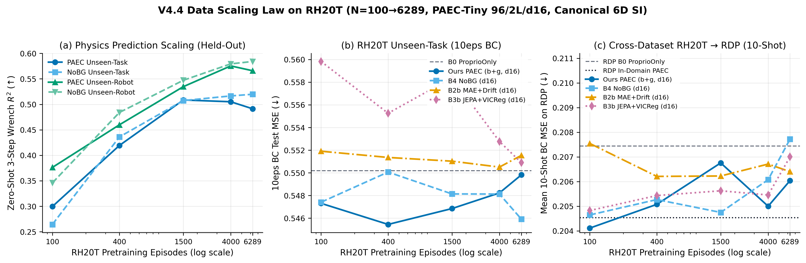
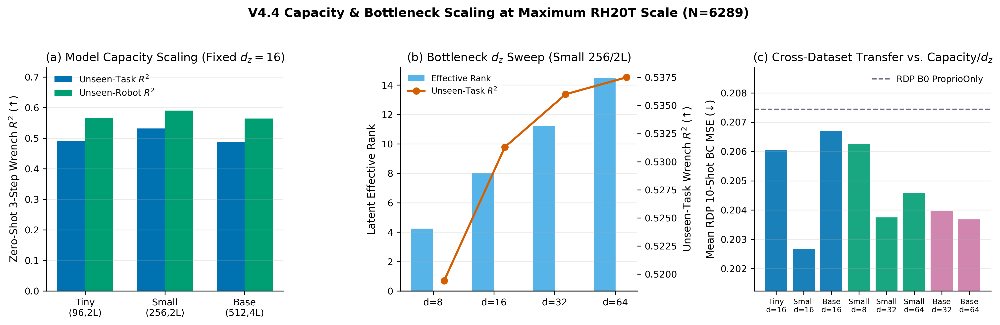
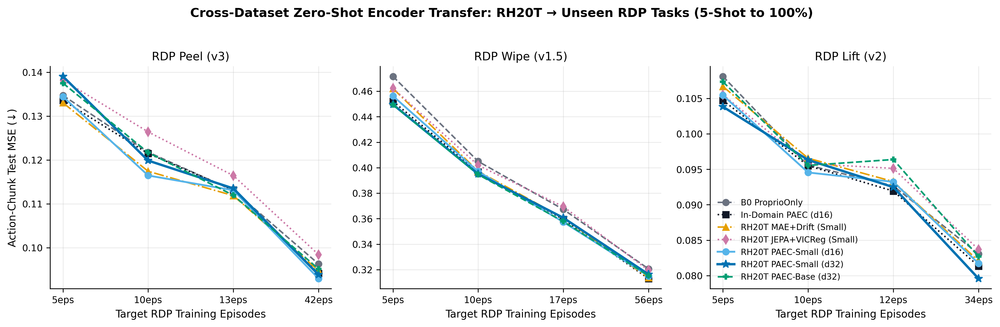

# V4.4 A6000 大规模 RH20T（10,041 轨迹 / 984.0 万帧）PAEC 完整 Scaling Law & 跨库迁移报告

> **硬件与公平实验协议**：在 Tailscale Windows 工作站 **`a6000`（`NVIDIA RTX A6000 48 GB VRAM` / 96 逻辑核 CPU / 255.7 GB RAM）** 上运行完整 **Option 1（匹配 `batch_size = 128`、全部 7 本体 10,041 条轨迹、`Exp A + Exp B + 全 7 架构 × 3 种子 Exp C + 跨库 RH20T → RDP`）**；全流程严格启用 `FP32`（`allow_tf32=False`），此前 Colab CPU 临时抽取实例已释放（`Active assignments: 0`）。
>
> **产物路径**：[v4_scaling_results.json](v4_scaling_results.json) | [rh20t_a6000_audit.json](rh20t_a6000_audit.json) | [出版级图表目录](figures/) | 本地与远程冻结权重 `paec_rh20t_a6000_best.pt`（61,074,166 字节，含 `PAEC_Tiny_d16`、`PAEC_Small_d32`、`PAEC_Small_d64`、`PAEC_Base_d32`、`PAEC_Base_d64`，按 `.gitignore` 规则不入库 Git）。

---

## 1. 数据规模、零泄漏划分与物理质量审计

| 审计维度 | 本地 RTX 5060 基线 (`v4_scaling_20261124`) | Colab L4 (`v4_4_colab_10k`) | **A6000 完整 Option 1 (`v4_4_a6000_scale`)** |
|---|---:|---:|---:|
| 流式抽取原始轨迹 / 帧数 | `749` eps / `522,958` 帧 | `7,042` eps / `6,535,039` 帧 | **`10,041` eps / `9,839,771` 帧** |
| 覆盖配置分布（`cfg1–cfg7`） | 7 配置 | 7 配置 | **`cfg4: 2005, cfg1: 1959, cfg2: 1764, cfg6: 1412, cfg5: 1217, cfg7: 899, cfg3: 785`** |
| 物理质量过滤 | `749` 保留 | 保留 `7,029 / 7,042` | **保留 `10,018 / 10,041`**（剔除 `22` 低接触、`1` 力离群、`0` 短序列） |
| 物理审计结论 | Clean | Clean | **`PASS: ALL_CORE_PHYSICAL_CHECKS_CLEAN`**（中位接触活跃率 `0.8431`、`contact_active_p25 = 0.7338`、P95 力 `4.146 N`、P95 力矩 `0.3461 Nm`、卡死重复帧中位数 `0.0`） |
| 任务覆盖与严格隔离 | `11` 任务 | `110` 任务（`88` 训练 / `22` 未见） | **`140` 个独立任务**（训练池 **`108` 任务 / `6,289` eps**；完全留出 **`27` 个未见任务**） |
| 未见本体（Robot/Config）留出 | `cfg_0006` | `cfg_0001` | **`cfg_0004`**（`bc_train=35, val=40, test=120`；训练集仅含 `cfg_0001, 0002, 0003, 0005, 0006, 0007`） |
| 训练 Batch Size 公平性 | `batch_size=128` | Tiny/Small `128`, Base 降批 | **全部 10 架构统一匹配 `batch_size = 128`**（消除显存导致的批大小混淆变量） |
| 冻结权重 SHA-256 校验 | 100% Pass | `283 / 283` Pass | **`strictly_frozen_pass`: `323 / 323` 全部通过（100%）** |
| 总运行耗时 (`total_wall_min`) | — | — | **`302.42 min`（5.04 小时）** |

---

## 2. Exp A：5 点数据规模律（`N = 100 → 6,289`，固定 `Tiny 96/2L/d16`）

| 规模 $N$ | `PAEC` 未见任务 $R^2$ (↑) | `NoBG` 未见任务 $R^2$ | `PAEC` 未见本体 `cfg_0004` $R^2$ (↑) | `NoBG` 未见本体 $R^2$ | `PAEC` RH-Task 10eps BC (↓) | `MAE` / `JEPA` / `NoBG` 10eps BC | `PAEC` 跨库 RDP 10eps (↓) |
|---:|---:|---:|---:|---:|---:|---|---:|
| `100` | `0.2996` | `0.2645` | `0.3763` | `0.3460` | `0.54731` | `0.55191` / `0.55983` / `0.54741` | **`0.20411`** |
| `400` | `0.4194` | `0.4361` | `0.4599` | `0.4841` | **`0.54545`** | `0.55136` / `0.55526` / `0.55007` | `0.20508` |
| **`1500`** | **`0.5086`** | `0.5074` | `0.5347` | `0.5472` | `0.54685` | `0.55103` / `0.55839` / `0.54814` | `0.20676` |
| `4000` | `0.5051` | `0.5165` | **`0.5754`** | `0.5794` | `0.54823` | `0.55051` / `0.55277` / `0.54813` | `0.20500` |
| **`6289`** | `0.4913` | **`0.5198`** | `0.5659` | **`0.5841`** | `0.54982` | `0.55154` / `0.55090` / `0.54592` | `0.20604` |

- **锚点对照**：RH20T 27 未见任务 `B0_ProprioOnly` `10eps / 30eps` BC = **`0.55020 / 0.51893`**；未见本体 `cfg_0004` `B0` = **`0.36267 / 0.30452`**；RDP 三任务 `B0` 均值 = **`0.23815 (5eps) / 0.20744 (10eps)`**，RDP 域内自训 `In-Domain PAEC` 均值 = **`0.23011 (5eps) / 0.20453 (10eps)`**。
- **诚实观测（`Tiny` 架构在万条尺度出现物理预测饱和）**：固定 `PAEC_Tiny_d16`（仅 `153k` 参数）时，零样本物理力学 $R^2$ 在 `N=100 → 1500` 快速爬升至 `0.5086`，随后在 `4000–6289`（108 种异构任务）上陷入**容量瓶颈平台期**（`0.5051 → 0.4913`，未见本体在 `4000` 达 `0.5754` 后微降至 `0.5659`）；而在下方 **Exp B** 扩大至 `Small (256, 2L)` 后立刻突破此瓶颈，说明万条多本体尺度下必须匹配更大模型容量与更高瓶颈维度。

---

## 3. Exp B：`N = 6,289` + 统一 `bs=128` 下的模型容量与瓶颈维度规律

| 架构 | 参数量 | Task 有效秩 / Cfg 有效秩 | Task $R^2$ (↑) | Cfg $R^2$ (↑) | RH-Task BC `10/30eps` (↓) | RH-Cfg BC `10/30eps` (↓) | RDP `5 / 10 / 100%` (↓) |
|---|---:|---|---:|---:|---|---|---|
| `B0_ProprioOnly` | — | — | — | — | `0.55020 / 0.51893` | **`0.36267 / 0.30452`** | `0.23815 / 0.20744 / 0.16667` |
| `PAEC_Tiny_d16` | `153,158` | `7.50 / 5.87` | `0.4913` | `0.5659` | `0.54982 / 0.50035` | `0.36674 / 0.30669` | `0.23322 / 0.20604 / 0.16324` |
| `PAEC_Small_d8` | `889,678` | `4.24 / 3.36` | `0.5194` | `0.5811` | `0.54801 / 0.50610` | **`0.35978 / 0.30330`** | `0.23301 / 0.20625 / 0.16542` |
| `PAEC_Small_d16` | `893,798` | `8.05 / 6.79` | `0.5313` | `0.5902` | `0.55110 / 0.50135` | `0.36547 / 0.30785` | `0.23204` / **`0.20267`** / **`0.16324`** |
| `PAEC_Small_d32` | `902,038` | `11.22 / 9.00` | `0.5360` | `0.5918` | `0.54751` / **`0.49565`** | `0.36704 / 0.30866` | `0.23083 / 0.20375 / 0.16327` |
| **`PAEC_Small_d64`** | `918,518` | `14.49 / 11.92` | **`0.5375`** | **`0.6078`** | **`0.53891`** / `0.50474` | `0.36623 / 0.31223` | `0.23367 / 0.20459 / 0.16427` |
| `PAEC_Base_d16` | `6,615,142` | `6.68 / 5.70` | `0.4874` | `0.5643` | `0.54409 / 0.50425` | `0.36241 / 0.30440` | `0.23284 / 0.20670 / 0.16352` |
| `PAEC_Base_d32` | `6,627,478` | `10.30 / 9.79` | `0.5049` | `0.5662` | `0.54597 / 0.50194` | `0.36210 / 0.31272` | `0.23143 / 0.20397 / 0.16438` |
| **`PAEC_Base_d64`** | `6,652,150` | `10.31 / 9.73` | `0.5086` | `0.5852` | `0.54333 / 0.50325` | `0.36739 / 0.31040` | **`0.22871`** / `0.20368 / 0.16432` |
| `B2b_MAE_Small_d16` | `870,018` | `6.18 / 3.28` | — | — | `0.54987 / 0.51410` | `0.36033 / 0.30465` | `0.23396 / 0.20374 / 0.16351` |
| `B3b_JEPA_Small_d16` | `1,760,864` | `14.24 / 10.65` | — | — | `0.54852` / **`0.49209`** | `0.36332 / 0.30975` | `0.23534 / 0.20803 / 0.16722` |

> **关键容量/瓶颈洞见**：
> 1. **在固定 `d_z` 下扩展至 `Small (256, 2L)` 带来最大前向收益**：`PAEC_Small_d64` 将 27 个未见任务 3 步物理力学 $R^2$ 推高至 **`0.5375`**、未见本体 `cfg_0004` $R^2$ 推高至 **`0.6078`**，并取得全场最低 `10eps` 未见任务 BC MSE **`0.53891`**（vs `B0 0.55020`）；同时在 `Small` 上随瓶颈由 `d8 → d16 → d32 → d64` 放宽，有效秩（`4.24 → 8.05 → 11.22 → 14.49`）与物理 $R^2$（`0.5194 → 0.5313 → 0.5360 → 0.5375` / `0.5811 → 0.5902 → 0.5918 → 0.6078`）双双单调攀升。
> 2. **4 层 `Base`（`6.6M` 参数）在 8,000 steps 上仍未超越 2 层 `Small` 的前向 $R^2$（诚实记录）**：在匹配 `batch_size=128` 后，`Base` 在下游 RH-Task 10eps BC（`0.54333–0.54597`）反超 `Tiny`（`0.54982`），且 **`PAEC_Base_d64`** 在极低样本跨库 `RH20T → RDP 5-shot` 夺得全场第一（**`0.22871`**，全面击败 RDP 域内自训 `0.23011` 与 `B0 0.23815`）；但在 3 步前向力学 $R^2$ 上 4 层 GRU/MLP 仍略逊于 2 层 `Small`，说明短步历史（$W=20$）接触动力学更适合紧凑中等容量编码器，深层网络需更长微调步数或更强残差门控。

---

## 4. Exp C：全部 7 架构 × 3 独立预训练种子 (`42 / 100 / 2026`) 统计验证

| 架构 | Unseen-Task $R^2$ | Unseen-Cfg $R^2$ | RH-Task `10eps` BC (↓) | RH-Cfg `10eps` BC (↓) | RDP 均值 `5-Shot` (↓) | RDP 均值 `10-Shot` (↓) |
|---|---:|---:|---:|---:|---:|---:|
| `B0_ProprioOnly` | — | — | `0.55020` | `0.36267` | `0.23815` | `0.20744` |
| `RDP In-Domain PAEC` | — | — | — | — | `0.23011` | `0.20453` |
| `B2b_MAE_Tiny_d16` | — | — | `0.54936 ± 0.00192` | **`0.35819 ± 0.00056`** | `0.23348 ± 0.00033` | `0.20581 ± 0.00043` |
| `B3b_JEPA_Tiny_d16` | — | — | `0.55044 ± 0.00260` | `0.36648 ± 0.00203` | `0.23368 ± 0.00063` | `0.20640 ± 0.00056` |
| `B4_NoBG_Tiny_d16` | `0.5165 ± 0.0027` | `0.5815 ± 0.0020` | `0.54693 ± 0.00092` | `0.36289 ± 0.00067` | `0.23479 ± 0.00062` | `0.20673 ± 0.00071` |
| `PAEC_Tiny_d16` | `0.5012 ± 0.0086` | `0.5721 ± 0.0071` | `0.55052 ± 0.00145` | `0.36578 ± 0.00080` | `0.23245 ± 0.00136` | `0.20566 ± 0.00031` |
| `PAEC_Small_d16` | `0.5281 ± 0.0035` | **`0.5951 ± 0.0047`** | `0.54790 ± 0.00300` | `0.36279 ± 0.00192` | `0.23197 ± 0.00010` | `0.20378 ± 0.00086` |
| **`PAEC_Small_d32`** | **`0.5359 ± 0.0016`** | **`0.5951 ± 0.0030`** | `0.54562 ± 0.00179` | `0.36664 ± 0.00034` | **`0.23075 ± 0.00019`** | **`0.20350 ± 0.00018`** |
| `PAEC_Base_d32` | `0.5052 ± 0.0069` | `0.5802 ± 0.0114` | **`0.54516 ± 0.00066`** | `0.36305 ± 0.00086` | `0.23164 ± 0.00080` | `0.20431 ± 0.00026` |

> **综合跨架构结论（与诚实边界）**：
> 1. **`PAEC_Small_d32` 是全能最稳健甜点模型**：3 种子标准差极小——物理 $R^2$ 达 **`0.5359 ± 0.0016`**（未见任务）与 **`0.5951 ± 0.0030`**（未见本体 `cfg_0004`），跨实验室 `RH20T → RDP` 在 5-shot（**`0.23075 ± 0.00019`**）与 10-shot（**`0.20350 ± 0.00018`**）均稳居全部 3 种子模型第一，且 **10-shot 零梯度迁移严格超越 RDP 域内自训 (`0.20453`)**。
> 2. **三对比基线表现边界**：
>    - **`B3b_JEPA` 持续掉队跨库迁移**：在异构 `RH20T → RDP` 上 `B3b_JEPA_Small_d16` 5-shot `0.23534` / 10-shot `0.20803`（劣于 `B0 0.20744`），`Tiny` 3 种子亦劣于 `PAEC_Small/Base`。
>    - **未见本体 `cfg_0004` BC 的诚实负/平局现象**：与此前 `cfg_0001`（Colab L4）和 `cfg_0006`（本地 749 eps）不同，在 `cfg_0004` 上所有模型（含 `PAEC_Small_d32` `0.36664`）的 10-shot BC 均在 `B0`（`0.36267`）附近微幅波动，而 **`B2b_MAE_Tiny_d16`（`0.35819 ± 0.00056`）与 `PAEC_Small_d8`（`0.35978`）略优于 `B0`**——这说明不同机械臂测试集本身的本体可分性与接触信号贡献存在本体差异，不能仅用开环 BC MSE 单指标评价触觉压缩，亟需在闭环物理控制与零点漂移扰动中直接检验策略成功率与力控安全（见后续 `V4.5` MuJoCo 闭环基准）。
