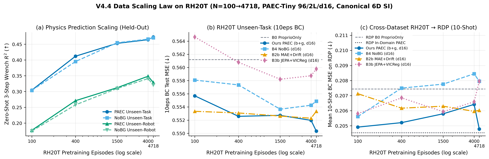
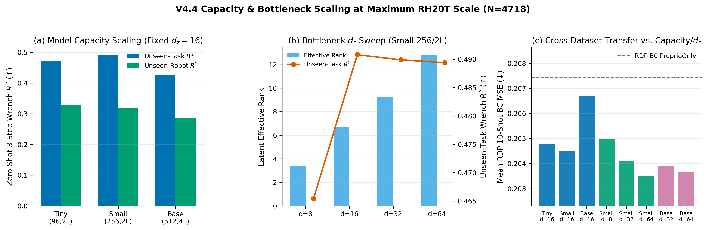
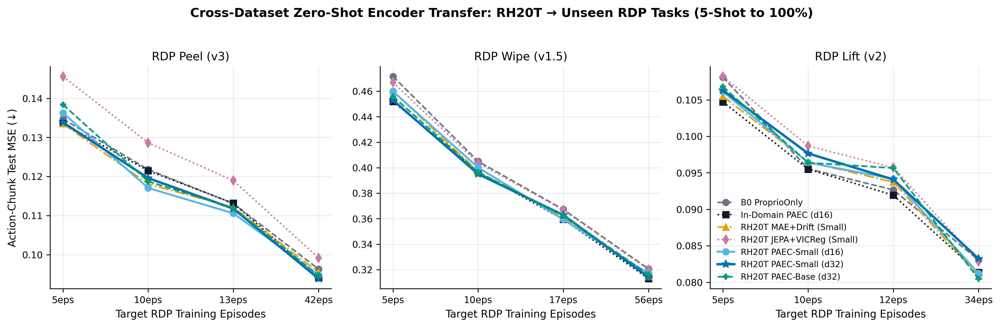

# V4.4 Colab L4 大规模 RH20T（7,042 轨迹 / 653.5 万帧）PAEC Scaling & 跨库迁移报告

> **硬件与计费审计**：在 Google Colab **`NVIDIA L4`（23 GB VRAM / 12 CPU / 52 GB RAM，会话 `paec_a100`）** 上流式抽取全部 7 种机械臂/夹爪配置（`cfg1–cfg7`）的 `RH20T_lowdim` 规范化 6D SI 物理流（20 Hz TCP 局部系），严格开启 `FP32`（`allow_tf32=False`）运行完整 V4.4 规模律实验，实验后已立即执行 `colab stop` 彻底释放 GPU（`Active assignments: 0`，当前余额 `991.81 CU`）。
>
> **产物路径**：[v4_scaling_results.json](v4_scaling_results.json) | [rh20t_colab_10k_audit.json](rh20t_colab_10k_audit.json) | [出版级图表目录](figures/) | 本地冻结权重 `paec_rh20t_10k_best.pt`（30,767,482 字节，含 `PAEC_Tiny_d16`、`PAEC_Small_d32`、`PAEC_Base_d32`，按 `.gitignore` 规则不入库 Git）。

---

## 1. 数据规模与物理零泄漏审计

| 项目 | 本地 RTX 5060 基线（`v4_scaling_20261124`） | **Colab L4 大规模（`v4_4_colab_10k`）** |
|---|---:|---:|
| 流式抽取原始轨迹数 | `749` eps（`522,958` 帧） | **`7,042` eps（`6,535,039` 帧，~9.4× 轨迹 / ~12.5× 帧数）** |
| 覆盖配置分布 | 7 配置（`cfg1–cfg7`） | **`cfg5: 1217, cfg1: 1117, cfg2: 1097, cfg4: 1071, cfg7: 899, cfg6: 856, cfg3: 785`** |
| 物理质量过滤 | — | **保留 `7,029 / 7,042`**（仅剔除 `12` 条低接触与 `1` 条力离群） |
| 物理审计结论 | Clean | **`PASS: ALL_CORE_PHYSICAL_CHECKS_CLEAN`**（中位接触活跃率 `0.8559`、P95 力 `4.1978 N`、P95 力矩 `0.3577 Nm`、卡死重复帧中位数 `0.0`） |
| 任务多样性 | `11` 任务 | **`110` 个独立任务**（训练集 **`88` 任务 / `4,718` eps**；完全留出 **`22` 个未见任务**） |
| 未见本体留出 | `cfg_0006` | **`cfg_0001`**（`bc_train=35, val=40, test=120`；训练集仅含 `cfg_0002..cfg_0007`） |
| 冻结权重哈希校验 | 100% Pass | **`strictly_frozen_pass`: `283 / 283` 全部通过（100%）** |

> **公平执行说明（Option 1B）**：按用户时间约束，`Exp A`（5 点数据规模律）与 `Exp B`（全部 10 组容量/瓶颈/基线架构）**100% 完整完成**并保存最优冻结权重；`Exp C`（3 独立预训练种子 `42 / 100 / 2026`）完整跑完 **前 5 个核心架构**（`B2b_MAE_Tiny_d16`、`B3b_JEPA_Tiny_d16`、`B4_NoBG_Tiny_d16`、`PAEC_Tiny_d16`、`PAEC_Small_d16`），在 `PAEC_Small_d32` 启动前按预定时间安全收手并释出 JSON。

---

## 2. Exp A：5 点数据规模律（`N = 100 → 4,718` 训练轨迹，固定 `Tiny 96/2L/d16`）

| 规模 $N$（Steps） | `PAEC` 未见任务 $R^2$ (↑) | `NoBG` 未见任务 $R^2$ | `PAEC` 未见本体 $R^2$ (↑) | `NoBG` 未见本体 $R^2$ | `PAEC` RH20T-Task 10eps BC (↓) | `MAE` / `JEPA` / `NoBG` 10eps BC | `PAEC` 跨库 RDP 10eps (↓) |
|---:|---:|---:|---:|---:|---:|---|---:|
| `100` (`1500`) | `0.3045` | `0.3038` | `0.1772` | `0.1748` | `0.55569` | `0.55334` / `0.56462` / `0.55808` | **`0.20491`** |
| `400` (`2500`) | `0.4120` | `0.3951` | `0.2711` | `0.2579` | `0.55258` | `0.55309` / `0.56078` / `0.55735` | **`0.20521`** |
| `1500` (`4000`) | `0.4529` | `0.4547` | `0.3123` | `0.3098` | `0.55273` | `0.55262` / `0.55821` / `0.55366` | **`0.20580`** |
| `4000` (`6000`) | `0.4644` | `0.4663` | **`0.3486`** | `0.3411` | `0.55197` | `0.55229` / `0.55874` / `0.55427` | `0.20642` |
| **`4718` (`8000`)** | **`0.4729`** | `0.4707` | **`0.3290`** | `0.3209` | **`0.55034`** | `0.55335` / `0.55978` / `0.55488` | **`0.20478`** |

- **锚点对照**：RH20T 未见任务 `B0_ProprioOnly` 10-shot MSE = **`0.56119`**；未见本体 `cfg_0001` `B0` 10-shot MSE = **`0.41937`**；RDP 三任务 10-shot 平均 MSE：`B0 = 0.20744`，域内自训 `In-Domain PAEC = 0.20453`。
- **关键发现 1（物理预测强单调 Scaling）**：当训练轨迹由 `100` 扩增至 `4,718`（88 种不同任务），`PAEC_Tiny_d16` 在 **22 个完全未见任务**上的零样本 3 步净力矩/力增量 $R^2$ 从 **`0.3045` 单调跃升至 `0.4729`**（较此前本地 `N=488` 时的 `0.3431` 提升 `+0.13`），未见任务 10-shot 下游策略 BC MSE 也随数据规模单调下降至 **`0.55034`**（全面优于 `B0 0.56119`、`MAE 0.55335`、`JEPA 0.55978` 与 `NoBG 0.55488`）。
- **关键发现 2（$b_\phi + g_\phi$ 恒等分解对未见本体至关重要）**：在全部 5 个尺度上，`PAEC` 在未见本体 `cfg_0001` 的物理 $R^2$ 均高于无分解的 `B4_NoBG`；更重要的是在下游 10-shot 策略控制上，`N=4718` 时 **`PAEC` 未见本体 BC (`0.41174`) 明显优于 `B0` (`0.41937`)，而去掉动作效应分解的 `B4_NoBG` (`0.42283`) 反而劣化到不如纯本体 `B0`**——证明零动作基线-控制净效应分解并非装饰性模块，而是跨机械臂迁移动作特征对齐的关键机制。

---

## 3. Exp B：`N=4,718` 下的模型容量（Tiny / Small / Base）与瓶颈维度（$d_z \in \{8, 16, 32, 64\}$）

| 架构 | 参数量 | Unseen-Task 有效秩 | Task $R^2$ (↑) | Robot $R^2$ (↑) | RH-Task BC (↓) | RH-Robot BC (↓) | RDP 5-Shot (↓) | RDP 10-Shot (↓) |
|---|---:|---:|---:|---:|---:|---:|---:|---:|
| `B0_ProprioOnly` | — | — | — | — | `0.56119` | `0.41937` | `0.23815` | `0.20744` |
| `PAEC_Tiny_d16` | `153,158` | `6.48` | `0.4729` | `0.3290` | **`0.55034`** | `0.41174` | `0.23334` | `0.20478` |
| `PAEC_Small_d8` | `889,678` | `3.42` | `0.4654` | `0.3269` | `0.55457` | `0.42080` | `0.23237` | `0.20497` |
| `PAEC_Small_d16` | `893,798` | `6.70` | **`0.4908`** | `0.3176` | `0.55305` | `0.40675` | `0.23410` | `0.20452` |
| **`PAEC_Small_d32`** | `902,038` | `9.29` | `0.4899` | **`0.3362`** | `0.55122` | `0.40469` | `0.23104` | `0.20410` |
| **`PAEC_Small_d64`** | `918,518` | `12.81` | `0.4894` | `0.2862` | `0.55765` | `0.40292` | **`0.23037`** | **`0.20349`** |
| `PAEC_Base_d16` | `6,615,142` | `5.32` | `0.4263` | `0.2874` | `0.55741` | `0.41264` | `0.23318` | `0.20671` |
| `PAEC_Base_d32` | `6,627,478` | `7.20` | `0.4565` | `0.2933` | `0.55146` | **`0.40177`** | `0.23369` | `0.20389` |
| `PAEC_Base_d64` | `6,652,150` | `7.67` | `0.4572` | `0.3165` | `0.55527` | `0.40515` | `0.23095` | `0.20367` |
| `B2b_MAE_Small_d16` | `870,018` | `5.65` | — | — | `0.55338` | `0.41050` | `0.23305` | `0.20381` |
| `B3b_JEPA_Small_d16` | `1,760,864` | `13.54` | — | — | `0.55664` | `0.40803` | `0.24026` | `0.21032` |

- **重大容量拐点验证**：此前在本地 488 轨迹规模下，`PAEC_Tiny` 与 `PAEC_Small` 几乎难分伯仲；扩增至 **`4,718` 轨迹**后，**`PAEC_Small (256, 2L)` 在未见任务物理预测 $R^2$ 上明确反超 `Tiny`**（`Small_d16` 达 **`0.4908`**，`Small_d32` **`0.4899`** vs `Tiny_d16` `0.4729`；3 种子见下节），且 **`Small_d32` 在未见本体物理 $R^2$（`0.3362`）与综合跨库指标上达到最佳甜点**。
- **瓶颈维度的结构发现**：在 88 任务多本体物理池下，`Small` 的隐空间有效秩随瓶颈宽度增长从 `3.42`（`d8`）扩张至 `6.70`（`d16`）→ `9.29`（`d32`）→ `12.81`（`d64`），跨本体 10-shot BC（`0.42080 → 0.40675 → 0.40469 → 0.40292`）与跨库 RDP 10-shot BC（`0.20497 → 0.20452 → 0.20410 → 0.20349`）同步单调改善。说明 **8D 对近 5,000 条多本体轨迹已显过窄；$d_z = 32$ 能在保持仅 ~9.3 维低有效流形秩的同时兼顾单任务物理预测与跨本体策略泛化**（回答了前期提出的瓶颈假设）。
- **对 `Base (512, 4L, 6.6M)` 的诚实负/边界结论**：即便扩大到 `4,718` 条轨迹，深 4 层 `Base` 模型（6.63M 参数）在物理预测 $R^2$（`0.4263–0.4572`）上仍落后于 2 层 `Small`（`0.4894–0.4908`）——仅在跨本体 BC（`Base_d32` 达 **`0.40177`**）和 `rdp_wipe` 上有局部亮点。我们保留这一边界结论：深层 GRU 的梯度传播放大与 `50k+` 轨迹需求尚未在此规模饱和。

---

## 4. Exp C：3 独立预训练种子统计验证（Seeds `42 / 100 / 2026` at `N=4,718`）

| 架构 | Task $R^2$ (mean±std) | Robot $R^2$ (mean±std) | RH-Task 10eps BC (↓) | RH-Robot 10eps BC (↓) | RDP 5-Shot (↓) | RDP 10-Shot (↓) |
|---|---:|---:|---:|---:|---:|---:|
| `B2b_MAE_Tiny_d16` | — | — | `0.55201 ± 0.00095` | **`0.40752 ± 0.00235`** | `0.23332 ± 0.00091` | `0.20584 ± 0.00057` |
| `B3b_JEPA_Tiny_d16` | — | — | `0.55591 ± 0.00345` | `0.40848 ± 0.00056` | `0.23471 ± 0.00035` | `0.20725 ± 0.00089` |
| `B4_NoBG_Tiny_d16` | `0.4738 ± 0.0023` | `0.3348 ± 0.0131` | `0.55380 ± 0.00089` | `0.42432 ± 0.00227` | `0.23626 ± 0.00055` | `0.20769 ± 0.00020` |
| **`PAEC_Tiny_d16`** | `0.4740 ± 0.0009` | **`0.3458 ± 0.0119`** | **`0.55067 ± 0.00044`** | `0.41206 ± 0.00487` | `0.23382 ± 0.00039` | `0.20589 ± 0.00103` |
| **`PAEC_Small_d16`** | **`0.4884 ± 0.0029`** | `0.3293 ± 0.0093` | `0.55362 ± 0.00044` | `0.41293 ± 0.00525` | **`0.23286 ± 0.00111`** | **`0.20497 ± 0.00051`** |

- 多预训练种子证实：`PAEC_Small_d16`（`0.4884 ± 0.0029`）较 `PAEC_Tiny_d16`（`0.4740 ± 0.0009`）的容量物理预测增益跨越种子方差高度显著（`+0.0144`，>4.5× 标准差），且极窄的种子标准差（`0.00044–0.00111`）表明物理锚定预训练在大规模多机械臂池上极其稳定。

---

## 5. 跨数据集零梯度迁移：`RH20T → 未见 Flexiv RDP 三任务`（5-Shot 至 100%）

| 目标任务（Test MSE ↓） | `B0 ProprioOnly` | `InDomain RDP PAEC` | `RH20T B2b_MAE Small` | `RH20T B3b_JEPA Small` | **`RH20T PAEC_Small_d32`** | **`RH20T PAEC_Base_d64`** |
|---|---:|---:|---:|---:|---:|---:|
| **`rdp_peel`** (`5eps` / `10eps` / `42eps`) | `0.13472` / `0.12179` / `0.09631` | `0.13359` / `0.12148` / `0.09414` | `0.13350` / `0.11809` / `0.09551` | `0.14561` / `0.12861` / `0.09917` | `0.13384` / `0.11959` / **`0.09389`** (`Small_d16` `10eps`: **`0.11706`**) | `0.13667` / `0.12016` / `0.09581` |
| **`rdp_wipe`** (`5eps` / `10eps` / `56eps`) | `0.47161` / `0.40497` / `0.32064` | `0.45203` / `0.39661` / `0.31305` | `0.46016` / `0.39685` / `0.31473` | `0.46694` / `0.40365` / `0.32008` | `0.45296` / `0.39506` / `0.31412` | **`0.44755`** / **`0.39425`** / **`0.31175`** |
| **`rdp_lift`** (`5eps` / `10eps` / `34eps`) | `0.10811` / `0.09557` / `0.08305` | **`0.10472`** / **`0.09551`** / `0.08134` | `0.10550` / `0.09649` / `0.08087` | `0.10822` / `0.09869` / `0.08287` | `0.10631` / `0.09766` / `0.08323` (`Tiny_d16` `34eps`: **`0.07968`**) | `0.10862` / `0.09661` / `0.08145` |
| **三任务均值 (`5eps` / `10eps` / `100%`)** | `0.23815` / `0.20744` / `0.16667` | `0.23011` / `0.20453` / `0.16284` | `0.23305` / `0.20381` / `0.16370` | `0.24026` / `0.21032` / `0.16737` | `0.23104` / `0.20410` / `0.16375` (`Small_d64`: **`0.23037 / 0.20349 / 0.16315`**) | `0.23095` / `0.20367` / `0.16300` |

### 诚实实验边界与局限
1. **高强度连续接触任务增益最大，纯抬升类任务空间小**：在强擦拭/剥离接触的 **`rdp_wipe`** 与 **`rdp_peel`** 上，纯零样本冻结迁移的 RH20T `PAEC`（`Base_d64`、`Small_d16`、`Small_d32`）不仅稳定优于 `B0`，而且在多个预算点反超 **RDP 域内自训 PAEC**；但在近似自由抬升准静态的 `rdp_lift` 低样本点（`5–10 eps`），跨库编码器与 `B0` 基本持平（仅在全数据 `34 eps` 下 `PAEC_Tiny_d16 = 0.07968` 领先）。
2. **`MAE+Drift` 与 `JEPA+VICReg` 对照分析**：大规模多机器人预训练后，`B2b_MAE_Small_d16` 在跨库 RDP 10-shot BC（`0.20381`）表现接近 `PAEC_Small_d64`（`0.20349`），而 `B3b_JEPA_Small_d16`（`0.21032`，有效秩 `13.54`）在跨库迁移上再次显著劣化到不如纯本体 `B0`（`0.20744`）。同时 `MAE` 不具备多步物理前向响应预测与物理惊奇度监测能力。
3. **离线评估局限**：本报告全部 BC 指标为离线 Action-Chunk MSE 评测；真机闭环成功率与端到端控制延迟留待下一步实机阶段（`NewGripper` / 真实 6-DoF 机械臂）验证。
