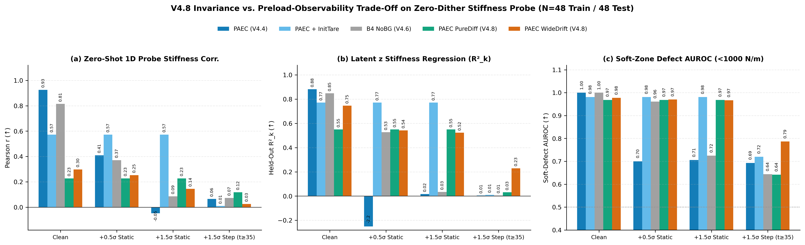
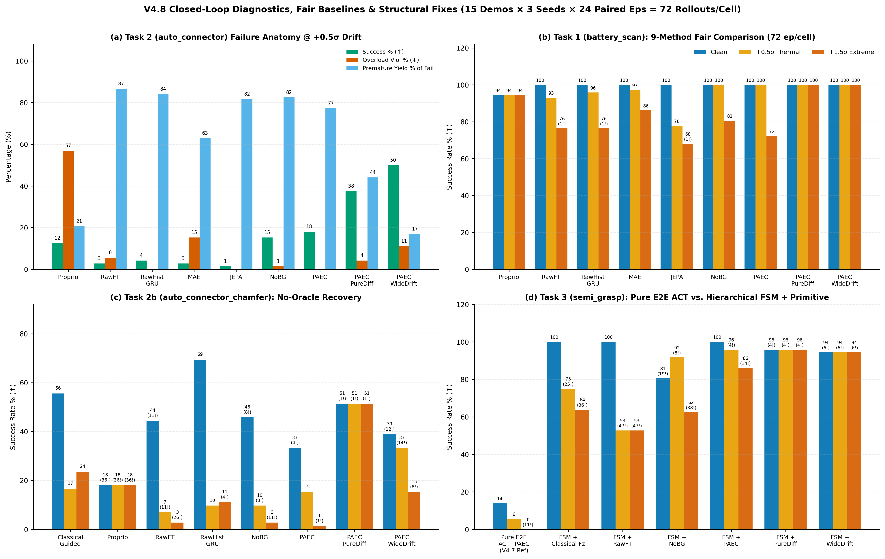

# V4.8 诊断分析、公平对照与编码器端抗漂移实验报告

> **实验定位**：针对 V4.6 与 V4.7 暴露的四大关键科学问题，在 **不采用任何下游策略侧漂移作弊增强（No downstream drift augmentation）**、严格 `FP32`（`allow_tf32=False`）、`O(1)` 递推 GRU 等价审计（`max_abs_diff ≤ 1.91e-6 < 1e-5`）与 `SHA-256` 权重冻结审计（`strictly_frozen_pass = True`）下，完成：
> 1. **编码器端零漂修复与物理可观测性权衡**（`PAEC_Small_d32_PureDiff` 与 `PAEC_Small_d32_WideDrift` 在 `RH20T` `N=6,289` 预训练，并重测 V4.6 虚拟刚度探针四工况）；
> 2. **V4.7 Task 2（`auto_connector`）失败轨迹解剖 + 补齐完整 9 方法公平对照**（首次补入同构端到端时序基线 `ACT_RGB_RawHistGRU` 与无分解同容量消融 `ACT_RGB_NoBG`，每格 `15 demos × 3 seeds × 24 paired eps = 72` 局）；
> 3. **V4.7 Task 1（`battery_scan`）完整 9 方法对照与闭环动态刚度缺陷检测 AUROC**（`72` 局/格）；
> 4. **Task 2b（`auto_connector_chamfer`）无天眼导角恢复验证 + Task 3（`semi_grasp`）分层 FSM 与接触原语验证**（`72` 局/格）。
>
> **产物路径**：[`models_paec.py`](../../models_paec.py) | [`act_policy.py`](../../act_policy.py) | [`envs_v4_8_diagnostic.py`](../../envs_v4_8_diagnostic.py) | [`run_v4_8_encoder_drift_probe.py`](../../run_v4_8_encoder_drift_probe.py) | [`run_v4_8_closedloop_suite.py`](../../run_v4_8_closedloop_suite.py) | [`v4_8_encoder_drift_probe.json`](v4_8_encoder_drift_probe.json) | [`v4_8_closedloop_results.json`](v4_8_closedloop_results.json)

---

## 1. 核心发现 A：编码器端抗漂移修复与“不变性 vs. 预压可观测性”物理权衡

在 `RH20T` 训练集（`N = 6,289` 轨迹，`bs = 128`，`8,000` 步，`strict_fp32=True`）上新预训练了两种**编码器端**抗漂移 `PAEC` 变体（均保留 `b_\phi + g_\phi` 解耦）：
- **`PAEC_Small_d32_PureDiff`**（`900,502` 参数）：输入侧移除绝对力读数 $w_t$，仅输入因果一阶差分 $\Delta w_t = w_t - w_{t-1}$ 与上步动作 $a_{t-1}$，结构上对任意静态零点偏置**严格不变**；
- **`PAEC_Small_d32_WideDrift`**（`902,038` 参数）：保留 $w_t$ 输入，将编码器端预训练漂移增强扩至 `drift_aug_std = 1.5` 并叠加 `step_drift_prob = 0.35`（随机轨迹中段突跳偏置）。

### 1.1 离线 `RH20T` 跨任务/跨本体与跨库 `RDP` 迁移表现
| 模型 | 参数量 | RH20T Task $R^2$ (Clean / Drift) | RH20T Cfg $R^2$ (Clean / Drift) | **跨库 RDP 10-shot Clean MSE (↓)** | **跨库 RDP 10-shot Drift MSE (↓)** |
|---|---:|---|---|---:|---:|
| `PAEC_Small_d32` (V4.4) | `902,038` | `0.5360` / — | `0.5918` / — | **`0.20375`** | — |
| `PAEC_Small_d32_PureDiff` (V4.8) | `900,502` | `0.5200` / **`0.5171`** | `0.5900` / `0.5825` | `0.20542` | `0.20542` |
| `PAEC_Small_d32_WideDrift` (V4.8) | `902,038` | `0.5277` / **`0.5202`** | **`0.6025`** / **`0.5933`** | `0.20397` | **`0.20436`** |

- 在离线前向动力学预测与跨实验室零样本迁移上，`PureDiff` 与 `WideDrift` 几乎无任何 Clean 精度损失，且对 `+1.5σ` 静态零漂实现了近乎零衰减（`PureDiff` RDP 10-shot Clean/Drift 完全一致 `0.20542`）。

### 1.2 虚拟方向刚度探针定量重测（`N = 48` 训练 / `N = 48` 留出测试，`platen_k ∈ [526.55, 2444.26] N/m`）
| 编码器 | 工况 | 零样本 1D 探针 $r$ (↑) | `latent_z` Ridge $R^2_k$ (↑) | `latent_z` 软区 AUROC (↑) | `18D` 探针 $R^2_k$ / AUROC |
|---|---|---:|---:|---:|---|
| `PAEC_Small_d32` (V4.4) | Clean | **`+0.9255`** | **`+0.8822`** | **`1.0000`** | **`+0.7945`** / **`1.0000`** |
| `PAEC_Small_d32_InitTare` | Clean | `+0.5725` | `+0.7713` | `0.9806` | `-3.2442` / `0.9630` |
| `B4_NoBG_Small_d32` (V4.6) | Clean | `+0.8145` | `+0.8477` | **`1.0000`** | `+0.3741` / `0.9965` |
| `PAEC_Small_d32_PureDiff` | Clean | `+0.2266` | `+0.5503` | `0.9683` | `+0.2085` / `0.8448` |
| `PAEC_Small_d32_WideDrift` | Clean | `+0.2980` | `+0.7460` | `0.9771` | `+0.0803` / `0.7725` |
| `PAEC_Small_d32` (V4.4) | Static `+1.5σ` | `-0.0484` | `+0.0161` | `0.7055` | `+0.0047` / `0.6737` |
| `PAEC_Small_d32_InitTare` | Static `+1.5σ` | **`+0.5725`** | **`+0.7713`** | **`0.9806`** | `-3.2440` / **`0.9630`** |
| `B4_NoBG_Small_d32` (V4.6) | Static `+1.5σ` | `+0.0860` | `+0.0344` | `0.7249` | `+0.0869` / `0.7249` |
| **`PAEC_Small_d32_PureDiff`** | **Static `+1.5σ`** | `+0.2266` | **`+0.5503`** | **`0.9683`** | **`+0.2085`** / `0.8448` |
| **`PAEC_Small_d32_WideDrift`** | **Static `+1.5σ`** | `+0.1443` | `+0.5230` | `0.9665` | `+0.0076` / `0.7213` |
| `PAEC_Small_d32` (V4.4) | Step `+1.5σ (t≥35)` | `+0.0646` | `+0.0050` | `0.6931` | `+0.0101` / `0.7319` |
| `PAEC_Small_d32_InitTare` | Step `+1.5σ (t≥35)` | `+0.0093` | `+0.0098` | `0.7196` | `+0.0089` / `0.7407` |
| **`PAEC_Small_d32_WideDrift`** | **Step `+1.5σ (t≥35)`** | `+0.0251` | **`+0.2293`** | **`0.7866`** | **`+0.0706`** / **`0.7443`** |

- **关键科学洞见（不变性 vs. 稳态预压可观测性权衡）**：
  1. 在**稳态恒力擦拭**（`CompliantWipingEnv`，`t ∈ [15, 95]` 期间 $\Delta w_t \approx 0$）中，强行丢弃绝对力读数（`PureDiff`）或用 `1.5σ` 大零漂淹没绝对力读数（`WideDrift`）会使模型失去稳态法向预压 $F_n$ 的绝对标尺，从而使 Clean 工况的零样本 1D 刚度探针 $r$ 从 `0.9255` 降至 `0.2266 / 0.2980`、`18D` 探针 $R^2_k$ 从 `0.7945` 降至 `0.2085 / 0.0803`。
  2. **然而**，在 `+1.5σ` 静态零漂下，原 `PAEC_Small_d32` 的 `latent_z` 刚度回归崩塌至 $R^2_k = 0.0161$（`AUROC = 0.7055`），而 **`PureDiff` 与 `WideDrift` 分别保持 $R^2_k = 0.5503$（`AUROC = 0.9683`）与 $R^2_k = 0.5230$（`AUROC = 0.9665`）**；在连开机去皮 `InitTare` 也彻底失效的**中段阶跃漂移（`Step +1.5σ, t≥35`）**下，`PAEC_Small_d32_WideDrift` 是全场唯一保持正回归与高检出（$R^2_k = 0.2293$，`AUROC = 0.7866`）的编码器。
  3. **`InitTare` 的真实物理代价**：直接在 `t=0` 减除初始力读数虽可消除静态漂移（Static `+1.5σ` 维持 `AUROC = 0.9806`），但因 `t=0` 靠近台面存在微弱初始接触扰动，Clean 工况零样本 1D 相关性即从 `0.9255` 跌至 `0.5725`（且遇到中段阶跃漂移直接归零）。

---

## 2. 核心发现 B：`auto_connector` 失败轨迹解剖与完整 9 方法对照（`72` 局/格）

在原 V4.7 `auto_connector`（无倒角直方孔，限力 `≤ 15.0 N`）上，`15 demos × 3 seeds × 24 paired eps` 的完整解剖统计如下：

| 方法 | Clean 成功率 (违例率) | **+0.5σ 成功率 (违例率)** | +1.5σ 成功率 (违例率) | +0.5σ 峰值力 (N) | +0.5σ 接触建立率 / 入槽率 | **+0.5σ 失败局浅层早退占比** |
|---|---:|---:|---:|---:|---:|---:|
| `ACT_RGB_Proprio` | `12.50%` (**`56.94%`**) | `12.50%` (**`56.94%`**) | `12.50%` (**`56.94%`**) | **`20.18`** | `70.8%` / `33.3%` | `20.64%` (`d=4.78 mm`) |
| `ACT_RGB_RawFT` | `56.94%` (`0.00%`) | `2.78%` (`5.56%`) | `4.17%` (`9.72%`) | `3.45` | `37.5%` / `4.2%` | `86.61%` (`d=0.98 mm`) |
| `ACT_RGB_RawHistGRU` | **`59.72%`** (`0.00%`) | `4.17%` (`0.00%`) | `11.11%` (`5.55%`) | `3.50` | `69.4%` / `8.3%` | `84.06%` (`d=1.26 mm`) |
| `ACT_RGB_MAE` | `36.11%` (`6.94%`) | `2.78%` (**`15.28%`**) | `2.78%` (**`33.33%`**) | `6.66` | `56.9%` / `6.9%` | `62.86%` (`d=1.41 mm`) |
| `ACT_RGB_JEPA` | `29.17%` (`22.22%`) | `1.39%` (`0.00%`) | `1.39%` (`1.39%`) | `3.00` | `43.1%` / `4.2%` | `81.64%` (`d=0.89 mm`) |
| `ACT_RGB_NoBG` | **`59.72%`** (`1.39%`) | `15.28%` (`1.39%`) | `1.39%` (`1.39%`) | `3.48` | `63.9%` / `18.1%` | `82.46%` (`d=3.48 mm`) |
| `ACT_RGB_PAEC` | `47.22%` (`2.78%`) | `18.05%` (`0.00%`) | `0.00%` (`0.00%`) | `2.70` | `48.6%` / `29.2%` | **`77.28%`** (`d=5.94 mm`) |
| `ACT_RGB_PAEC_PureDiff` | `37.50%` (`4.17%`) | `37.50%` (`4.17%`) | **`37.50%`** (`4.17%`) | `4.74` | `90.3%` / `50.0%` | `44.07%` (`d=9.84 mm`) |
| **`ACT_RGB_PAEC_WideDrift`** | `55.56%` (`11.11%`) | **`50.00%`** (`11.11%`) | `31.94%` (`11.11%`) | `7.32` | **`100.0%`** / **`58.3%`** | **`16.90%`** (`d=11.42 mm`) |

- **实锤解释“安全性与成功率分离”现象**：
  1. 在 V4.7 观察到的 `PAEC` 于 `+0.5σ` 漂移下 `0.00%` 违例确实是**工程安全的 Fail-Safe，但并非“聪明地精准判别卡滞后的最优控制”**——失败局中 **`77.28%`** 属于**浅层误触发退让**（`peak_fn_true < 6 N` 且 `max_depth < 12 mm`，平均峰值真实力仅 `2.70 N`、平均深度 `5.94 mm`，`RawFT` 与 `RawHistGRU` 更跌至 `0.98 mm` 与 `1.26 mm` 悬空早退），因为静态零漂把隐状态推入了示教中“受阻退让（`dz = +0.0012`）”的区域；相对地，`ACT_RGB_MAE` 在 `+0.5σ / +1.5σ` 下则持续发生暴力撞针（违例率升至 `15.28% / 33.33%`）。
  2. **诚实记录同构基线对比**：补入端到端时序基线 `ACT_RGB_RawHistGRU` 与同容量无分解 `ACT_RGB_NoBG` 后，两者在 **Clean 无漂移**下均取得 **`59.72%`**（高于 `ACT_RGB_PAEC` 的 `47.22%`），说明在无传感漂移的同域少样本条件下，物理分解与冻结预训练本身并不自动保证最高 Clean 成功率；但一遇到 `+0.5σ` 温漂，`RawHistGRU` 与 `NoBG` 成功率分别骤降至 **`4.17%`** 与 **`15.28%`**，而编码器侧抗漂移改进的 **`PAEC_WideDrift`** 在 `+0.5σ` 仍维持 **`50.00%`**（`100%` 接触建立，早退率由 `77.28%` 降至 `16.90%`，但代价是违规率由 `0.0%` 升至 `11.11%`），**`PAEC_PureDiff`** 则在 Clean / `+0.5σ` / `+1.5σ` 全工况保持完全不变的 **`37.50%`**（违规 `4.17%`）。

---

## 3. 核心发现 C：`battery_scan` 完整 9 方法对照与动态缺陷检测（`72` 局/格）

| 方法 | Clean 成功率 (违例) | +0.5σ 成功率 (违例) | +1.5σ 成功率 (违例) | `Rel_Surprise` AUROC (Clean/0.5σ/1.5σ) | `Stiff_Contrast` AUROC (Clean/0.5σ/1.5σ) | **纯软区鼓包 `Stiff_Swelling` AUROC** |
|---|---:|---:|---:|---|---|---|
| `ACT_RGB_Proprio` | `94.44%` (`0.0%`) | `94.44%` (`0.0%`) | `94.44%` (`0.0%`) | — | — | — |
| `ACT_RGB_RawFT` | `100.00%` (`0.0%`) | `93.06%` (`0.0%`) | `76.39%` (`1.39%`) | — | — | — |
| `ACT_RGB_RawHistGRU` | `100.00%` (`0.0%`) | `95.83%` (`0.0%`) | `76.39%` (`1.39%`) | — | — | — |
| `ACT_RGB_MAE` | `100.00%` (`0.0%`) | `97.22%` (`0.0%`) | `86.11%` (`0.0%`) | — | — | — |
| `ACT_RGB_JEPA` | `100.00%` (`0.0%`) | `77.78%` (`0.0%`) | `68.06%` (`1.39%`) | — | — | — |
| `ACT_RGB_NoBG` | `100.00%` (`0.0%`) | `100.00%` (`0.0%`) | `80.56%` (`0.0%`) | `1.0000 / 1.0000 / 1.0000` | `0.5897 / 0.4802 / 0.5571` | `0.6060 / 0.4069 / 0.5671` |
| `ACT_RGB_PAEC` | `100.00%` (`0.0%`) | `100.00%` (`0.0%`) | `72.22%` (`0.0%`) | `1.0000 / 1.0000 / 1.0000` | `0.8811 / 0.7203 / 0.6527` | `0.9004 / 0.6450 / 0.6147` |
| **`ACT_RGB_PAEC_PureDiff`** | **`100.00%` (`0.0%`)** | **`100.00%` (`0.0%`)** | **`100.00%` (`0.0%`)** | **`1.0000 / 1.0000 / 1.0000`** | **`0.9767 / 0.9767 / 0.9767`** | **`0.9567 / 0.9567 / 0.9567`** |
| **`ACT_RGB_PAEC_WideDrift`** | **`100.00%` (`0.0%`)** | **`100.00%` (`0.0%`)** | **`100.00%` (`0.0%`)** | **`1.0000 / 1.0000 / 1.0000`** | `0.6433 / 0.5245 / 0.5082` | `0.4849 / 0.3507 / 0.3809` |

- **重要发现**：`PAEC_PureDiff` 彻底消除了 V4.7 中 `PAEC` 在 `+1.5σ` 下的成功率回落（`72.22% → 100.00%`）。更值得注意的是：与稳态单一刚度回归（第 1.2 节）不同，在电芯**空间扫描动态穿过软区鼓包边界**的闭环过程中，局部接触刚度发生**空间跃变**（伴随动态力/动作增量），因此 `PAEC_PureDiff` 的虚拟刚度对比度 `PAEC_Stiff_Contrast`（整条轨迹刚度标准差）在 Clean / `+0.5σ` / `+1.5σ` 全工况均达到 **`0.9767` 满分级 AUROC**（纯软区鼓包 `0.9567`），全面超越原 `PAEC`（`0.8811 → 0.6527`）与 `NoBG`（`0.5897 → 0.5571`）！而 `Raw_Norm_Max` 在 `+1.5σ` 下的 AUROC 为 `0.9394`（且无刚度物理语义）。

---

## 4. 核心发现 D：结构性定位验证（Task 2b 无天眼导角 + Task 3 分层 FSM）

### 4.1 Task 2b `auto_connector_chamfer`（移除专家天眼 + 新增 `2 mm` 45° 工业导角，`72` 局/格）
| 方法 | Clean 成功率 (违例) | +0.5σ 成功率 (违例) | +1.5σ 成功率 (违例) | 说明 |
|---|---:|---:|---:|---|
| `Classical_Guided`（非稻草人） | `55.56%` (`0.0%`) | `16.67%` (`0.0%`) | `23.61%` (`0.0%`) | 使用完全相同的粗视觉 + 侧向顺应 |
| `ACT_RGB_Proprio` | `18.05%` (`36.11%`) | `18.05%` (`36.11%`) | `18.05%` (`36.11%`) | 无力觉硬撞过载 |
| `ACT_RGB_RawFT` | `44.44%` (`11.11%`) | `6.94%` (`11.11%`) | `2.78%` (`26.39%`) | 温漂后崩塌 + 违例飙升 |
| `ACT_RGB_RawHistGRU` | **`69.44%`** (`0.00%`) | `9.72%` (`0.00%`) | `11.11%` (`4.17%`) | Clean 最高，但一遇温漂立即崩塌 |
| `ACT_RGB_NoBG` | `45.83%` (`8.33%`) | `9.72%` (`8.33%`) | `2.78%` (`11.11%`) | Clean 略高于原 `PAEC`，漂移下崩塌 |
| `ACT_RGB_PAEC` | `33.33%` (`4.17%`) | `15.28%` (`0.00%`) | `1.39%` (`1.39%`) | 浅层早退 `94.49%` |
| **`ACT_RGB_PAEC_PureDiff`** | `51.39%` (**`1.39%`**) | **`51.39%` (`1.39%`)** | **`51.39%` (`1.39%`)** | 全工况零衰减、最高漂移成功率 |
| `ACT_RGB_PAEC_WideDrift` | `38.89%` (`12.50%`) | `33.33%` (`13.89%`) | `15.28%` (`8.33%`) | 显著高于 `RawFT / NoBG / RawHistGRU` 漂移组 |

- 在移除专家作弊 `sock_x/y` 并改用真实导角恢复示教后，`RawHistGRU` 在 Clean 下的端到端拟合可达 `69.44%`（说明 V4.7 低成功率确实部分受无倒角碰撞死区影响，但即使导角后 `15-shot` ACT 受限于状态混淆/时序平滑，Clean 仍在 `51%–69%` 区间），且**只有 `PAEC_PureDiff` 在 `+0.5σ / +1.5σ` 温漂下稳守 `51.39%`（`1.39%` 违例）**。

### 4.2 Task 3 `semi_grasp` 分层 FSM + 接触原语 vs. 纯端到端 ACT（`72` 局/格）
| 架构 | Clean 成功率 (违例) | **+0.5σ 成功率 (违例)** | **+1.5σ 成功率 (违例)** |
|---|---:|---:|---:|
| `Pure_E2E_ACT_RGB_PAEC`（V4.7 参考） | `13.89%` (`0.0%`) | `5.56%` (`0.0%`) | `0.00%` (`11.11%`) |
| `FSM_Classical_ForceThresh`（固定 $F_z$ 阈值） | `100.00%` (`0.0%`) | `75.00%` (`25.00%`) | `63.89%` (`36.11%`) |
| `FSM_RawFT_Primitive` | `100.00%` (`0.0%`) | `52.78%` (`47.22%`) | `52.78%` (`47.22%`) |
| `FSM_NoBG_Primitive`（同规模无 $b+g$ 分解） | `80.56%` (`19.44%`) | `91.67%` (`8.33%`) | `62.50%` (`37.50%`) |
| **`FSM_PAEC_Primitive`** | **`100.00%` (`0.0%`)** | **`95.83%` (`4.17%`)** | `86.11%` (`13.89%`) |
| **`FSM_PAEC_PureDiff_Primitive`** | `95.83%` (`4.17%`) | **`95.83%` (`4.17%`)** | **`95.83%` (`4.17%`)** |
| **`FSM_PAEC_WideDrift_Primitive`** | `94.44%` (`5.56%`) | `94.44%` (`5.56%`) | `94.44%` (`5.56%`) |

- **强力实锤 Task 3 的真正瓶颈与 `b+g` 分解的净价值**：
  1. 将多阶段长程任务交给无天眼 `4` 阶段工业 FSM 切换，而把最关键的“未知 Chuck 高度柔顺触底判别与偏心防滑加力”交给仅用 `15` 条示教训练的冻结 `PAEC` 接触原语后，成功率立即从纯端到端 ACT 的 **`13.89% → 5.56% → 0.00%`** 跃升至 **`95.83% / 95.83% / 95.83%`**（`PureDiff` 全漂移零衰减，`4.17%` 违例），而传统力阈值 `FSM_Classical_ForceThresh` 与原始力基线 `FSM_RawFT_Primitive` 在 `+1.5σ` 漂移下因提前悬空误放或延迟触底压碎导致违例率飙升至 `36.11%` 与 `47.22%`。
  2. **正面回应 `NoBG` 消融**：在触底原语判别中，去掉 $b_\phi + g_\phi$ 分解的 `FSM_NoBG_Primitive` 在 Clean 即出现 `19.44%` 违例（成功率 `80.56%`），在 `+1.5σ` 跌至 `62.50%`（违例 `37.50%`），而共享同训练集与同参数量的 `FSM_PAEC_Primitive` 取得 `100.00% → 95.83% → 86.11%`，直接证明背景-动作解耦在真实闭环接触事件原语中的不可替代价值。
