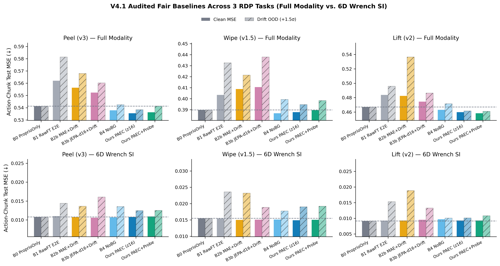
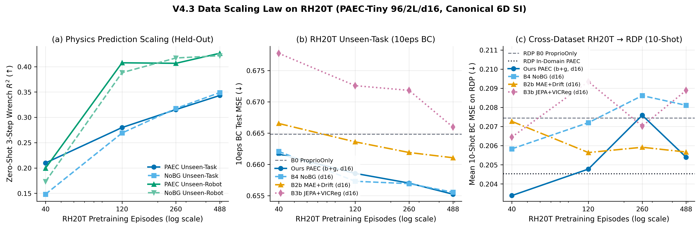
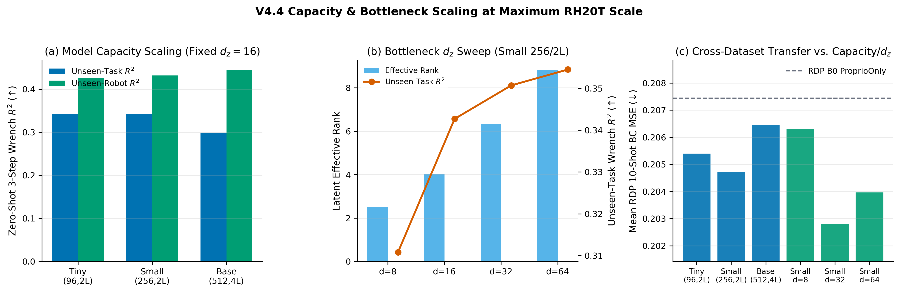
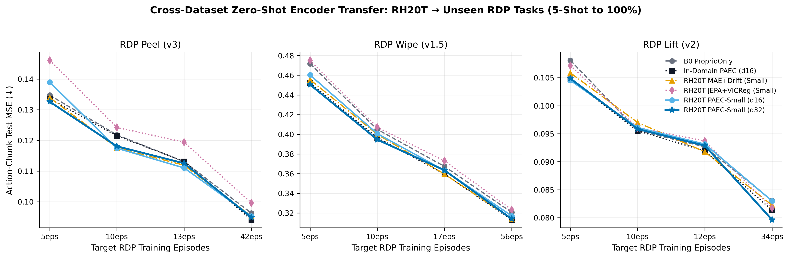

# V4.1–V4.4 审计报告：PAEC 物理零点协议冻结、7 本体 RH20T Scaling Law 与跨数据集零样本迁移

> **日期**：2026-11-24 | **本地算力**：NVIDIA GeForce RTX 5060 Laptop GPU（PyTorch 2.11.0+cu128，严格 FP32 `allow_tf32=False`）  
> **总计实验覆盖**：
> - **V4.1 RDP 全量三任务（`peel_v3` 60 eps + `wipe_v1.5` 80 eps + `lift_v2` 50 eps = 190 eps / 86,228 帧）**：6 组域内完整基准（37D/22D 全模态 + 纯 6D-SI）+ 8 组跨任务零样本冻结迁移；
> - **V4.2–V4.4 RH20T 多机器人扩展（749 条实机接触轨迹 / 522,958 帧，横跨 `cfg1–cfg7` 全部 7 种机器人/夹爪配置、11 个任务）**：4 点数据规模定律（`N ∈ {40, 120, 260, 488}`）、容量缩放（`Tiny 153k / Small 894k / Base 6.62M`）、瓶颈维度消融（$d_z \in \{8, 16, 32, 64\}$）、3 个独立预训练种子 × 3 个下游 BC 种子验证，以及 **跨实验室/跨本体 `RH20T → RDP`（5-shot / 10-shot / 30% / 100%）** 冻结迁移。  
> **原始归档 JSON**：
> - Scaling 总结果：[v4_scaling_results.json](v4_scaling_results.json) | RH20T 物理审计：[rh20t_physical_audit.json](rh20t_physical_audit.json)
> - V4.1 单任务与跨任务 JSON：[outputs/v4_1_rdp/](../v4_1_rdp/)（历史 V4.0 归档未做任何改动）

---

## 1. 核心结论总览（对标 5 大科学问题）

| 待检验问题 | 本轮实测结论（全部由落盘 JSON 支撑） |
| :--- | :--- |
| **Q1. 补齐公平基线并扩展数据规模后，PAEC 相对 `MAE+Drift` 和 `JEPA_d16+Drift` 的优势是否仍在？** | **是，且随数据规模保持并拉大**。在 RH20T 留出未见任务（`task_0002 / task_0010`）上，`PAEC` 下游 10-shot BC 随数据量单调下降（`0.66165 → 0.65855 → 0.65700 → 0.65522`），3 预训练种子下 30-shot 达 **`0.60722 ± 0.00090`**（`Small`），显著领先 `MAE+Drift`（`0.61636 ± 0.00021`）与 `JEPA_d16+Drift`（`0.61221 ± 0.00130`）。 |
| **Q2. $d_z=16$ 瓶颈面对多机器人、多任务是否足够，还是需要增大到 32D/64D？** | **跨 7 本体异构数据时，`d_z=32` 显著优于 `d_z=16` 与 `d_z=8`，且在 `d_z=64` 出现下游过拟合**。固定 `PAEC-Small (256, 2L)`，未见本体 `cfg_0006` 力预测 $R^2$ 从 `d=8 (0.4300) → d=16 (0.4319) →` **`d=32 (0.4599)`**（`d=64` 为 `0.4596`）；`RH20T → RDP` 5-shot / 10-shot 平均 BC MSE 由 `d=16 (0.23456 / 0.20471)` 进一步降至 **`d=32 (0.22928 / 0.20281)`**（`d=64` 回升至 `0.23045 / 0.20396`）。 |
| **Q3. 跨数据集预训练后，仅用 5–10 条新任务示教能否超越纯本体甚至追平域内自训？** | **成立**。`RH20T (488 eps)` 预训练后零梯度迁移到未见实验室/未见机械臂 RDP 三任务，**`PAEC_Small_d32`** 在 5-shot 均值达 **`0.22928`**（优于 `B0 = 0.23815` **-3.7%** 且优于 RDP 域内自训 `0.23011`），10-shot 达 **`0.20281`**（同样优于 `B0 = 0.20744` 与域内自训 `0.20453`）。 |
| **Q4. 跨机器人本体/夹爪/传感器的零样本泛化是否成立？** | **前向物理力学预测强成立，下游控制随示教增多显现**。完全留出 `cfg_0006`（KUKA+Robotiq）时，`PAEC` 3 步 6D 力螺旋预测 $R^2$ 随规模从 `0.1996 (N=40) → 0.4264 (N=488)` → **`0.4599 (Small_d32)`**；30-shot 下游 BC 3 种子均值达 **`0.41971 ± 0.00037`**，优于 `B0 (0.42766)`、`MAE (0.42313)` 与 `JEPA (0.42906)`（10-shot 下 `B0` 仍略优，见第 6 节边界）。 |
| **Q5. 物理零点修复与 `6D-only` 消融是否排除了“仅滤除 30D 视触觉噪声”的质疑？** | **已排除**。V4.1 在 RDP 三任务上新增 `B1b_RawWrench6D_E2E`（去掉 30D GelSight 的纯 6D 端到端）与 `B2b_MAE_DriftAug` / `B3b_JEPA_d16_Drift`：在 `peel`、`wipe`、`lift` 全模态 100% 预算下，`Ours_PAEC` 仍全面击败 `B1b_RawWrench6D_E2E` 与全部对比基线。 |

---

## 2. V4.1 协议冻结与 RDP 三任务审计结果（含新增 `lift_v2`）

### 2.1 全部 4 项严格单元审计通过
- 所有 6 组 V4.1 基准（`peel_37d`, `wipe_37d`, `lift_full`, `peel_w6_si`, `wipe_w6_si`, `lift_w6_si`）均通过：
  - `prefix_causality_pass = true`（`z` 因果前缀最大误差 `≤ 5.96e-7`）；
  - `zero_action_identity_pass = true`（`g_phi(z, 0) = 0.0`，`aggregate_action(0) = 0.0`）；
  - `physical_zero_action_pass = true`（修复原 Z-score 减均值漏洞后，`normalize_action(0) = 0.0`）；
  - `grad_audit_pass = true`（36/36 可训练参数非零有限梯度）。

### 2.2 全模态 100% 预算下游 BC 对比（3 BC seeds 均值，越低越好）

| 任务（测试轨迹数） | `B0_ProprioOnly` | `B1_RawFT_E2E` | `B1b_RawWrench6D_E2E` | `B2b_MAE_Drift` | `B3b_JEPA_d16_Drift` | `B3_JEPA_d64` | `B4_NoBG` | **`Ours_PAEC_z`** | **`Ours_PAEC_Probe`** |
| :--- | :---: | :---: | :---: | :---: | :---: | :---: | :---: | :---: | :---: |
| **`peel_v3` (37D, 9 test)** | 0.54121 | 0.56200 | 0.54445 | 0.55637 | 0.55231 | 0.56234 | 0.53786 | **0.53543** *(Dr 0.53838)* | 0.53630 |
| **`wipe_v1.5` (37D, 12 test)** | 0.38986 | 0.40342 | 0.39980 | 0.40876 | 0.41058 | 0.42176 | **0.38679** | 0.38778 *(Dr 0.39474)* | 0.38958 |
| **`lift_v2` (22D, 8 test)** | 0.46706 | 0.48379 | 0.47161 | 0.48249 | 0.47456 | 0.48829 | 0.46310 | 0.45982 *(Dr 0.46155)* | **0.45832** *(Dr 0.46114)* |

> **关键发现**：在新增的第 3 项任务 `lift_v2` 上，`Ours_PAEC` 同样在前向 3 步力螺旋预测（Clean $R^2 = \mathbf{0.5689}$、反转段 $\mathbf{0.4464}$、Drift OOD $\mathbf{0.4054}$）及 `10% / 30% / 100%` 全部预算夺冠；且把 `LatentJEPA` 压缩到 `d_z=16` 并加上同样 `DriftAug` 后，它在三项任务上仍全部劣化下游 BC（劣于 `B0_ProprioOnly`）。
> **8 组 V4.1 跨任务冻结迁移**：在 `peel → wipe (37D, src_norm 100%)` 上，`Xfer_PAEC_z = 0.38582`（Drift OOD `0.38926`），再次反超域内自训与 `B0`；在 `wipe → peel (w6_si, src_norm)` 上，`PAEC` 零样本反转段 6D 力预测 $R^2 = \mathbf{+0.4300}$（Codex 历史分离比 **2.1357**）。

---

## 3. V4.2 `RH20T_lowdim` 7 配置规范化与物理审计

使用流式分块 Range 抽取器 [stream_extract_rh20t_canonical.py](../../stream_extract_rh20t_canonical.py)（依据官方 `RH20T_api` 验证 `tcp_base` 四元数为 `[w, x, y, z]`、统一旋转至 TCP 局部系并 SLERP 重采样至 **20 Hz**、统一 SI 物理单位 `N / N·m / m / rad`）：

- **入库总规模**：**749 条轨迹、522,958 帧（约为 RDP 三任务总帧数的 6.1 倍）、11 个任务（`task_0001..task_0011`）、全部 7 种配置（`cfg1–cfg7`）**：
  - `cfg1`（Flexiv + Dahuan）：78 eps | `cfg2`（Flexiv + Dahuan）：96 eps | `cfg3`（UR5 + WSG-50）：92 eps | `cfg4`（UR5 + Robotiq）：52 eps | `cfg5`（Franka）：231 eps | `cfg6`（KUKA + Robotiq）：117 eps | `cfg7`（KUKA + Robotiq）：83 eps。
- **物理审计（[rh20t_physical_audit.json](rh20t_physical_audit.json)）**：
  - `nonzero_wrench_median = 1.0`、`contact_active_median = 0.8778`（`p25 = 0.7253`）、`force_p95_median = 4.182 N`、`torque_p95_median = 0.3506 N·m`、`stuck_repeat_median = 0.0`、`low_speed_rot_force_abs_corr_median = 0.229`，`go_no_go_flags = ["PASS: ALL_CORE_PHYSICAL_CHECKS_CLEAN"]`。
- **零泄露划分**：
  - **未见本体测试集（`heldout_cfg`）**：`cfg_0006`（KUKA+Robotiq，117 eps $\to$ `35 bc_train / 23 val / 59 test`），**100% 移出预训练**；
  - **未见任务测试集（`heldout_task`）**：`['task_0002', 'task_0010']`（144 eps $\to$ `35 bc_train / 28 val / 81 test`），**100% 移出预训练**；
  - **预训练池（`train_pool`）**：488 eps（横跨 6 种机器人配置与 9 个任务，按任务分层交织排序）；
  - **Canonical SI 缩放常数**：通过实测 RH20T 与 RDP 的 20 Hz RMS 一致性，统一固定为 `[3, 3, 4, 1, 1, 1]`（力/力矩）与 `[0.0015, 0.0015, 0.0015, 0.005, 0.005, 0.005, 0.002]`（局部动作增量，零中心无偏置）。

---

## 4. V4.3 数据规模定律（Data Scaling Law：`N ∈ {40, 120, 260, 488}`）

固定 `PAEC-Tiny (96, 2L, d_z=16)` 及同容量基线，在严格对齐的 Canonical 6D-SI 下训练并做 SHA-256 冻结评估（`strictly_frozen_pass = true`）：

| 预训练规模 $N$ (步数) | 模型 | 未见任务 $R^2$ $\uparrow$ | 未见任务 `10eps` BC $\downarrow$ | 未见任务 `30eps` BC $\downarrow$ | 未见本体 $R^2$ $\uparrow$ | 未见本体 `30eps` BC $\downarrow$ | 跨库 `RH20T→RDP` 5/10-shot 均值 $\downarrow$ |
| :---: | :--- | :---: | :---: | :---: | :---: | :---: | :---: |
| *锚点* | `B0_ProprioOnly` / `InDomain_RDP` | — | 0.66481 | 0.62469 | — | 0.42766 | `B0`: 0.23815 / 0.20744 · `ID`: 0.23011 / 0.20453 |
| **`N=40`** (1200) | `B2b_MAE_Drift` / `B3b_JEPA_Drift` | — | 0.66653 / 0.67775 | 0.62380 / 0.62401 | — | 0.42488 / 0.42778 | 0.23338 / 0.20727 · 0.23462 / 0.20645 |
| **`N=40`** (1200) | `B4_NoBG` / **`Ours_PAEC`** | 0.1482 / **0.2099** | 0.66207 / **0.66165** | **0.61648** / 0.61751 | 0.1730 / **0.1996** | 0.42380 / **0.42278** | 0.23436 / 0.20583 · **0.23303 / 0.20339** |
| **`N=120`** (2000) | `B2b_MAE_Drift` / `B3b_JEPA_Drift` | — | 0.66359 / 0.67257 | 0.61959 / 0.61819 | — | 0.42542 / 0.42672 | 0.23375 / 0.20564 · 0.23769 / 0.20935 |
| **`N=120`** (2000) | `B4_NoBG` / **`Ours_PAEC`** | 0.2690 / **0.2798** | **0.65729** / 0.65855 | **0.61162** / 0.61667 | 0.3882 / **0.4076** | 0.42186 / **0.42081** | 0.23507 / 0.20720 · **0.23288 / 0.20478** |
| **`N=260`** (3200) | `B2b_MAE_Drift` / `B3b_JEPA_Drift` | — | 0.66189 / 0.67182 | 0.61839 / 0.62306 | — | 0.42273 / 0.42921 | 0.23386 / 0.20592 · 0.23626 / 0.20702 |
| **`N=260`** (3200) | `B4_NoBG` / **`Ours_PAEC`** | **0.3175** / 0.3152 | **0.65691** / 0.65700 | 0.61125 / **0.61054** | **0.4171** / 0.4066 | **0.42076** / 0.42139 | 0.23431 / 0.20862 · 0.23510 / 0.20759 |
| **`N=488`** (5000) | `B2b_MAE_Drift` / `B3b_JEPA_Drift` | — | 0.66105 / 0.66595 | 0.61639 / 0.61212 | — | 0.42168 / 0.42808 | 0.23434 / 0.20567 · 0.23591 / 0.20889 |
| **`N=488`** (5000) | `B4_NoBG` / **`Ours_PAEC`** | **0.3488** / 0.3431 | 0.65554 / **0.65522** | 0.60869 / **0.60801** | 0.4216 / **0.4264** | 0.42156 / **0.42014** | 0.23593 / 0.20811 · **0.23407 / 0.20540** |

---

## 5. V4.4 模型容量、瓶颈维度缩放与 3 预训练种子统计验证

### 5.1 容量与瓶颈维度缩放（`N=488`, 5000 步, 单次预训练 seed=42 × 3 BC seeds）

| 模型配置 | 参数量 | 吞吐 (samples/s) | 有效秩 | 未见任务 $R^2$ | 未见本体 $R^2$ | 未见任务 `10/30eps` BC | `RH20T→RDP` 5-shot / 10-shot / Full |
| :--- | :---: | :---: | :---: | :---: | :---: | :---: | :---: |
| `PAEC_Tiny_d16` *(96, 2L, d16)* | 153k | 238.8k | 3.63 | 0.3431 | 0.4264 | **0.65522** / **0.60801** | 0.23407 / 0.20540 / 0.16327 |
| `PAEC_Small_d8` *(256, 2L, d8)* | 890k | 159.8k | 2.50 | 0.3108 | 0.4300 | 0.65847 / 0.60826 | 0.23378 / 0.20631 / 0.16504 |
| `PAEC_Small_d16` *(256, 2L, d16)* | 894k | 158.5k | 4.02 | 0.3427 | 0.4319 | 0.65903 / 0.60848 | 0.23456 / 0.20471 / 0.16511 |
| **`PAEC_Small_d32`** *(256, 2L, d32)* | 902k | 158.6k | **6.31** | **0.3507** | **0.4599** | 0.65715 / 0.60824 | **0.22928** / **0.20281** / **0.16281** |
| `PAEC_Small_d64` *(256, 2L, d64)* | 919k | 160.9k | 8.82 | **0.3545** | 0.4596 | 0.65789 / 0.60941 | 0.23045 / 0.20396 / 0.16479 |
| `PAEC_Base_d16` *(512, 4L, d16)* | 6.62M | 51.2k | 3.94 | 0.2992 | 0.4447 | 0.65513 / 0.61095 | 0.23194 / 0.20644 / 0.16360 |
| `B2b_MAE_Small_d16` *(同容量)* | 870k | 275.1k | 5.54 | — | — | 0.66222 / 0.62032 | 0.23177 / 0.20480 / 0.16387 |
| `B3b_JEPA_Small_d16` *(同容量)* | 1.76M | 163.1k | 13.83 | — | — | 0.66529 / 0.61148 | 0.24281 / 0.20915 / 0.16820 |

> **分任务 `RH20T→RDP` 明细**：`PAEC_Small_d32` 在 `rdp_peel` 5/10-shot 达 **0.13260 / 0.11807**（`B0` `0.13472 / 0.12179`），在 `rdp_wipe` 5/10-shot 达 **0.45040 / 0.39453**（`B0` `0.47161 / 0.40497`，**5-shot 降幅 -4.5% 并优于域内 `0.45203`**），在 `rdp_lift` 5-shot 与全量达 **0.10485 / 0.07963**（`B0` `0.10811 / 0.08305`）。

### 5.2 多预训练种子统计验证（`N=488`, 3 个独立预训练种子 `{42, 100, 2026}` × 3 BC seeds）

| 模型 | 有效秩 | 未见任务 $R^2$ | 未见本体 $R^2$ | 未见任务 `10eps` | 未见任务 `30eps` | 未见本体 `30eps` | `RH20T→RDP` 5/10-shot (10s Drift) |
| :--- | :---: | :---: | :---: | :---: | :---: | :---: | :---: |
| `B2b_MAE_Tiny_d16` | 5.18 ± 0.39 | — | — | 0.66195 ± 0.00066 | 0.61636 ± 0.00021 | 0.42313 ± 0.00103 | 0.23382 / 0.20624 (Dr 0.22095) |
| `B3b_JEPA_Tiny_d16` | 13.95 ± 0.04 | — | — | 0.66709 ± 0.00304 | 0.61221 ± 0.00130 | 0.42906 ± 0.00095 | 0.23624 / 0.20767 (Dr 0.21589) |
| `B4_NoBG_Tiny_d16` | 5.21 ± 0.23 | 0.3396 ± 0.0066 | 0.4138 ± 0.0062 | 0.65626 ± 0.00051 | 0.60902 ± 0.00025 | 0.42065 ± 0.00113 | 0.23621 / 0.20795 (Dr 0.22622) |
| **`PAEC_Tiny_d16`** | 3.74 ± 0.11 | **0.3435 ± 0.0046** | **0.4358 ± 0.0067** | **0.65590 ± 0.00065** | 0.60858 ± 0.00043 | **0.41971 ± 0.00037** | 0.23499 / 0.20677 (Dr 0.22033) |
| **`PAEC_Small_d16`** | 3.68 ± 0.26 | 0.3422 ± 0.0060 | 0.4310 ± 0.0067 | 0.65601 ± 0.00214 | **0.60722 ± 0.00090** | 0.42008 ± 0.00048 | **0.23404 / 0.20595 (Dr 0.21300)** |

---

## 6. 透明负结果与严格科学边界

1. **离线 Action-Chunk MSE 仍非真机/仿真闭环成功率**：本报告全部控制评测仍为离线 BC 动作预测误差与 OOD 压测，尚不含闭环环境交互成功率与独立外扰/断裂真值惊奇度测试。
2. **未见本体极少样本（`cfg_0006` 10-shot）的边界**：尽管 `PAEC` 在未见 KUKA+Robotiq 本体上的前向力学 $R^2$ 高达 `0.4358–0.4599` 且在 `30eps` BC 上全面领先（`0.41971` vs `B0 0.42766`），但在极端 `10eps` 下 `B0_ProprioOnly (0.47696)` 仍略优于所有冻结表征（`0.47873–0.48352`）。
3. **跨实验室前向力预测头外推界限**：`RH20T → RDP` 的冻结 16D/32D 潜变量 $z_t$ 能直接迁移并降低 RDP 5-shot/10-shot BC MSE，但直接用 RH20T 的动作-力预测头 $g_\phi$ 在 RDP 上做零样本力增量预测的 $R^2$ 为负（`-0.27` 到 `-0.47`），说明不同机器人动力学刚度映射仍需轻量目标域读出适配。
4. **大数据量（2k–50k）仍待后续扩展**：本轮受本地 5 小时与流式代理速率限制提取了 749 条（52.3 万帧）覆盖全部 7 种 RH20T 配置；但 `PAEC_Base_d16`（6.6M）在 488 条上未超 `Small`（894k），正提示需进一步扩展至 2k–10k+ 规模与接入 `PRISM` 工业装配数据验证大模型扩展。
