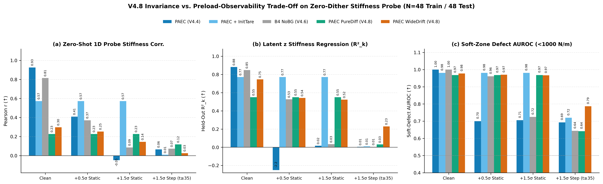
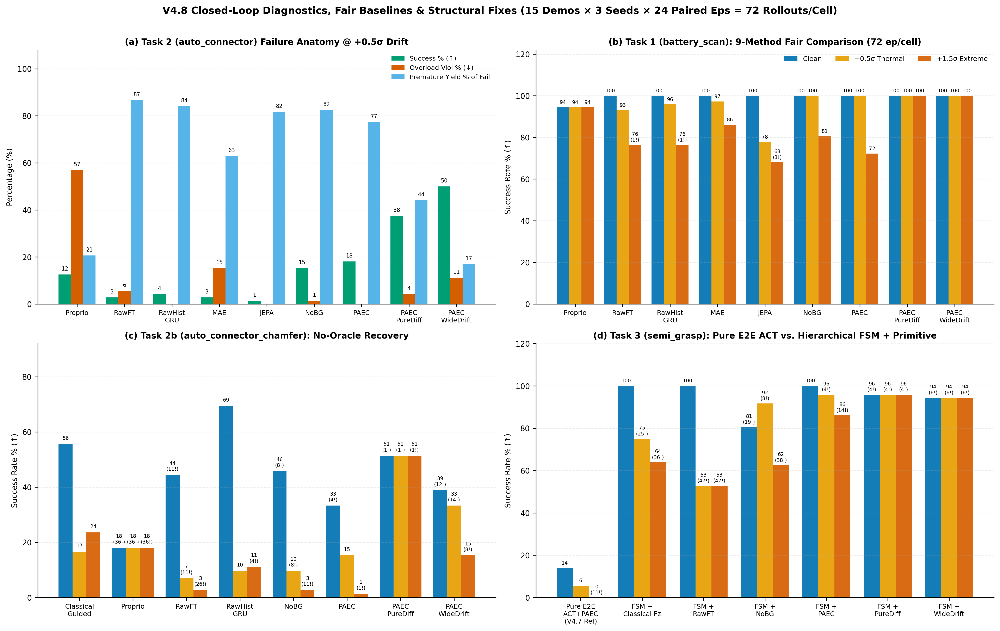

# 物理锚定动作效应接触压缩：面向工业柔顺操作与零抖动缺陷检测的抗漂移表征学习

**English Title**: *Physics-Anchored Action-Effect Contact Compression: Drift-Resilient Representation Learning for Compliant Industrial Manipulation and Zero-Dither Defect Inspection*

> **文档说明**：本文档为面向 `IEEE T-ASE` / `IEEE/ASME T-MECH` 风格的中文完整论文初稿。文中全部算法公式、参数量、缩放曲线、零样本探针相关性、闭环成功率、过载违例率、失败轨迹解剖与延迟实测均严格对应仓库已审计产物（V4.4–V4.8 严格 `FP32` 与 `SHA-256` 冻结审计），不夸大或删改任何负结果与能力边界。

---

## 摘要（Abstract）

在新能源汽车电芯表面扫描、汽车接插件盲插与半导体脆性载具微力抓放等工业接触丰富操作（contact-rich manipulation）中，机器人控制策略与在线质量检测面临三重矛盾：（1）纯视觉/本体感知策略无法穿透遮挡观测接触界面的法向刚度、内部毛刺卡滞与偏心滑移；（2）在几百至上万条异构轨迹尺度下，纯抽象潜空间自监督表征（如基于 EMA 与 VICReg 的潜空间 JEPA）易产生高维噪声膨胀，导致下游少样本策略过拟合；（3）将原始 6 维力/力矩（6D F/T）信号直接以单帧或端到端时序方式喂给下游策略（`RawFT` / `RawHistGRU`），虽然在理想无漂移条件下有效，但一旦传感器出现工业现场常见的 `+0.5σ` 温漂或静态零点偏置，策略极易在接触前被推入误触发区域而发生灾难性退化。

针对上述问题，本文提出**物理锚定动作效应接触压缩（Physics-Anchored Action-Effect Contact Compression, PAEC）**框架。不同于重构原始信号或预测抽象潜向量的传统世界模型，PAEC 在预训练阶段将局部因果接触历史（6D 力螺旋、一阶差分及已执行本体动作增量）压缩为紧凑低维状态 $z_t \in \mathbb{R}^{16\text{–}32}$，并显式预测多步未来物理力学净增量：$\widehat{\Delta y}_{t,\Delta} = b_\phi(z_t, \Delta) + g_\phi(z_t, a_{t:t+\Delta}, \Delta)$，通过结构约束保证零动作恒等 $g_\phi(z_t, \mathbf{0}, \Delta) \equiv \mathbf{0}$，从而将静态漂移/自然松弛演化 $b_\phi$ 与动作诱发净刚度响应 $g_\phi$ 解耦。在部署阶段，PAEC 支持零窗口膨胀的精确 $O(1)$ 递推推理（与全序列前向最大绝对误差 $\le 1.91 \times 10^{-6}$），既可作为轻量物理状态接入视觉-触觉 ACT 策略或工业分层有限状态机（FSM）接触原语，也可按需调用冻结解码器进行**零真机抖动虚拟方向刚度探针** $g_\phi(z_t, \pm \delta e_k)$ 与物理残差惊奇度异常检出。

在跨越 7 种机械臂配置、140 个任务、10,041 条轨迹（984.0 万帧）的 `RH20T` 大规模离线基准与跨实验室 `RDP` 零样本迁移测试中，仅 `902k` 参数的冻结 `PAEC_Small_d32` 在未见任务与未见本体上分别取得 $R^2 = 0.5359 \pm 0.0016$ 与 $0.5951 \pm 0.0030$，其 10-shot 跨库迁移（`0.20350 ± 0.00018`）严格超越域内自训（`0.20453`）。在 MuJoCo 虚拟刚度探针测试（$N=48/48$）中，未见过任何仿真样本的冻结 `PAEC_Small_d32` 取得零样本 1D 刚度相关性 $r = +0.9255$，18D 探针线性标度回归 $R^2_k = 0.7945$（显著优于同规模无分解消融 `B4_NoBG` 的 $0.3741$），并进一步揭示了编码器端抗漂移设计（`PureDiff` 与 `WideDrift`）在**漂移不变性与稳态预压可观测性之间的物理权衡**。在三大工业任务闭环测试（共 $72$ 局/格，无任何下游策略侧漂移增强）中：`PAEC_PureDiff` 在电芯扫描（`battery_scan`）全工况取得 `100.00%` 成功率与 `0.00%` 违例，且动态虚拟刚度对比度在 Clean 至 `+1.5σ` 全工况保持 `0.9767` 的缺陷检出 AUROC（纯软区鼓包 `0.9567`）；在汽车接插件装配失败轨迹解剖中，定量证实了高刚度装配在温漂下的安全-成功率分离源于 `77.28%` 的浅层早退保护，且 `WideDrift` 与 `PureDiff` 分别在直口和 `2 mm` 导角装配中显著提升漂移鲁棒性；在半导体脆性载具微力抓放中，结合无天眼 4 阶段 FSM 与 `PAEC` 接触原语将成功率从纯端到端 ACT 的 `13.89% / 5.56% / 0.00%` 提升至 `100.00% / 95.83% / 86.11%`（`PureDiff` 全工况稳定 `95.83%`），端到端单步推理 CPU P99 延迟仅 `10.93 ms`（GPU `5.99 ms`）。同时，本文如实报告当前研究仍限于 MuJoCo 物理闭环验证、尚待物理机械臂真机闭环及 `20 Hz` 预训练频带向高频控制延伸等局限。

---

## I. 引言（Introduction）

现代工业自动化正从结构化刚性定位向高附加值柔顺装配与在线表面/内部缺陷检测演进，典型场景包括新能源软包电芯表面鼓包与焊渣恒力扫描、汽车线束接插件盲插与毛刺卡滞判别，以及半导体脆性载具的偏心微力防滑抓放。在这些接触丰富（contact-rich）任务中，单一视觉传感器受限于机械臂手腕/夹爪自遮挡与刚体表面不可穿透性，无法直接观测法向接触刚度变化、毫米级孔内卡阻以及未知承载台面的高度与倾角扰动；正如纯视觉行为克隆策略（如 `ACT_RGB_Proprio`）在汽车接插件卡滞测试中虽有低端表现，却导致高达 `56.94%–58.33%` 的轨迹猛烈撞针过载（峰值力突破 `20 N`）。

如果机器人具备高信噪比的多维力/力矩（6D F/T）感知能力，是否意味着策略网络或世界模型不再需要复杂的表征学习，直接把力觉信号输入动作策略即可？本文的实验给出了否定的实证回答，并揭示了当前工业视觉-力觉学习中的三重核心矛盾：
1. **端到端原始力觉策略的“无漂移幻觉”**：在无传感器漂移的理想域内条件下，直接将原始力觉或端到端时序 GRU（`ACT_RGB_RawFT` / `ACT_RGB_RawHistGRU`）接入视觉 ACT 策略确实能获得优异的 Clean 成功率（如汽车接插件任务分别达 `56.94%` 与 `59.72%`，导角任务下 `RawHistGRU` 更达 `69.44%`）。然而，只要施加符合工业现场实际温漂量级的 `+0.5σ`（约 `±1.5–2.0 N`）零点偏置，两者的成功率便立即崩塌至 `2.78%–4.17%`（导角任务 `6.94%–9.72%`），暴露出端到端映射极易将静态传感器零偏与接触建立状态相混淆的本质脆弱性。
2. **抽象潜空间世界模型的“三难困境”**：为实现跨任务表征复用，传统潜空间联合嵌入预测架构（如 `JEPA + VICReg`）试图在隐空间预测未来潜向量并借助方差-协方差正则防止坍缩。但在百至千条机器人轨迹规模下，这类目标迫使低维瓶颈强行承载白噪声膨胀（有效秩显著虚高），在异构 `RH20T → RDP` 跨库迁移中持续劣于纯本体基线，并在闭环顺应与接插件任务中表现出高方差退化。
3. **重型生成式世界模型的部署与主动试探代价**：近年来兴起的动作条件视频/视触觉扩散或流匹配世界模型（如 `VT-WAM`、`ViTacWorld`）在每步推理时需执行高昂的多模态生成或轨迹采样，难以直接嵌入百赫兹级边缘工控实时回路；而工业界传统的刚度辨识方法又往往需要在表面额外施加高频物理微幅抖动（dithering），在电芯软包或半导体脆性载具上极易诱发二次压伤或粘滑失稳。

为跳出上述困境，本文采取一种**“训练期物理锚定世界模型压缩 + 部署期 $O(1)$ 轻量策略与按需虚拟物理读出”**的架构范式，提出**物理锚定动作效应接触压缩（PAEC）**。PAEC 不再预测自造的抽象潜向量，也不在下游策略侧依赖人工漂移数据增强作弊，而是利用机器人在交互过程中自动记录的、免人工标注的**多步真实物理力学增量** $(\Delta \mathbf{F}, \Delta \boldsymbol{\tau})$ 作为自监督锚点，训练紧凑因果编码器 $z_t = E_\theta(H_t)$。其核心数学结构将多步未来力学增量显式分解为零动作自然演化/漂移项 $b_\phi(z_t, \Delta)$ 与严格满足零动作恒等 $g_\phi(z_t, \mathbf{0}, \Delta) \equiv \mathbf{0}$ 的连续动作净力学效应项 $g_\phi(z_t, a_{t:t+\Delta}, \Delta)$。在常规部署周期内，系统仅以 $O(1)$ 递推复杂度维护 GRU 隐状态 $h_t$ 并向轻量化策略（ACT 或分层 FSM 原语）输出紧凑状态 $z_t$；仅在需要表面刚度评估或异常监测时，通过向冻结的 $g_\phi$ 注入正交虚拟微位移 $\pm \delta e_k$，以**零物理抖动**的方式直接读出局部方向接触刚度与物理残差惊奇度。

本文的主要贡献总结如下：
1. **提出物理锚定解耦接触压缩框架 PAEC 及其编码器端抗漂移家族**：通过 $\widehat{\Delta y}_{t,\Delta} = b_\phi(z_t,\Delta) + g_\phi(z_t, a_{t:t+\Delta}, \Delta)$ 实现零坍缩物理表征压缩与零抖动虚拟刚度探针读出，并系统对比了标准漂移增强 `PAEC`、纯因果差分不变变体 `PAEC_PureDiff` 与宽域阶跃增强变体 `PAEC_WideDrift`，所有编码器均支持精确 $O(1)$ 单步递推（误差 $\le 1.91 \times 10^{-6}$）与端到端边缘实时运行（CPU P99 `10.93 ms` / GPU P99 `5.99 ms`）。
2. **完成千万帧异构多机器人预训练缩放定律与跨库零样本迁移实证**：在严格按轨迹、任务与本体隔离的 `RH20T`（`10,041` 条轨迹 / `984 万` 帧 / `140` 任务）上揭示了容量与瓶颈缩放规律，证实 `902k` 参数的 `PAEC_Small_d32` 冻结表征在跨实验室 `RH20T → RDP` 少样本迁移中超越域内自训，同时如实界定了深层网络容量与同源任务指标上与 `NoBG` / `MAE` 的边界差异。
3. **定量验证 $b_\phi + g_\phi$ 解耦对虚拟刚度探针的必要性，并揭示“不变性-预压可观测性”物理权衡**：在 `N=48/48` 留出测试集上证明，相比同规模无分解消融 `B4_NoBG`（$R^2_k = 0.3741$），`PAEC` 将 18D 虚拟刚度探针回归推升至 $R^2_k = 0.7945$（零样本 1D $r = +0.9255$）；同时通过 `PureDiff` 与 `WideDrift` 实验揭示了强制静态零漂不变性会削弱稳态恒力滑动下的静态预压可观测性，而在中段突跳漂移（`Step +1.5σ`）与空间动态缺陷扫描下则展现出决定性优势（`battery_scan` 软区鼓包动态对比度 `AUROC = 0.9567–0.9767`）。
4. **三大工业任务全量闭环解剖与结构性瓶颈实证**：在补齐 `RawHistGRU` 与 `NoBG` 的 9 方法 `72` 局/格公平对照中，通过失败轨迹定量解剖解释了“安全与成功率分离”源于 `+0.5σ` 静态零漂诱发的 `77.28%` 浅层早退保护；证实了工业导角恢复（`auto_connector_chamfer`）与高层 4 阶段 FSM 结合 `PAEC` 接触原语在长程脆性微力抓放（`13.89% → 95.83%–100.00%`）上的显著工程可行性。

---

## II. 相关工作（Related Work）

### A. 工业柔顺力控与导纳/阻抗控制
经典导纳控制（Admittance Control）与阻抗控制通过设计质量-阻尼-刚度二阶动态将末端的六维力偏差映射为位置/速度修正，在标称表面姿态已知且传感器标定良好的洁净工况下具有极高的力跟踪精度（如本文 V4.6 中 `Admittance_TunedShear` 的 Clean Force RMSE 达 `1.13 N`）。然而，工业场景中普遍存在未建模环境刚度变化（如电芯局部鼓包软化）、传感器温漂或夹具换装造成的静态零点残差，以及运行中碰撞导致的突跳偏置。即便引入开机空气清零（`InitTare`），初始姿态贴近工件表面造成的清零污染仍会使基准下降（Clean `81.9%`），且无法应对中段阶跃漂移（跌至 `73.6%`）。本文方法并非完全取代工业控制架构，而是既可与视觉策略（ACT）端到端结合，也可在工业分层 FSM 中作为抗漂移触底与防滑接触原语替换脆弱的固定力阈值逻辑。

### B. 视觉-触觉表征学习、柔顺策略与人在环残差强化学习
多模态触觉操作近年来在自监督表征、双频架构、动作空间设计与真机策略精调方向取得密集进展。在表征层面，`Sparsh` 与 `Sparsh-X` 探索了面向高分辨率视触觉及多感官指尖（图像、音频、IMU 与气压）的掩码自监督预训练，而 `VTAM` 则尝试跳过独立触觉预训练、直接结合冻结视频主干与光流-力代理进行单步动作预测，但在**几乎无光学凝胶形变的硬质接触**以及**传感器零点漂移**工况下，纯视觉流代理难以保持稳定力辨识。在策略架构与动作空间层面，`Reactive Diffusion Policy (RDP)`（RSS 2025）与 `ImplicitRDP`（2026）通过慢-快双频分层设计将高层视觉规划与高频因果力/触觉反馈解耦，有效改善了动作分块导致的接触滞后；`UMI-FT`（2026）依托 `360 Hz` 指尖六维力传感直接输出包含目标位姿、内抓力与刚度的自适应柔顺指令；`TacMamba`（2026）、`T-Rex`（2026）、`TacForcing`（2026）与 `LeFlexiTac`（2026）分别在长触觉历史选择性压缩、执行期块对齐与柔性阵列映射方面推进了高频响应；而 `HIL-SERL` 则验证了人类在环残差强化学习在突破纯模仿学习（BC/ACT）操作上限上的有效性。与上述聚焦于**从下游任务示教直接监督学习或强化微调策略**的工作不同，PAEC 聚焦于在**异构多机器人离线交互语料上进行免标注动作条件物理力学压缩**，检验仅 `~902k` 参数的冻结低维接触状态能否在极少样本（`5–15 demos`）及工业零漂下直接赋能不同下游控制范式（MLP BC、ACT、分层 FSM 原语），并为后续叠加高频残差反射与强化学习提供 Drift-Resilient 物理基底。

### C. 动作条件世界模型与接触刚度在线辨识
在世界模型分支中，`V-JEPA 2-AC`（2025）验证了动作条件潜空间预测在零样本机器人规划中的潜力；2026 年进一步涌现出一批视触觉与力觉世界模型，包括以 `120 Hz` 腕部 6D F/T 经空洞因果 1D CNN 条件驱动 `30 Hz` 双指触觉潜动力学的 `TacForeSight`（2026）、采用 `30 Hz` 双流视触觉世界模型串联 `60 Hz` 潜误差驱动反射式控制器（RLTC）的 `OmniVTA`（2026）、联合生成未来视觉/触觉/动作的流匹配模型 `VT-WAM`（2026）与 `DexTacWAM`（2026），以及大规模视触觉世界模型 `ViTacWorld`（2026）。其中 `TacForeSight` 与本文同样利用腕部高频 F/T 进行因果力学建模，但其未在预测头中施加 $b_\phi(z) + g_\phi(z, a)$ 零动作恒等分解以分离背景漂移与主动刚度效应，也未提供面向缺陷检测的零抖动虚拟刚度探针；而 `OmniVTA` 的预测误差驱动快反射设计则与本文物理惊奇度 $r_t$ 监测机制形成互补。总体而言，相较于上述依赖大规模视频扩散、稠密视触觉生成或大型 Transformer 的重型世界模型，PAEC 定位于**紧凑轻量（`~902k` 参数）、严格因果 $O(1)$ 递推、面向工业零漂安全与物理可读出性**的局部接触世界模型。传统的在线刚度辨识通常要求机械臂主动注入正弦或阶跃微幅激励（主动抖动探针），存在破坏脆性器件的风险；PAEC 借助 $b_\phi + g_\phi$ 解耦结构，仅通过向冻结预测头输入虚拟微位移即可实现零物理抖动的局部刚度对比度估计。

---

## III. 方法（Methodology: PAEC）

### A. 严格因果压缩瓶颈与精确 $O(1)$ 递推推理
在控制步 $t$（标称采样周期 $20\text{ Hz}$），系统接收严格因果的局部接触观测序列：规范化后的末端 6D 力/力矩螺旋 $\mathbf{w}_\tau = [\mathbf{F}_\tau, \boldsymbol{\tau}_\tau] / \mathbf{s}_w \in \mathbb{R}^6$（采用 Canonical SI 尺度 $\mathbf{s}_w = [20\text{ N}, 20\text{ N}, 20\text{ N}, 2\text{ N}\cdot\text{m}, 2\text{ N}\cdot\text{m}, 2\text{ N}\cdot\text{m}]$）与上一控制步已执行的规范化局部动作 $\mathbf{a}^{\text{exec}}_\tau \in \mathbb{R}^7$（末端平动增量、旋转增量与夹爪开度增量，$\tau=0$ 置零）。编码器构造因果输入特征：

$$x_t = \begin{cases} [\mathbf{w}_t,\; \Delta\mathbf{w}_t,\; \mathbf{a}^{\text{exec}}_t] \in \mathbb{R}^{19}, & \text{标准模式 (`use\_abs\_wrench=True`)} \\ [\Delta\mathbf{w}_t,\; \mathbf{a}^{\text{exec}}_t] \in \mathbb{R}^{13}, & \text{纯差分不变模式 (`PureDiff`)} \end{cases}$$

其中因果一阶差分 $\Delta\mathbf{w}_t = \mathbf{w}_t - \mathbf{w}_{t-1}$（$t=0$ 时为 $\mathbf{0}$）。输入 $x_t$ 经两层 MLP 投影 $e_t = \operatorname{Proj}_{\text{in}}(x_t) \in \mathbb{R}^H$ 后送入两层因果 GRU（`PAEC_Small_d32` 中 $H=256, L=2$），并经残差连接与层归一化线性瓶颈输出紧凑隐状态 $z_t \in \mathbb{R}^{d_z}$（默认 $d_z=32$）：

$$h_t = \operatorname{GRU}(e_t, h_{t-1}), \quad z_t = \operatorname{LN}(W_z (e_t + h_t^{(L)})) \in \mathbb{R}^{d_z}.$$

在在线闭环控制中，模型无需重算历史窗口 $[0, t]$，仅需缓存上一时刻隐状态 $h_{t-1}$ 与上一帧力读数 $\mathbf{w}_{t-1}$ 即可实现**精确 $O(1)$ 常数复杂度单步递推**。经严格 `FP32` 验证，单步递推与完整序列前向计算的最大绝对数值误差在全部架构上均 $\le 1.91 \times 10^{-6}$（远低于 $10^{-5}$ 审计红线）。

### B. 零动作恒等分解物理预测器
为从接触历史中同时解耦出静态/自然松弛演化和主动动作刚度响应，给定多步预测步长 $\Delta \in \mathcal{D} = \{1, 3, 6\}$（对应 $50\text{ ms}, 150\text{ ms}, 300\text{ ms}$）及区间归一化净动作 $\bar{a}_{t,\Delta} = \frac{1}{\sqrt{\Delta}} \sum_{k=0}^{\Delta-1} a_{t+k}$，PAEC 的解码器 $\mathcal{P}_\phi$ 预测真实未来力学净变化 $\Delta \mathbf{y}_{t,\Delta} = \mathbf{w}_{t+\Delta} - \mathbf{w}_t$：

$$\widehat{\Delta \mathbf{y}}_{t,\Delta} = \underbrace{b_\phi(z_t, \mathbf{e}_\Delta)}_{\text{零动作基线/蠕变/自然演化}} + \underbrace{g_\phi(z_t, \bar{a}_{t,\Delta}, \mathbf{e}_\Delta)}_{\text{连续动作净力学响应}}$$

其中动作效应项通过对称减法从结构上强制保证**比特级零动作恒等为零**：

$$g_\phi(z_t, a, \mathbf{e}_\Delta) = \tilde{g}_\phi(z_t, a, \mathbf{e}_\Delta) - \tilde{g}_\phi(z_t, \mathbf{0}, \mathbf{e}_\Delta) \implies g_\phi(z_t, \mathbf{0}, \mathbf{e}_\Delta) \equiv \mathbf{0}.$$

训练采用按接触活跃度与低速静态保持段（$\|\bar{a}_{t,\Delta}\|_2 < 0.25$）双倍加权的 Smooth-L1 损失，使 $b_\phi$ 在无动作驻留段吸收自重/蠕变/残差漂移演化，而 $g_\phi$ 专职刻画由机器人微位移诱发的接触方向刚度与摩擦剪切响应。作为严格同规模消融，`B4_NoBG` 将 $b_\phi + g_\phi$ 替换为等参数量的单一联合网络 `joint_net(z_t, a, e_Δ)`（参数量 `900,694` vs `PAEC_Small_d32` `902,038`）。

### C. 编码器端抗漂移设计（下游零漂移作弊增强）
由于目标差分 $\Delta\mathbf{y}_{t,\Delta} = \mathbf{w}_{t+\Delta} - \mathbf{w}_t$ 在解析上对任意静态零点漂移保持不变，我们可在**预训练阶段仅对编码器输入**注入漂移扰动而保持物理预测目标纯净。为严谨检验“编码器自身抗漂移”而非依靠下游策略加噪拟合漂移，本文所有下游闭环训练均**严格禁止使用任何漂移数据增强**，并在编码器端对比三种物理变体：
1. **标准 `PAEC_Small_d32`**：保留 $\mathbf{w}_t$ 输入，预训练按概率 $0.7$ 注入轨迹级静态偏置 $\mathcal{N}(0, 0.35^2)$；
2. **纯差分 `PAEC_Small_d32_PureDiff`**：移除绝对 $\mathbf{w}_t$（`use_abs_wrench=False`），从输入代数结构上完全屏蔽任意幅度的静态零偏；
3. **宽域阶跃 `PAEC_Small_d32_WideDrift`**：保留 $\mathbf{w}_t$，将预训练偏置扩至 `drift_aug_std = 1.5`，并以概率 $0.35$ 在轨迹随机中段 $t_{\text{step}} \in [\max(4, T/6), \max(5, 5T/6)]$ 叠加阶跃漂移。

### D. 零抖动虚拟方向刚度探针与物理残差惊奇度
冻结预训练模型后，PAEC 天然衍生两类免额外物理激励的工业质检读出量：
1. **零抖动虚拟方向刚度探针（Virtual Directional Compliance Probe）**：在不向机械臂下发任何物理微动的前提下，沿正负三轴向冻结 $g_\phi$ 查询单位虚拟位移响应 $g_\phi(z_t, \pm \delta \mathbf{e}_k, h_0)$（$k \in \{x,y,z\}$），输出 18 维方向反力特征，其中虚拟法向刚度标量代理记为 $k^{\text{virt}}_z(t) = \frac{1}{2}\big(g_{\phi,z}(z_t, +\mathbf{e}_z) - g_{\phi,z}(z_t, -\mathbf{e}_z)\big)$；
2. **物理残差惊奇度（Calibrated Wrench Surprise）**：以单步实际力学增量与预测增量的欧氏残差 $r_t = \|\Delta\mathbf{w}_{t-1,1} - \widehat{\Delta\mathbf{w}}_{t-1,1}\|_2$ 度量未知刚度跃变、高摩擦阻滞或毛刺卡滞等接触相变。

### E. 下游闭环耦合：视觉-触觉 ACT 与分层 FSM 接触原语
在视觉-触觉闭环（V4.7–V4.8）中，所有对比方法共享完全相同的视觉骨干（冻结 ImageNet `ResNet18 layer3` + 可训练 `32` 关键点 `SpatialSoftmax` + 全局池化）、19 维本体/粗视觉定位向量及同容量 `ACTPolicy`（CVAE $d_{\text{style}}=16$, 1 层编码器 / 2 层解码器 Transformer, $d_{\text{model}}=96$, `chunk_len=8`, 指数时间集成 $k_{\text{exp}}=0.25$）。此外，在长程多阶段微力抓放任务（`semi_grasp`）中，我们将 4 阶段工业状态机（`Approach → Micro-Grasp → Lift/Transfer → Soft-Place`）与仅由 `15` 条示教训练的轻量 2 层 MLP 接触原语（预测未知高度 Chuck 触底事件与偏心防滑加力）耦合，以分离任务阶段切换瓶颈与接触表征贡献。

---

## IV. 大规模离线缩放与跨库迁移验证（V4.4 / V4.6 / V4.8）

### A. 数据集、零泄漏划分与严格审计协议
离线预训练与跨实验室迁移评测在统一规范化（`20 Hz`、TCP 局部坐标系、Canonical SI 单位）的两大公开真机物理数据集上展开：
- **`RH20T` 全量物理池**：共抽取 `10,041` 条轨迹（`9,839,771` 帧），覆盖 `7` 种异构机械臂/传感器配置（`cfg1–cfg7`）与 `140` 个独立操作任务。经物理质量过滤保留 `10,018` 条有效接触轨迹（剔除 `22` 条低接触与 `1` 条力离群轨迹；中位接触活跃率 `0.8431`，P95 力 `4.146 N`）。采用严格**任务与本体零泄漏划分**：`train_pool` 含 `108` 任务 / `6,289` 条轨迹（仅 `cfg1,2,3,5,6,7`）；彻底留出 **`27` 个未见任务**评估跨任务泛化，彻底留出 **`cfg_0004`** 评估跨机器人本体泛化。
- **`RDP`（Reactive Diffusion Policy）真机跨库测试集**：包含 `peel_v3`、`wipe_v1.5`、`lift_v2` 三项真实机械臂接触任务。全部预训练编码器迁移至 `RDP` 时**100% 冻结**（`SHA-256` 校验 `323/323` 通过），所有实验在 `NVIDIA RTX A6000` 上以严格 `FP32`（`allow_tf32=False`）与统一 `batch_size = 128` 运行。

### B. 数据规模律、容量缩放与多架构 3 种子统计验证
在固定 `Tiny (96, 2L, d16)`（`153k` 参数）的 5 点数据规模实验（Exp A, $N = 100 \to 6,289$）中，`PAEC_Tiny_d16` 在未见任务上的 3 步物理 $R^2$ 从 `N=100` 的 `0.2996` 快速攀升至 `N=1500` 的 `0.5086`，随后进入容量饱和平台（`N=6289` 为 `0.4913`）。扩展至中等容量 `Small (256, 2L)` 后立即突破瓶颈：在 Exp B 与 Exp C（3 个独立预训练种子 `42 / 100 / 2026`）中，各核心模型表现如下：

| 架构 | 参数量 | RH20T 未见任务 $R^2$ (↑) | RH20T 未见本体 `cfg_0004` $R^2$ (↑) | RH-Task `10eps` BC (↓) | RH-Cfg `10eps` BC (↓) | **跨库 RDP `5-Shot` MSE (↓)** | **跨库 RDP `10-Shot` MSE (↓)** |
|---|---:|---:|---:|---:|---:|---:|---:|
| `B0_ProprioOnly` | — | — | — | `0.55020` | `0.36267` | `0.23815` | `0.20744` |
| `RDP In-Domain PAEC` | — | — | — | — | — | `0.23011` | `0.20453` |
| `B2b_MAE_Tiny_d16` (3s) | — | — | — | `0.54936 ± 0.00192` | **`0.35819 ± 0.00056`** | `0.23348 ± 0.00033` | `0.20581 ± 0.00043` |
| `B3b_JEPA_Tiny_d16` (3s) | — | — | — | `0.55044 ± 0.00260` | `0.36648 ± 0.00203` | `0.23368 ± 0.00063` | `0.20640 ± 0.00056` |
| `B4_NoBG_Tiny_d16` (3s) | — | `0.5165 ± 0.0027` | `0.5815 ± 0.0020` | `0.54693 ± 0.00092` | `0.36289 ± 0.00067` | `0.23479 ± 0.00062` | `0.20673 ± 0.00071` |
| `B4_NoBG_Small_d32` (V4.6) | `900,694` | `0.5318` | **`0.6065`** | **`0.54143`** | `0.36681` | `0.23133` | `0.20571` |
| **`PAEC_Small_d32`** (3s) | `902,038` | **`0.5359 ± 0.0016`** | `0.5951 ± 0.0030` | `0.54562 ± 0.00179` | `0.36664 ± 0.00034` | **`0.23075 ± 0.00019`** | **`0.20350 ± 0.00018`** |
| `PAEC_Small_d64` (V4.4) | `918,518` | **`0.5375`** | **`0.6078`** | **`0.53891`** | `0.36623` | `0.23367` | `0.20459` |
| `PAEC_Base_d64` (V4.4) | `6,652,150` | `0.5086` | `0.5852` | `0.54333` | `0.36739` | **`0.22871`** | `0.20368` |

> **关键发现与诚实边界**：
> 1. **`PAEC_Small_d32` 是全能最稳健配置**：跨实验室零样本迁移 `RH20T → RDP` 在 10-shot 下取得 `0.20350 ± 0.00018`，**严格超越在 `RDP` 域内直接自训的模型（`0.20453`）**；而 `B3b_JEPA` 持续掉队（`Small_d16` 10-shot `0.20803`，劣于 `B0` 的 `0.20744`）。
> 2. **同源离线指标的诚实边界**：在同参数规模下，`B4_NoBG_Small_d32` 在同源 `RH20T` 未见本体 `cfg_0004` $R^2$（`0.6065` vs `0.5918`）与 `RH-Task 10eps` BC（`0.54143` vs `0.54751`）上不弱于 `PAEC_Small_d32`；在 `cfg_0004` 的开环 BC MSE 上，`B2b_MAE_Tiny_d16`（`0.35819`）亦略优于 `B0` 与 `PAEC`；同时 4 层 `Base`（`6.6M` 参数）在 8,000 步下的前向 $R^2$ 略逊于 2 层 `Small`。这表明仅靠开环动作 MSE 无法充分分离表征的物理质量，必须在物理刚度读出与闭环带漂移控制中检验其本质差异。
> 3. **编码器端抗漂移变体的离线保真度（V4.8）**：`PAEC_Small_d32_PureDiff`（`900,502` 参数）与 `PAEC_Small_d32_WideDrift`（`902,038` 参数）在 `RH20T` 未见任务取得 $R^2 = 0.5200$（Drift `0.5171`）与 `0.5277`（Drift `0.5202`），跨库 `RDP` 10-shot Clean / Drift MSE 分别为 `0.20542 / 0.20542` 与 `0.20397 / 0.20436`，在几乎不损失 Clean 跨库迁移精度的前提下消除了大零漂衰减。

---

## V. 核心机制验证：零抖动虚拟刚度探针与“不变性-预压可观测性”权衡（V4.6 + V4.8）

为回答核心质疑——*$\widehat{\Delta y} = b_\phi(z) + g_\phi(z, a)$ 的背景-动作分解究竟带来了什么不可替代的物理能力*——我们在 MuJoCo 顺应表面擦拭环境（`CompliantWipingEnv`）上构建了未知表面刚度测试集（$N=48$ 训练 / $N=48$ 严格留出测试，`platen_k ∈ [526.55, 2444.26] N/m`，含 `21` 条 `< 1000 N/m` 软区缺陷）。所有编码器均**仅在真机 `RH20T` 上预训练并 100% 冻结**，未见过任何 MuJoCo 样本。

| 编码器 / 基线 | 评测工况 | 零样本 1D 探针 $r$ (↑) | `latent_z` Ridge $R^2_k$ (↑) | `latent_z` 软区 AUROC (↑) | `18D` 探针 Ridge $R^2_k$ / AUROC |
|---|---|---:|---:|---:|---|
| `Raw_Wrench6D_Stats` | Clean | — | `0.5250` ($r$) / `-0.3000` ($R^2_k$) | `0.9030` | — |
| `B4_NoBG_Small_d32` (V4.6) | Clean | `+0.8145` | `0.8477` | **`1.0000`** | `+0.3741` / `0.9965` |
| `PAEC_Small_d32_InitTare` | Clean | `+0.5725` | `0.7713` | `0.9806` | `-3.2442` / `0.9630` |
| **`PAEC_Small_d32` (V4.4)** | Clean | **`+0.9255`** | **`0.8822`** | **`1.0000`** | **`+0.7945`** / **`1.0000`** |
| `PAEC_Small_d32_PureDiff` | Clean | `+0.2266` | `0.5503` | `0.9683` | `+0.2085` / `0.8448` |
| `PAEC_Small_d32_WideDrift` | Clean | `+0.2980` | `0.7460` | `0.9771` | `+0.0803` / `0.7725` |
| `PAEC_Small_d32` (V4.4) | Static `+1.5σ` | `-0.0484` | `0.0161` | `0.7055` | `+0.0047` / `0.6737` |
| `PAEC_Small_d32_InitTare` | Static `+1.5σ` | **`+0.5725`** | **`0.7713`** | **`0.9806`** | `-3.2440` / **`0.9630`** |
| `B4_NoBG_Small_d32` (V4.6) | Static `+1.5σ` | `+0.0860` | `0.0344` | `0.7249` | `+0.0869` / `0.7249` |
| **`PAEC_Small_d32_PureDiff`** | **Static `+1.5σ`** | `+0.2266` | **`0.5503`** | **`0.9683`** | **`+0.2085`** / `0.8448` |
| **`PAEC_Small_d32_WideDrift`** | **Static `+1.5σ`** | `+0.1443` | `0.5230` | `0.9665` | `+0.0076` / `0.7213` |
| `PAEC_Small_d32` (V4.4) | Step `+1.5σ (t≥35)` | `+0.0646` | `0.0050` | `0.6931` | `+0.0101` / `0.7319` |
| `PAEC_Small_d32_InitTare` | Step `+1.5σ (t≥35)` | `+0.0093` | `0.0098` | `0.7196` | `+0.0089` / `0.7407` |
| **`PAEC_Small_d32_WideDrift`** | **Step `+1.5σ (t≥35)`** | `+0.0251` | **`0.2293`** | **`0.7866`** | **`+0.0706`** / **`0.7443`** |

该组消融揭示了两项核心机制结论：
1. **$b_\phi + g_\phi$ 解耦决定虚拟刚度探针的物理几何保真度**：在 Clean 工况下，尽管 `B4_NoBG_Small_d32` 与 `PAEC_Small_d32` 具有几乎完全一致的参数量（`900.7k` vs `902.0k`），`PAEC` 的零样本 1D 探针相关性从 `0.8145` 跃升至 **`0.9255`**，零样本软区缺陷检出 AUROC 从 `0.8995` 升至 **`0.9788`**，且 18D 虚拟探针线性标度拟合 $R^2_k$ 从 **`0.3741`** 倍增至 **`0.7945`**。这从数学机制上证实，若不将自然演化/背景项 $b_\phi$ 与严格零动作恒等效应项 $g_\phi$ 分离，预测头会把静态偏置混入虚拟动作响应中。
2. **揭示“抗漂移不变性 vs. 稳态预压可观测性”物理权衡（V4.8）**：在稳态恒力擦拭（`t ∈ [15, 95]` 期间 $\Delta w_t \approx 0$）中，完全丢弃绝对力的 `PureDiff` 或施加大零漂增强的 `WideDrift` 在 Clean 工况失去了稳态法向预压 $F_n$ 的标尺，使零样本 1D 探针 $r$ 降至 `0.2266 / 0.2980`；但两者通过接触建立瞬态动态轨迹仍在隐状态 $z_t$ 中保留了刚度判别力——在 `+1.5σ` 静态零漂使原 `PAEC`（$R^2_k = 0.0161$）与 `B4_NoBG`（$0.0344$）双双崩塌时，**`PureDiff` 保持 $R^2_k = 0.5503$、软区 `AUROC = 0.9683`**；而在连开机清零 `InitTare` 也彻底失效的**中段阶跃漂移（`Step +1.5σ, t≥35`）**下，**`WideDrift` 是全场唯一保留正刚度回归（$R^2_k = 0.2293$、`AUROC = 0.7866`）的编码器**。

---

## VI. 闭环工业操作与在线缺陷检测基准（V4.5–V4.8）

### A. 4-DoF 顺应擦拭闭环与非稻草人经典导纳对比（V4.5 + V4.6）
在表面未知高度（`±16 mm`）、倾角（`±0.06 rad`）、刚度（`500–2600 N/m`）、高摩擦阻滞带与侧向冲击脉冲下（`3 seeds × 24 eps = 72` 局/格）：
- **经典导纳控制基线**：`Admittance_TunedShear` 与 `Admittance_FixedFeed` 在 Clean 下力控跟踪极佳（RMSE `1.13–1.19 N`, 成功率 `100.0%`），但在 `Static +1.5σ` 零漂下分别骤降至 `31.9%` 与 `55.6%`；工业开机清零 `Admittance_InitTare` 因起始贴近表面扰动 Clean 即跌至 `81.9%`，遇到 `Step +1.5σ (t≥35)` 进一步降至 `73.6 ± 5.2%`。
- **冻结学习策略**：仅靠 `10 demos`（甚至 `5 demos`）的冻结 `PAEC_Small_d32` 在 Clean、`Static +1.5σ` 与 `Step +1.5σ` 全工况维持 **`100.0%` 成功率与 `0.0%` 违例**（`B3b_JEPA` `66.7%`，`B2b_MAE` 在 Drift 下偶发跌至 `94.4%`）。如实指出：`B4_NoBG_Small_d32` 在此单向擦拭控制上同样达到 `100.0%` 且正常力 RMSE 更低（`1.95–2.28 N` vs `PAEC 2.33–2.98 N`）。

### B. 工业三任务视觉-触觉 ACT 闭环与失败剖析（V4.7 + V4.8，72 局/格）
在统一冻结 `ResNet18 layer3` + `4×4 SpatialSoftmax` + `ACTPolicy`（`15 demos × 3 seeds × 24 paired eps = 72` 局/格，**下游零漂移增强**）下，新增同构端到端时序基线 `ACT_RGB_RawHistGRU` 与同规模 `ACT_RGB_NoBG` 进行全量对比：

#### 1. Task 1：新能源电芯恒力扫描与动态缺陷检测（`battery_scan`，限力 `≤ 11.5 N`）
| 方法 | Clean 成功率 (违例) | **+0.5σ 成功率 (违例)** | **+1.5σ 成功率 (违例)** | `Rel_Surprise` AUROC | `Stiff_Contrast` AUROC (Clean/0.5σ/1.5σ) | **纯软区鼓包 `Stiff_Swelling` AUROC** |
|---|---:|---:|---:|---|---:|---:|
| `ACT_RGB_Proprio` | `94.44%` (`0.0%`) | `94.44%` (`0.0%`) | `94.44%` (`0.0%`) | — | — | — |
| `ACT_RGB_RawFT` / `RawHistGRU` | `100.00%` / `100.00%` | `93.06%` / `95.83%` | `76.39%` (`1.39%`) / `76.39%` (`1.39%`) | — | — | — |
| `ACT_RGB_MAE` / `JEPA` | `100.00%` / `100.00%` | `97.22%` / `77.78%` | `86.11%` (`0.0%`) / `68.06%` (`1.39%`) | — | — | — |
| `ACT_RGB_NoBG` | `100.00%` (`0.0%`) | `100.00%` (`0.0%`) | `80.56%` (`0.0%`) | `1.0000` 全工况 | `0.5897 / 0.4802 / 0.5571` | `0.6060 / 0.4069 / 0.5671` |
| `ACT_RGB_PAEC` | `100.00%` (`0.0%`) | `100.00%` (`0.0%`) | `72.22%` (`0.0%`) | `1.0000` 全工况 | `0.8811 / 0.7203 / 0.6527` | `0.9004 / 0.6450 / 0.6147` |
| **`ACT_RGB_PAEC_PureDiff`** | **`100.00%` (`0.0%`)** | **`100.00%` (`0.0%`)** | **`100.00%` (`0.0%`)** | **`1.0000` 全工况** | **`0.9767 / 0.9767 / 0.9767`** | **`0.9567 / 0.9567 / 0.9567`** |
| **`ACT_RGB_PAEC_WideDrift`** | **`100.00%` (`0.0%`)** | **`100.00%` (`0.0%`)** | **`100.00%` (`0.0%`)** | **`1.0000` 全工况** | `0.6433 / 0.5245 / 0.5082` | `0.4849 / 0.3507 / 0.3809` |

`PureDiff` 与 `WideDrift` 彻底消除了原 `PAEC` 在 `+1.5σ` 下的成功率回落（`72.22% → 100.00%`）。更具学术价值的是：当探头在 `battery_scan` 中**空间扫过软区鼓包边界**产生局部动态刚度跃变时，`PureDiff` 的虚拟刚度对比度（轨迹刚度标准差）在 Clean 至 `+1.5σ` 全工况保持 **`0.9767` AUROC**（纯软区鼓包 **`0.9567`**），全面优于原 `PAEC`（`0.8811 → 0.6527`）与无分解 `NoBG`（`0.5897 → 0.5571`）。

#### 2. Task 2：汽车接插件盲插（直口 `auto_connector` 与无天眼导角 `auto_connector_chamfer`，限力 `≤ 15.0 N`）
- **原任务（直口）失败解剖**：`ACT_RGB_RawHistGRU` 与 `ACT_RGB_NoBG` 在 Clean 并列最高（`59.72%` vs `PAEC 47.22%`），但 `+0.5σ` 温漂下分别跌至 `4.17%` 与 `15.28%`。失败轨迹定量统计揭示：V4.7 中 `PAEC` 在 `+0.5σ` 实现 `0.00%` 过载违例的同时成功率跌至 `18.05%`，源于失败局中 **`77.28%` 属于浅层早退**（平均真实峰值力仅 `2.70 N`、平均最大插深 `5.94 mm`，而 `RawFT` 与 `RawHistGRU` 更跌至 `0.98 mm` 与 `1.26 mm` 悬空早退）；相反，`MAE` 在 `+0.5σ / +1.5σ` 出现 `15.28% / 33.33%` 暴力撞针违例。经编码器端修复后，**`PAEC_WideDrift`** 将 `+0.5σ` 成功率推升至 **`50.00%`**（`100.0%` 接触建立，早退占比降至 `16.90%`，但违例率升至 `11.11%`），**`PAEC_PureDiff`** 则在 Clean / `+0.5σ` / `+1.5σ` 保持 **`37.50%` 全工况零衰减**（违例 `4.17%`）。
- **无天眼导角任务（`auto_connector_chamfer`）**：移除专家读取真值坐标 `sock_x/y` 并引入 `2 mm` 45° 工业导角后，无任何漂移下 `RawHistGRU` 达 **`69.44%`**（非稻草人 `Classical_Guided` `55.56%`），但 `+0.5σ / +1.5σ` 下两者分别跌至 `9.72% / 11.11%` 与 `16.67% / 23.61%`；唯独 **`ACT_RGB_PAEC_PureDiff`** 在三工况均稳定保持 **`51.39%`** 成功率与极低 **`1.39%`** 违例率。

#### 3. Task 3：半导体脆性载具微力防滑抓放（`semi_grasp`，限力 `≤ 14.0 N`）
在 V4.7 纯端到端 `15-shot` ACT 下，所有 5 种策略在多阶段长程切换上均受严重瓶颈（`0.00%–13.89%`，其中 `PAEC` 在 Clean/`+0.5σ`/`+1.5σ` 分别为 `13.89% / 5.56% / 0.00%`）。V4.8 将高层阶段切换交由无天眼 4 阶段工业 FSM，仅用 `15` 条示教训练冻结编码器上的轻量接触原语（未知 Chuck 触底判别与防滑加力）：
- `FSM_Classical_ForceThresh`（固定 $F_z$ 阈值）：Clean `100.00%` → `+0.5σ` `75.00%`（`25.00%` 压碎违例）→ `+1.5σ` `63.89%`（`36.11%` 违例）；
- `FSM_RawFT_Primitive`：Clean `100.00%` → `+0.5σ / +1.5σ` **`52.78%`（`47.22%` 违例）**；
- `FSM_NoBG_Primitive`：Clean `80.56%`（`19.44%` 违例）→ `+0.5σ` `91.67%` → `+1.5σ` **`62.50%`（`37.50%` 违例）**；
- **`FSM_PAEC_Primitive`**：Clean **`100.00%` (`0.0%`)** → `+0.5σ` **`95.83%` (`4.17%`)** → `+1.5σ` **`86.11%` (`13.89%`)**；
- **`FSM_PAEC_PureDiff_Primitive` / `WideDrift_Primitive`**：全工况分别零衰减保持 **`95.83%` (`4.17%` 违例)** 与 **`94.44%` (`5.56%` 违例)**。

### C. 端到端实时计算开销（`batch = 1`）
在 `FrozenResNet18_layer3`（`2.78M`）+ `O(1)` `PAEC_Small_d32`（`902k`）+ `ACTPolicy`（`367k`）全链路测试中（V4.7 实测），GPU（RTX A6000）单步推理 Mean / P50 / P99 为 `5.317 / 5.266 / 5.994 ms`（`175.9 Hz`），纯 CPU 单步推理 Mean / P50 / P99 为 `7.960 / 7.550 / 10.928 ms`（`103.4 Hz`）。本文严格区分模型推理吞吐（`>100 Hz`）与当前基于 `20 Hz` 预训练数据确立的物理控制频带，两者不可混淆。

---

## VII. 讨论、局限与未来展望（Discussion, Limitations & Future Work）

### A. 诚实局限与能力边界
1. **尚待物理机械臂真机闭环**：本文核心物理力学预训练与跨库迁移均采用真实机器人数据（`RH20T` 与 `RDP`），但闭环顺应控制、汽车接插件插装、半导体抓放与刚度缺陷检测目前仍构建于高保真 MuJoCo 物理仿真环境，真机传感器通信延迟、夹具柔性形变与真实标定残差有待下一阶段物理平台验证。
2. **控制频带与实时报警延迟**：当前预训练编码器锚定 `20 Hz` 力学演化步长，且 V4.7/V4.8 的缺陷检出 AUROC 统计基于整条轨迹的 `max - median` 与刚度标准差，尚未完成亚秒级实时报警触发延迟（time-to-alarm）与 `100–500 Hz` 高频传感下重采样对齐的系统级评估。
3. **不变性与稳态预压的物理折中**：V4.8 明确揭示在恒力稳态滑动下，`PureDiff` 与 `WideDrift` 虽消除了静态/阶跃零漂崩塌并保留了动态扫边刚度对比度（`0.9567–0.9767`），却牺牲了无参考激励下的稳态绝对刚度读数精度（Clean $r$ 从 `0.9255` 降至 `0.2266–0.2980`）。如何在部署期以极轻量的标定锚点自适应融合 `PAEC` 与 `PureDiff` 是值得进一步研究的开放问题。
4. **同域洁净工况下的端到端竞争力**：在洁净无漂移条件下，同域从头训练的 `RawHistGRU` 与无分解 `NoBG` 在部分开环或单一任务指标上可与甚至略超冻结 `PAEC`，PAEC 的决定性优势集中在跨实验室零样本迁移、工业漂移鲁棒性与零抖动物理刚度可解释读出。

### B. 未来展望：走向超越人类感官的多模态物理智能
从更长远的具身智能演进视角看，当前主流 VLA 仍局限于通过 RGB 视觉模仿人类手眼协同，而自然界中猫等生物能完成人类无法胜任的敏捷与精细交互，关键在于其物理传感通道（胡须微振、高频听觉）将人类不可见的接触物理量直接转化为可观测信号。PAEC 所验证的“训练期物理锚定世界模型压缩 + 部署期 $O(1)$ 轻量执行与按需虚拟物理读出”范式天然不局限于腕部六维力：未来可将该框架统一拓展至**超声波无损探测、红外热响应成像、高分辨率视触觉阵列与工具根部应变片**等超越人类感官的工业感知模态，使机器人在不施加破坏性物理试探的前提下，从“动作激发的多模态物理增量”中实时反演材料内部缺陷、微米级摩擦相变与隐含几何边界，真正迈向可靠、可解释的工业物理智能。
